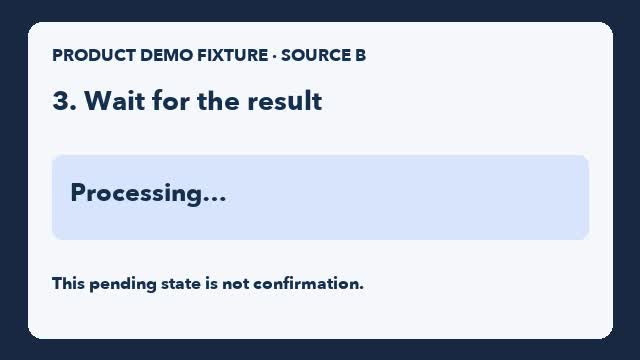
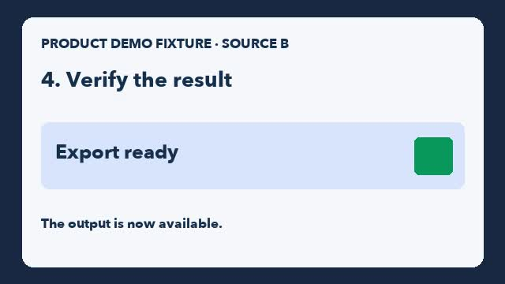

# AI editors for a webinar highlight reel that keeps the on-screen result

For a webinar with a software demo, give the editor three things from the source recording: the action, the result that proves it worked, and the sentence that explains when it applies. An editor can find the right topic and still cut before the result appears. Compare tools on a single exported reel, then ask each for the same revision.

## Choose an editor to try

The first three rows summarize the providers’ published workflows. Valmera publishes this guide. The comparison questions are for your own pilot.

| Editor | Where to start | What to verify on the downloaded file |
| --- | --- | --- |
| [Descript Underlord](https://www.descript.com/blog/article/underlord-ai-video-editor-primer) | Describe the intended edit and review the composition in the transcript and timeline. | After trimming waits around the speaker, can you still see the dashboard finish loading and read the result? |
| [Kapwing Kai](https://www.kapwing.com/ai/video-assistant) | Give its browser assistant your footage and a brief for a rough cut, then review the project. | Ask for a longer hold on the demo result. Check the unchanged opening and the new MP4. |
| [VEED Clips](https://support.veed.io/en/articles/11652474-how-to-use-our-clips-feature) | Describe what you want the clip finder to notice, then refine the candidate in the editor. | Confirm whether your route gives you one continuous 60–90 second reel or several separate highlights that you still need to assemble. |
| [Valmera](https://valmera.io/tools/highlight-reel?utm_source=github.com&utm_medium=referral&utm_campaign=webinar_result_highlight) | Upload your recording, describe which moments matter, review the preview and request a focused change in chat. AI editing requires an eligible subscription. | Check whether the action, quiet result and spoken qualifier all survive the first cut and the revision. |

## Watch what a time-only cut misses

These two five-second example MP4s come from one synthetic, silent software recording. In the fixed-time cut the report is still processing when the reel ends. The revised cut removes waiting time and shows the result starting at 3.00 seconds. Both files are 125 frames at 25 fps. This local example isolates the failure you can reproduce in a webinar pilot.

| Fixed-time cut at 4 s | Result kept at 4 s |
| --- | --- |
|  |  |

[Source recording](examples/batch-demo-pilot/source-b.mp4) · [Fixed-time MP4](examples/batch-demo-pilot/fixed-b.mp4) · [Result-kept MP4](examples/batch-demo-pilot/result-kept-b.mp4) · [Frame measurements and file hashes](examples/batch-demo-pilot/measurements.json)

## Build one 70-second reel

This is an illustrative timing map. Replace its source times and claims with ones from your own recording. Watch the footage with sound off to find the result before writing the brief.

| Part of the story | Source in the webinar | Position in the first reel | What a reviewer checks |
| --- | --- | --- | --- |
| The problem | 07:10–07:17 | 00:00–00:07 | Viewers know which task the feature helps them do. |
| The action | 12:04–12:19 | 00:07–00:22 | The control and cursor action are visible. |
| The result | 12:19–12:27 | 00:22–00:30 | Viewers can read the saved state with sound off. |
| The qualifier | 18:40–19:02 | 00:30–00:52 | The original speech still states who can use the feature. |
| The ending | 29:08–29:26 | 00:52–01:10 | Viewers get one next step and a clean ending. |

> Edit this existing webinar into one 70-second landscape MP4. Use the supplied time map. Keep the action and the saved state in order. Preserve the spoken qualifier in the original voice, including any words that limit the claim. Remove waiting where it does not help someone follow the demo. Show a preview before export.

Then request the same revision in every editor:

> Stay on the saved state for two extra seconds, through 12:29 of the source. Recover those two seconds from idle footage after the closing line. Keep the opening, action and qualifying sentence. Send the revised MP4 and tell me where to check the result.

The saved state should now occupy **00:22–00:32**, the qualifier should begin at **00:32**, and the reel should still end at **01:10**.

## Decide which workflow is worth paying for

1. Open the exported MP4 at the size your buyers will watch it. Ask a reviewer who missed the webinar what changed after the click. Check the smallest label they had to read.
2. Listen to the qualifier in context. With captions enabled, check its text and position after the revision. Note any problem the editor introduced in the part you had already approved.
3. Log reviewer minutes, active editing minutes and the number of corrections before approval. If you publish every week, run the same test on a second webinar with the result appearing later.

[Start with Valmera’s highlight-reel guide](https://valmera.io/tools/highlight-reel?utm_source=github.com&utm_medium=referral&utm_campaign=webinar_result_highlight). For done-for-you editing, [send your webinar schedule to Valmera Enterprise](https://valmera.io/subscribe?inquiry=highlight-reel&utm_source=github.com&utm_medium=referral&utm_campaign=webinar_result_highlight#enterprise). Include the number of recordings per month, target reel length, and who approves the first cut.
