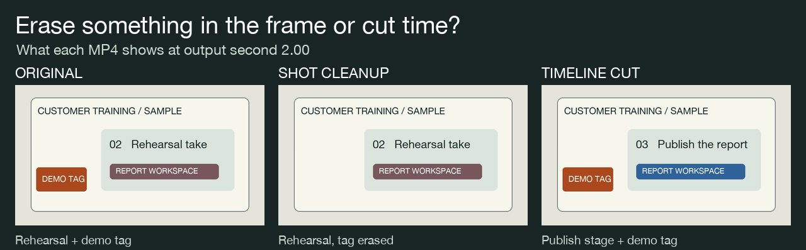

# Aisma vs. Valmera for existing footage: erase an object or cut a scene

Choose by what needs to change. A clip editor such as Aisma can fill the area behind an unwanted object while keeping the original framing and length. Valmera assembles and revises the timeline of footage you uploaded, so it can remove a rehearsal, keep the explanation and render the sequence you approve. If your video needs both jobs, review the cleaned shot, then replace that source in the cut and verify the finished MP4.

## Choose the workflow before you buy

| What your footage needs | Where to start | What to check in the downloaded result |
| --- | --- | --- |
| Erase a cable in a shot you need to keep | Aisma documents prompt-based fills for 2–60 second MP4 or MOV clips, with the framing, clip length and original audio retained. Its web and MCP workflows show the edit cost before processing. [Removal guide](https://aisma.ai/help/remove-people-and-objects) · [MCP workflow](https://aisma.ai/video-editing-mcp-server) | Look at the whole shot with sound. Check that the area around the cable looks consistent as the camera moves. |
| Remove a rehearsal and keep the final demonstration | Valmera edits a saved project from a written brief, with versioned previews and MP4 export. Use Studio or a compatible connected assistant. AI editing requires a subscription. [Valmera's editing workflow](https://valmera.io/ai-video-editor) | Check which original frames survived at the join. Listen for complete words and verify any captions that cross the cut. |
| Repair and assemble in a desktop workflow | Adobe documents masking and filling a selected region with After Effects Content-Aware Fill. Use a timeline editor to assemble the repaired shot with the rest of the video. [Adobe's fill workflow](https://helpx.adobe.com/after-effects/desktop/remove-objects-from-your-videos/content-aware-fill.html) | Check the fill in motion, then compare the imported source duration and the MP4 you export from the assembled project. |

Valmera publishes this guide. Aisma's documented workflow was checked November 24, 2026. Play [Aisma's own removal examples](https://aisma.ai/help/remove-people-and-objects) and [Valmera's recorded timeline revision](MCP-RECORDED-EDIT.md) to see what the two editing workflows produce. The practice clips below were rendered locally to make the differences easy to measure.

## Play both changes at the same output time

The silent [eight-second source clip](examples/shot-cleanup-or-timeline-cut/source.mp4) shows three stages of a training video. The middle stage is a rehearsal from source seconds 2.00 to 4.00, with the end excluded. An orange tag is visible at the lower left throughout.

| File | What appears at 2.00 seconds | Full duration at 24 fps |
| --- | --- | --- |
| [Original](examples/shot-cleanup-or-timeline-cut/source.mp4) | Rehearsal with the orange tag | 8.00 seconds, 192 frames |
| [Shot cleanup only](examples/shot-cleanup-or-timeline-cut/shot-cleanup-reference.mp4) | Rehearsal with the tag removed | 8.00 seconds, 192 frames |
| [Timeline cut only](examples/shot-cleanup-or-timeline-cut/timeline-cut-reference.mp4) | Publish stage with the tag visible | 6.00 seconds, 144 frames |
| [Both changes](examples/shot-cleanup-or-timeline-cut/both-edits-reference.mp4) | Publish stage with the tag removed | 6.00 seconds, 144 frames |

At frame 48, counting from zero, the tag and the workspace color are two independent checks. The shot cleanup changed the selected tag pixel from orange to the background color. The color and position of the workspace remained visibly consistent. The timeline cut moved the blue publish stage forward by 48 frames and left the orange tag visible. FFmpeg decoded each output and confirmed the counts and sampled colors. [Measurements](examples/shot-cleanup-or-timeline-cut/measurements.json)

## Test your own footage in two passes

Use a short clip where the essential action, framing and object to remove are easy to identify. Keep the original available and record the time of a clear frame before each change.

1. **Clean the picture.** Identify the object, when it appears and what needs to stay visible. Check the cleaned shot at the beginning, at the point where the object moves or overlaps something you want to keep, and near the end. Match its framing and frame count before swapping it into the assembly.
2. **Cut the timeline.** Specify the rehearsal using source timestamps and the spoken words or visible actions at its boundaries. Review the first retained frame, original sound and captions at the new join. For the practice file, the publish stage should begin at output second 2.00.
3. **Check the delivered MP4.** Compare the export at the marked moment with the approved cut. Watch enough surrounding footage to spot any shift in the fill, audio jump or caption that landed on the wrong words.

> Keep the first and third sections of this recording. Remove the rehearsal from source 00:02.00 up to 00:04.00. Preserve framing and keep the remaining sections in their original order. Show the join at output 00:02.00 before exporting.

[Try the timeline edit with your footage](https://valmera.io/ai-video-editor?utm_source=github.com&utm_medium=referral&utm_campaign=aisma_shot_or_timeline). If you're buying editing for a recurring series, [scope an Enterprise pilot](https://valmera.io/subscribe?inquiry=training-video-editing-service&utm_source=github.com&utm_medium=referral&utm_campaign=aisma_shot_or_timeline#enterprise) with one representative recording, one revision and your monthly video count.
