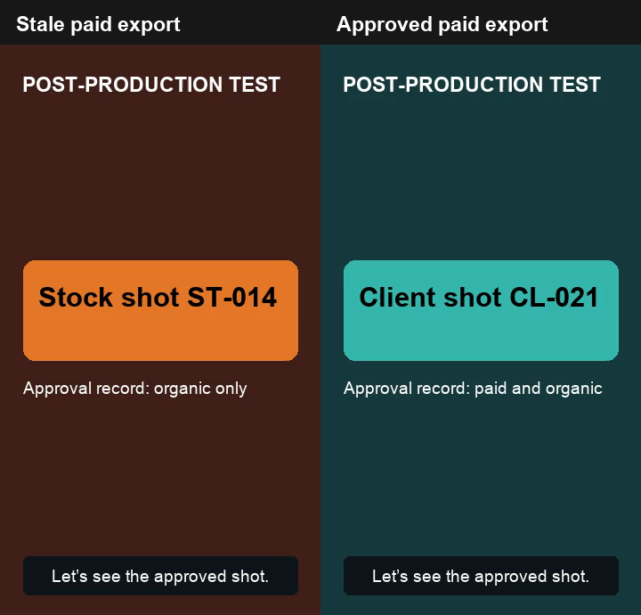

# Approve B-roll for client ads and check every exported version

A stock shot can be approved for a client's organic post while their paid ad still needs a different shot. Keep those two delivery decisions separate from the timeline. Before you publish, check the downloaded MP4 for each format and placement. A clean preview or a clean vertical export does not tell you what survived in the square version.

## A one-frame mistake you can try to catch

These ten-second files use synthetic cards and an identical test tone. The approval decisions are fictional. In this example, the stock card `ST-014` is cleared for organic use only. The client-supplied `CL-021` can appear in the paid placements. The same caption sits over the test shot in every version.

| File | Expected B-roll from 3.000 s up to 5.000 s | What decoded playback shows |
| --- | --- | --- |
| [Landscape organic export](examples/b-roll-client-approval/organic-landscape.mp4) | `ST-014` is approved for this destination. | Stock card throughout the interval. |
| [Stale vertical ad](examples/b-roll-client-approval/paid-vertical-stale.mp4) | `CL-021` should cover the whole interval. | One stock frame survives at 4.967 s. |
| [Corrected vertical ad](examples/b-roll-client-approval/paid-vertical-approved.mp4) | `CL-021` covers the whole interval. | Client card on frames 90–149. Camera card returns at frame 150. |

The two vertical files differ at exactly **frame 149**, counting from zero. All 300 frames were decoded at 30 fps. The decoded mono audio was byte-for-byte identical across the three files. These are controlled FFmpeg examples. Use your own project for tests of caption rendering, speech timing, and the editor's revision controls.

## Record permitted uses before you make versions

[Download the blank approval and delivery sheet](examples/b-roll-client-approval/b-roll-approval-template.csv) or [open the filled example](examples/b-roll-client-approval/b-roll-approval-example.csv). Use one row per source shot, version, and distribution destination. A short-form export can be eligible for two channels with different restrictions. Keep separate rows if their approvals differ.

For each shot, record the source or asset ID, the evidence location, the project and client it covers, who approved the use and when, and any limits that apply to the intended distribution. For paid ads, include the intended account or placement, campaign dates, and platforms in the brief as applicable. Ask the person responsible for rights to confirm the exact use. Keep paid receipts, license documents, release terms, and client permissions in the project folder or approved storage. For example, Adobe Stock documents where to find a licensed asset in your [License History](https://helpx.adobe.com/stock/web/help/using-adobe-stock-website.html). A library name or filename alone cannot tell the next editor which project or use your approval covers.

## Ask for the replacement on a separate paid version

> Keep the approved landscape organic export untouched. In each paid version, replace `ST-014` with the client-approved `CL-021` for the entire published cutaway, from 3.000 s inclusive through 5.000 s exclusive. Use a silent picture overlay. Keep narration, music levels, cut timing and captions as approved. If any paid version has a different cutaway time, report its actual in and out points before export. Return one named MP4 per placement and identify the first and last frames of the replacement in each.

Use an exact original filename or asset ID. Where a square cut uses a different opening or earlier trim, find the equivalent event in that cut rather than applying the landscape timecode blindly. Retain separate version names and unique filenames to avoid replacing the wrong release.

## Review the downloaded MP4 for each placement

1. Open each **named, downloaded paid export** and skip to the corresponding cue. Review the first and last frames of the replacement, then the adjacent frames. Check transitions and any secondary timeline layer that could reveal the old shot.
2. Compare later captions and narration with the approved version. You can confirm that decoded audio is unchanged in a controlled picture-only test using the audio stream from both files. In a real delivery, also listen for a level, channel, or timing change and check the version in the destination player.
3. Record the exact reviewed file and its approval in the worksheet. Put the outdated MP4 outside the publish folder. If you have already distributed it, flag the placement so your team can replace the correct upload.

Descript documents [replacing media in an existing layer while retaining adjustments](https://help.descript.com/visuals/replace-media). Valmera documents [silent B-roll overlays and source control](https://valmera.io/tools/add-b-roll), with a [recorded timing example](OWN-FOOTAGE-B-ROLL-CUTAWAY-TEST.md) you can compare against your test. Put the same paid and organic requirements to any editor before choosing one.

**[Test a B-roll edit with your own footage in Valmera](https://valmera.io/tools/add-b-roll?utm_source=valmera_mcp_docs&utm_medium=repository&utm_campaign=client_broll_approval)**. AI editing requires an eligible subscription. If your team needs recurring paid and organic versions, [scope a done-for-you pilot with Valmera Enterprise](https://valmera.io/paid-social-video-editing-service?utm_source=valmera_mcp_docs&utm_medium=repository&utm_campaign=client_broll_approval#scope). Bring one reference cut, intended placements, the source files, and a list of approved and restricted assets.
