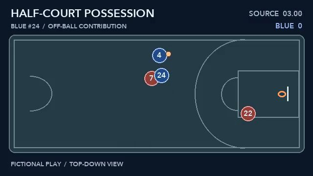

# Make a basketball highlight reel that shows the screen before the basket

If the player you’re featuring sets the screen, start the clip before the ball handler uses it. Mark the screener briefly while viewers can find them, then clear the mark. Stay wide enough to show the screener, ball handler and defender together. End after the basket or the next clear outcome. A clip that opens on the shot may show who scored while losing the work that created it.

[FieldLevel’s basketball video guidance](https://www.fieldlevel.com/resources/blog/basketball-video-guidance/) recommends showing actions without the ball and keeping full game film available. [Hudl’s interviews with recruiting coaches](https://www.hudl.com/blog/standing-out-in-todays-recruiting-landscape) discuss screen setting as one contribution a reel can show.

## Watch the same finish with and without the setup

The silent instructional files use a fictional half-court possession. Blue No. 24 sets a screen near source second 3.00. Blue No. 4 drives and the scoreboard changes at 6.50. The videos preserve the same source clock in the picture so you can compare exactly what each one includes.

| Download | Source range | What a reviewer can see |
| --- | --- | --- |
| [Full possession](examples/basketball-screen-highlight/01-full-possession.mp4) | 0.00–8.00 s | No. 24 sets up, holds the screen and moves after No. 4 drives. |
| [Finish-only cut](examples/basketball-screen-highlight/02-finish-only.mp4) | 5.00–8.00 s | No. 4’s finish and the score. The screen is outside the cut. |
| [Screen through score](examples/basketball-screen-highlight/03-screen-to-score.mp4) | 1.00–8.00 s | A one-second ring identifies No. 24. The play then runs at normal speed through the screen and basket in one view. |

The screen is at frame 48 and the score change is at frame 132 in the seven-second cut, counting from zero at 24 fps. The identification ring is visible for 24 frames and clears before the screen. The three-second cut keeps the score and omits the screen. [Decoded frame measurements](examples/basketball-screen-highlight/measurements.json) · [Editable play-log row](examples/basketball-screen-highlight/sample-play-log.csv)

## Build the reel from your game footage

1. Write down the source filename and the play’s start and end on the video clock. Pick the start by looking for the featured player’s approach and the defender’s position. The game clock helps find the possession but can stop during the recording.
2. Use a brief marker before the action and name the player by team color, number and place on court. After the marker clears, keep the screener and ball handler visible. In a portrait cut, use a wider layout if a tight crop would hide a second player. Watch the play at normal speed before adding any replay.
3. In the finished MP4, pause before the screen and again at the outcome. Check that the requested player is recognizable and that the causal sequence is intact. If a camera pans away before the result, find another angle or use a different possession. Keep the full game link available if a coach asks.

| Editing workflow | What to test |
| --- | --- |
| Hudl game library and team highlights | Hudl documents an automatic game recap centered on events such as baskets and steals. Open the wider play in your library and use the highlight editor to check whether the screener’s lead-in and the result are in your chosen clip. [Automatic highlights](https://support.hudl.com/s/article/basketball-autogen-highlights-faq-hudl-v3?language=en_US) · [Make an athlete highlight](https://support.hudl.com/s/article/create-premium-highlights-hudl-v3?language=en_US) |
| Recruiting playlists built from team video | SportsRecruits describes grouping position-specific clips and selecting actions such as defending a ball screen. If you need a standalone MP4, deliver and test that file separately from the playlist link. [SportsRecruits basketball playlists](https://help.sportsrecruits.com/hc/en-us/articles/31883323037581-Basketball-Guide-to-Playlists) |
| A local game recording and a written list of plays | Load the recording in Valmera, give the source times and identify the player. Review one play before committing to the whole reel. Check marker placement in the preview and open the downloaded file. AI editing requires a subscription. [Valmera highlight reel editor](https://valmera.io/tools/highlight-reel?utm_source=github.com&utm_medium=referral&utm_campaign=basketball_screen_highlight) |

Valmera publishes this guide. The three exports are teaching diagrams and do not measure any tool’s automatic player detection.

> Use my game recording and the logged possession. Feature Blue No. 24. Start before the screen and end after the basket. Give the viewer a brief cue to find No. 24 before the action and clear it before the guard uses the screen. Keep the screener, guard and defender in view. Show me this play in the preview before adding the rest of the reel.

For teams producing many reels, share the game count, player list, who can approve a play, when the cuts are needed and where the films will be shared. [Discuss recurring team editing with Valmera Enterprise](https://valmera.io/subscribe?inquiry=highlight-reel&utm_source=github.com&utm_medium=referral&utm_campaign=basketball_screen_highlight#enterprise).
