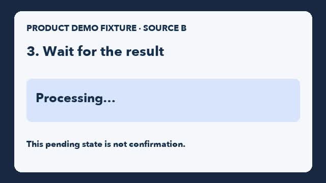
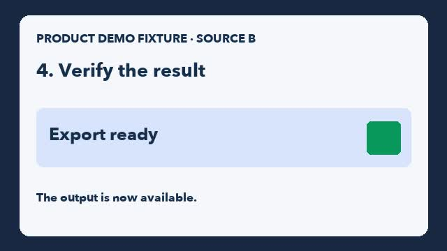

# Batch AI video editing with one prompt: test two product demos first

Use the same instructions for branding, format and what each video must show. Choose the cut times from each recording. If you turn ten product demos into ten short MP4s, the deliverables are the ten clips a reviewer can understand and approve. Matching runtimes alone do not show that the clips work.

## Choose how to run the pilot

| Editor | What its published workflow describes | What to test |
| --- | --- | --- |
| [Loopdesk](https://loopdesk.ai/blog/batch-video-editing-edit-50-videos-at-once-with-ai) | A batch workflow that applies a natural-language brief to many videos. | Include a recording with a slower result. Check that its export still shows the confirmation and that you can revise that file by itself. |
| [Descript](https://help.descript.com/export-and-share/video-gif.md) | Export the current composition or export one file per composition for a whole project. | Use two compositions and export only the one you revise. Confirm the other deliverable still matches the copy you approved. |
| [Kapwing](https://www.kapwing.com/help/about-the-kapwing-mcp/) | A connected editing workflow that can be directed from a compatible AI assistant. | Send one request per recording and verify project separation, the editable review version and the downloaded file. |
| [Valmera](https://valmera.io/ai-video-editor?utm_source=github.com&utm_medium=referral&utm_campaign=batch_demo_confirmation_pilot) | Edits supplied footage from instructions in Studio or a compatible assistant. AI editing requires an eligible subscription. | Reuse the same brief in separately identified projects. Review each output and revise only the one that misses its own result. |

These are public workflow descriptions. Valmera publishes this guide and the teaching fixtures below. The fixture compares two local cuts, so you can see what to check before using a subscription on your footage.

## Download two recordings with different clocks

The eight-second [source A](examples/batch-demo-pilot/source-a.mp4) and [source B](examples/batch-demo-pilot/source-b.mp4) show the same task with different waits. Each uses a synthetic interface and has no audio.

> Turn both supplied recordings into separate five-second product demos. Use the same format and style. In each export, show the report selection, the export action and a readable “Export ready” result. Remove waiting time or spare tail as needed. Keep source A and source B separate, then show both previews.

| File | Relevant timing | What a reviewer sees |
| --- | --- | --- |
| Source A | Confirmation at 3.00 s | Keeping the first five seconds retains it. |
| Source B | Confirmation at 5.00 s | The same five-second cut ends before the first confirmation frame. |
| [Fixed-time B export](examples/batch-demo-pilot/fixed-b.mp4) | Five seconds, 125 frames at 25 fps | It ends while the report is still processing. |
| [Result-kept B export](examples/batch-demo-pilot/result-kept-b.mp4) | Five seconds, 125 frames at 25 fps. Confirmation starts at 3.00 s, frame 75. | It keeps the action and then shows the result. |

| Fixed-time B at 4 seconds | Revised B at 4 seconds |
| --- | --- |
|  |  |

The revised file keeps source B from **0–3 s** and **5–7 s**. Both candidate MP4s are the same length. We decoded every frame to check where the green confirmation marker appeared. [Media hashes and frame counts](examples/batch-demo-pilot/measurements.json)

## Revise one file and check the delivery

Ask for an export of B only. Reopen the resulting MP4 and check that the action leads to the visible result. Preserve the approved file from A. If your publishing team requires the same bytes for an approved deliverable, use [the batch file comparison](PODCAST-CLIP-BATCH-REVIEW.md) to check everything outside the requested revision. Play the replacement to check the edit itself.

Try the same pilot on two actual recordings, with confirmation appearing at different source times. Use the same written brief for both. Record how many exports pass without correction, the time reviewers spent and the work needed on the second pass. A quote per usable export is easier to compare after you have those counts.

[Try an editing brief in Valmera](https://valmera.io/ai-video-editor?utm_source=github.com&utm_medium=referral&utm_campaign=batch_demo_confirmation_pilot). For recurring editing of supplied recordings, [ask Valmera Enterprise to scope a two-file pilot](https://valmera.io/subscribe?inquiry=product-demo-video-editing-service&utm_source=github.com&utm_medium=referral&utm_campaign=batch_demo_confirmation_pilot#enterprise). Include monthly volume, target length and formats, and which visible result each video must keep.
