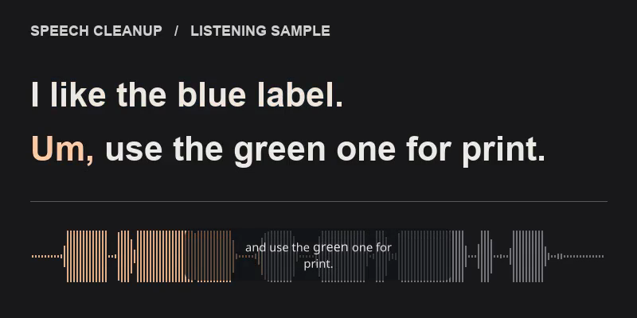
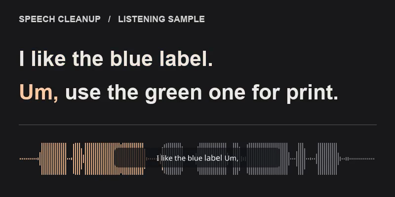

# Fix AI captions after cuts: timing, wording and the final export

When captions go out of sync after an edit, first check that the subtitle track belongs to the same version of the video. A constant delay, gradual drift and a jump after a cut need different corrections. Changing every timestamp by the same amount repairs a uniform offset; it cannot repair timing errors that change at individual edit joins.

Use this guide to direct caption revisions through Valmera, Claude, ChatGPT or another connected assistant. It includes a worked timing map, correction prompts and a delivery record. The recording and cues below are **fictional teaching examples**, not measured Valmera outputs or an accuracy benchmark.

For a real run with downloadable videos, see the [recorded caption-style revision](CAPTION-STYLE-EXAMPLE.md): two caption treatments, an unchanged selection, matching decoded preview audio and the final export.

[Connect your assistant](https://valmera.io/mcp/setup) · [Caption styling and corrections](https://valmera.io/docs/captions) · [Start an editing brief](https://valmera.io/prompts#prompt-builder)

For another language, use the [subtitle translation workflow](SUBTITLE-TRANSLATION.md): choose subtitle-only or dubbing, preserve meaning and review the translated track against the same edit.

## Convert word-level timestamps to subtitle files

Download the [four-second source video](https://valmera.io/examples/filler-word-cut/original.mp4) and its [12 word records](evaluation/one-word-caption/word-timestamps.json). Valmera's `get_words` returned these source times. We arranged the result as JSON with seconds and confidence values. The speaker is synthetic. This is one recording with a known caption error.

| Source word | Start | End | What to check |
| --- | ---: | ---: | --- |
| label | 0.88 s | 1.44 s | Listen to the end of “label” before the hesitation. |
| and | 1.44 s | 1.84 s | The automatic transcript says “and.” The audio and reviewed caption say “Um,”. |
| use | 1.84 s | 2.32 s | Keep this word and its start time when fixing the previous caption. |

Open the [word timestamp converter](https://valmera.io/glossary/word-level-timestamps#word-subtitle-converter), keep the sample in seconds and select cue 6. Enter **Um,** as its caption text. For another recording, paste its word-timed JSON first, select the correct time unit and open the matching media to hear the passage before revising it. The tool runs locally in the browser. It uses timing supplied with the transcript.

**Expected files.** Compare the [original SRT](evaluation/one-word-caption/source-words.srt), [corrected SRT](evaluation/one-word-caption/corrected-words.srt) and [corrected WebVTT](evaluation/one-word-caption/corrected-words.vtt). Each contains 12 single-word cues. In both SRT files, cue 6 spans `00:00:01,440 --> 00:00:01,840`. Only its displayed word changes. These sidecars were generated from the word records. The burned-in caption examples below group several words on screen.

## Correct a single misheard word and verify the downloaded video

On November 14, 2026, we uploaded Valmera’s [four-second synthetic speech sample](https://valmera.io/examples/filler-word-cut/original.mp4) to a new project. The source says “Um, use the green one for print.” The automatic transcript heard “and” at 1.44–1.84 seconds and flagged that word for review. The large lettering at the top is already in the original. Look at the smaller caption over the waveform.

| Before correction at 1.60 seconds | After correction at 1.60 seconds |
| --- | --- |
|  |  |
| [Download the first preview](evaluation/one-word-caption/before.mp4) | [Download the revised preview](evaluation/one-word-caption/after.mp4) |

We enabled captions from the transcript with the documentary preset, then appended one displayed-word correction. The start and end refer to the **edited program clock**. Read the word timing in your own project and map it to the current cut before applying a correction. This demo kept the entire original in order at normal speed, so both clocks agreed.

```json
{"operation":"append","replacements":[{"from":"and","to":"Um,","start":1.44,"end":1.84}]}
```

Supply those fields and your own project ID to `set_caption_fixes`. Then call `audit_captions`, render a complete preview and inspect the word in the actual picture. In this run, “Um,” moved into the preceding caption group. The voice continued through the same four seconds. To request this by chat, try “In this preview, correct the caption at 1.6 seconds from ‘and’ to ‘Um,’. Keep the hesitation audible. Keep every cut, the original voice and the existing caption style. Show me the revised passage.”

**Check the result yourself.** Both previews contained 100 frames at 25 fps. Decoding both audio streams with the same settings produced identical samples. On macOS or Linux with FFmpeg installed, run the following in the folder containing the two downloaded previews. Compare the final hash on each output line.

```sh
for file in before.mp4 after.mp4
do
  ffmpeg -v error -i "$file" -map 0:a:0 -ar 48000 -ac 2 -c:a pcm_s16le -f hash -hash sha256 -
done
```

The [finished MP4](evaluation/one-word-caption/final.mp4) is 1920 × 960 and lasts nine seconds, including the branded ending. Its [frame at 1.60 seconds](evaluation/one-word-caption/final.png) shows the corrected lower caption. The final uses a separate encode. We compared the left-channel waveform with the revised preview from 0.25 to 3.50 seconds at the same timestamps and measured a correlation of 0.999867. The final checker flagged the end card, although the decoded frame at seven seconds shows it. [File hashes and measurements](evaluation/one-word-caption/measurements.json).

For your own export, check the spelling with sound muted, then listen to the corrected word and the next few words. Check the following caption too. A correction can move a word across a phrase break, and two clips can have the same duration while containing different audio. [Start in Valmera Studio](https://valmera.io/studio?utm_source=valmera_mcp_docs&utm_medium=repository&utm_campaign=caption_word) · [AI editing plans](https://valmera.io/subscribe).

## Did correcting a caption change any other words or timestamps?

A speaker asks you to correct the spelling of their name after approving the cut. Save the approved SRT, make the correction in a copy, and export the revised SRT against the same video. The [SRT revision checker](evaluation/check_srt_revision.py) lists every changed cue with its old and new text and reports changes to either end of its time window. It runs locally with Python 3 and reads both files.

For a browser review, open [Compare two SRT files](https://valmera.io/tools/compare-srt-files). Open the approved file under **Original** and the candidate under **Revised**, then select **Compare subtitles**. If cue 18 was meant to change spelling only, check its before-and-after text and confirm its start and end are identical. Add the exact delivery cut under **Reference video** to hear the change in context. **Download full report** includes every changed cue even when the on-screen list spans several pages.

Choose **Try the caption example** to hear the four-second recording from the case study above. Two teaching SRTs isolate “and” → “Um,” at 1.44 seconds. The video is the actual first preview. A cue’s **Use this correction in Valmera** action carries the old text, revised text and time window into a Studio brief. Open the matching footage and review the request before starting a paid AI edit.

From a checkout of this repository, run the following command with your two subtitle paths.

```sh
python3 docs/evaluation/check_srt_revision.py approved.srt corrected.srt
```

Read each changed cue aloud against the recording. A spelling correction from “Sara” to “Sarah” that appears twice should produce two changed cues if those mentions are in separate cues. A third changed cue deserves a look even when all timestamps match. Line wraps and formatting tags count as text changes. Two mentions in one cue count as one changed cue.

**Try a known timing change.** The [original three-cue SRT](evaluation/subtitle-sync-20261107/input.srt) and its [downloaded revision](evaluation/subtitle-sync-20261107/browser-output.srt) come from our [recorded subtitle timing example](SUBTITLE-SYNC-EXAMPLE.md). Compare them from the repository root.

```sh
python3 docs/evaluation/check_srt_revision.py docs/evaluation/subtitle-sync-20261107/input.srt docs/evaluation/subtitle-sync-20261107/browser-output.srt
```

The middle cue starts at 00:00:50,000 in the original and 00:00:51,000 in the revision. The last line of the report reads `3 cues compared. Text changed in 0. Timing changed in 3.` This is the expected result for that retiming job. It would be a reason to pause a spelling-only handoff.

The checker accepts UTF-8, numbered SRT cues with plain start and end timestamps. Exit code 0 means it could pair the cues by number in sequence and all corresponding times matched. Inspect the reported wording yourself. Exit code 1 flags a timing or cue-structure change. When the cue numbers or count differ, inspect the split, joined or renumbered passages manually. Exit code 2 means a file could not be read or parsed. For captions already burned into an MP4, use the frame-and-audio comparison above. A subtitle file alone cannot show which words the player actually displayed.

## Identify what is wrong before changing anything

Listen to identifiable phrases near the beginning, middle and end of the exact video you intend to deliver. Compare the first audible word with its caption, then inspect any edit joins between those checks. Three samples help diagnose the pattern; they do not replace reviewing the complete file.

| What you observe | What to check | A suitable next step |
| --- | --- | --- |
| Every sampled caption is late by the same amount | Whether this is the correct cut with a uniform offset | Shift the subtitle times, then recheck the whole track. |
| The timing error grows steadily | Playback speed, file duration and whether the subtitle source matches | Establish the timing relationship before stretching the track. |
| Captions match until one cut, then jump | Removed, inserted or reordered footage; an older subtitle export | Align captions to the current edit and review the affected joins. |
| Timing matches but a name or number is wrong | The spoken recording and the intended spelling or quantity | Correct caption text without changing the speech or the cut. |
| Two copies of the words appear | Text already rendered into the video plus a player caption track | Decide which delivery version and player track you need. |
| The caption hides a face, control or chart | The actual output dimensions and viewing size | Revise placement or grouping and inspect representative frames. |

For an existing SRT or VTT file with a confirmed uniform delay, the free [subtitle timing shifter](https://valmera.io/tools/subtitle-timing-shifter) can move its cues. It also supports a linear scale and offset from two reference cues. See the [recorded three-cue SRT example](SUBTITLE-SYNC-EXAMPLE.md) for the actual input, downloaded result and an independent middle-cue check. Keep the original file. A global timing rule does not determine which source passages belong in a new cut.

## A worked example: three source sections become one clip

Assume a 24-second source, normal playback speed, hard cuts, no overlapping transitions and no inserted material. Keep source seconds 2–8, 12–18 and 20–24, in that order. End times are exclusive. These are convenient teaching boundaries; real speech cuts must preserve complete words and meaning.

| Section | Original-source time | Edited-program time | Duration |
| --- | --- | --- | --- |
| A | 2–8 s | 0–6 s | 6 s |
| B | 12–18 s | 6–12 s | 6 s |
| C | 20–24 s | 12–16 s | 4 s |

The edited program lasts **16 seconds**. Its third section starts at program second 12 even though it starts at source second 20. Keep those two clocks explicit when requesting a correction.

Within one unchanged, normal-speed section, map a source time by subtracting that section's source start and adding its program start. In section B, source second 13.4 maps to `13.4 − 12 + 6 = 7.4` seconds in the program.

These fictional cues sit wholly within their respective retained sections:

| Caption text | Source cue | First-edit cue |
| --- | --- | --- |
| Open the settings. | 4.2–6.0 s | 2.2–4.0 s |
| Keep the original file. | 13.4–15.0 s | 7.4–9.0 s |
| Review the export. | 21.0–23.0 s | 13.0–15.0 s |

This arithmetic maps time; it does not establish good caption segmentation. The cue must still match the retained speech and remain readable in context.

### What happens when a cue crosses a cut?

A source cue spanning 7.5–12.5 seconds crosses the removed interval 8–12. Do not simply move that cue and keep all its text: some of the words may have been removed from the audio. Listen to the retained portions, inspect word timings where available, and rebuild the cue wording and boundaries around the speech that remains. If the cut removes a qualification needed for the meaning, repair the edit itself.

Speed changes, repeated or reordered sections, inserted speech and overlapping transitions require a mapping that accounts for those changes. The simple calculation above is deliberately limited to the stated hard-cut example.

## One revision moves later captions too

Now shorten only section B, keeping source 12–16 instead of 12–18. The revised program becomes:

| Section | Retained source | Revised program |
| --- | --- | --- |
| A | 2–8 s | 0–6 s |
| B | 12–16 s | 6–10 s |
| C | 20–24 s | 10–14 s |

The program is **14 seconds**. The first two example cues remain at 2.2–4.0 and 7.4–9.0 seconds. “Review the export” moves from 13.0–15.0 to **11.0–13.0 seconds**. Its words are unchanged; its position in the program is two seconds earlier.

Shifting the entire old subtitle file two seconds earlier would damage the first two cues. Reusing it unchanged would leave the last cue late. Generate or align the captions for the revised edit, then review every affected cue, including any near the newly shortened boundary.

Adapt this request to real source ranges you have checked:

> In project [ID], revise version [version]. Shorten only the middle retained section to original-source seconds 12–16, replacing source 12–18. Preserve source 2–8 and 20–24, their order, playback speed, framing and approved caption style. These times use the original source clock. Align captions with the revised program, removing words whose audio was cut. Render a new preview and identify its project and version. Report any incomplete correction.

## Correct one word without editing the spoken recording

Transcription correction and speech replacement are different requests. A caption should represent what is actually said. If the speaker says the wrong quantity, silently substituting the desired quantity in the captions creates a disagreement with the audio. Decide whether to retain it, add an explicit correction or make a separate audio/video revision.

For a spelling error, identify the occurrence as well as its time:

> In project [ID], version [version], the phrase beginning “[quoted words]” at [time in this version's preview] captions the name as “[incorrect spelling]”. The correct spelling is “[correct spelling]”. Correct this occurrence only. Preserve the spoken audio, source selection, duration, framing and caption treatment. Show the corrected passage with its surrounding context and report the new version.

For a connected assistant, discover the current tool schemas before acting. The [tool guide](TOOLS.md) describes caption correction, styling and audit operations, including `set_caption_fixes`, `set_caption_style` and `audit_captions`. These names are starting points, not fabricated API payloads or a guarantee that an audit alone proves the result. Inspect the rendered output.

## Review readable phrases as well as accurate words

Check names, quantities, negatives and qualifications against the audio. Keep related words together where possible. Avoid a line change or a disappearing cue that briefly reverses the meaning, such as showing “Disconnect the cable” before the qualifying instruction has been understood.

Preview the fastest passage, a bright frame and a busy frame at the size your audience will actually watch. The free [subtitle reading-speed checker](https://valmera.io/tools/subtitle-reading-speed-checker) can flag demanding cues in existing files; a numerical reading rate alone does not establish readability for every audience. For slides and charts, use the [vertical-video readability guide](SLIDE-READABILITY.md).

The [W3C caption guidance](https://www.w3.org/WAI/media/av/captions/) explains why automatic captions need accuracy review and why relevant sounds and speaker information matter. Use the full viewing context, not just a spelling pass.

## Match the subtitle file to the delivered video

The separate-file checks below apply to an SRT or VTT you already have or obtain through a confirmed export route. Do not assume an MP4 export includes a separate subtitle file: check the current tools and available delivery formats first. Keep each export with the captions reviewed for that exact cut. A downloaded file does not acquire later project revisions. Captions rendered into the picture and a separate subtitle track also have different delivery behavior; see [burned-in captions versus subtitle tracks](https://valmera.io/glossary/burned-in-captions-vs-subtitles).

Use a short delivery record:

| Field | Record for your delivery |
| --- | --- |
| Project and approved version | [Project ID and version] |
| Video file | [Exact filename] |
| Caption delivery | [Rendered into video, separate track, or both] |
| Subtitle file and language, if applicable | [Exact filename and language] |
| Program duration / total file duration | [Measured values; include any end card separately] |
| Timing and wording review | [Reviewer, date, corrected passages, unresolved issues] |
| Destination playback | [Player/platform and observed result] |

For final delivery, adapt this request:

> Export the reviewed version [version] of project [ID]. Confirm the caption delivery format before starting. Wait for the export's terminal result, then provide the completed file. Identify the version it contains and any unresolved caption issues. If a separate subtitle file is available, identify the matching language and cut; do not substitute an older track.

Open the downloaded video with its intended caption track. Check the beginning, every changed join and the ending, then watch the full delivery with sound. Test the destination player too: native captions can overlap with words already in the picture. If the file is an older version, obtain the correct export before changing otherwise correct caption timing.

## Start with your recording

[Connect Valmera](https://valmera.io/mcp/setup?utm_source=valmera_mcp_docs&utm_medium=repository&utm_campaign=caption_revisions), identify your project and use the focused requests above. Account creation and uploading are free; editing requires an eligible subscription. Your assistant provider's access and billing are separate. Confirm current requirements on the [plans page](https://valmera.io/subscribe).

For a broader comparison, use the [edit-and-revise evaluation kit](EDITOR-EVALUATION.md), then add representative speech footage: its supplied silent motion graphic does not test caption accuracy. Keep first attempts, corrections and final delivery observations in your comparison record.

Published by Valmera, November 7, 2026. The timing examples are illustrative; no competitor accuracy or performance ranking is claimed.
