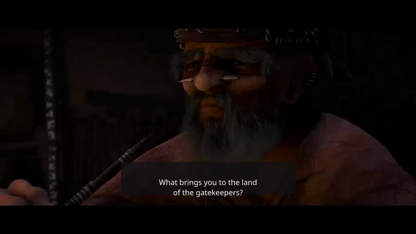
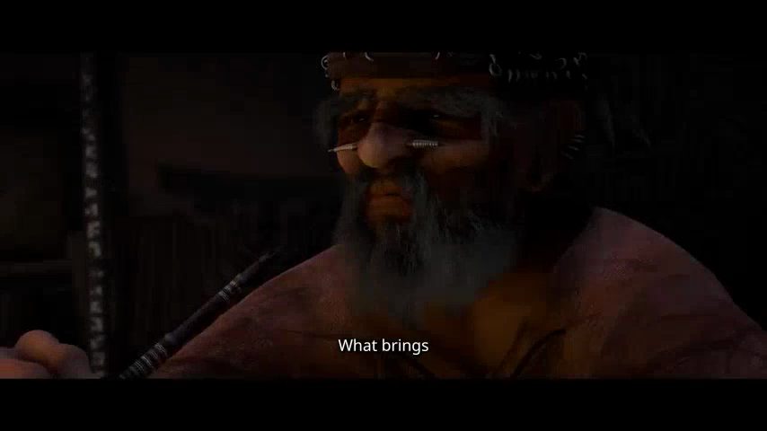
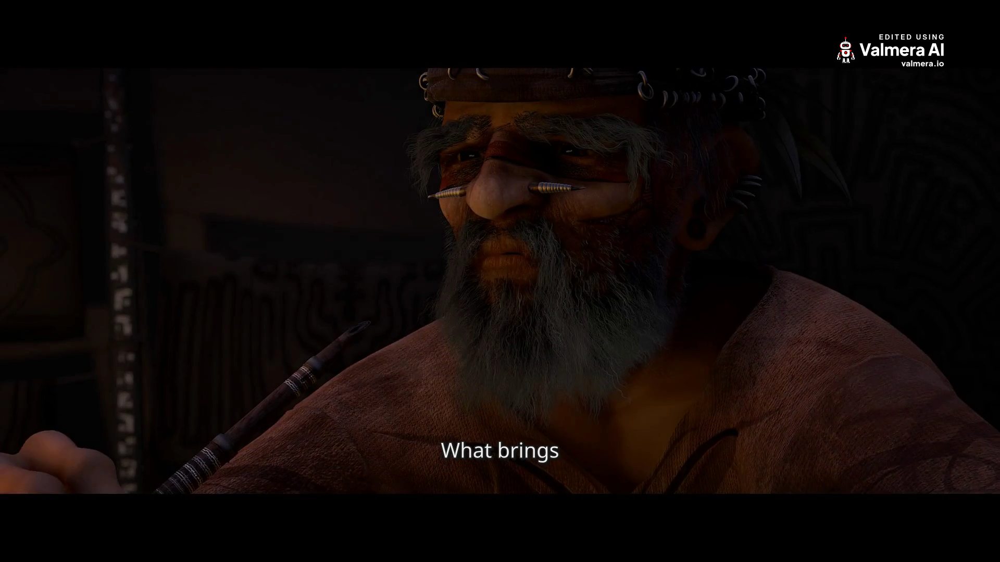

# Change AI video captions without changing the cut: a recorded Valmera example

Changing captions should not silently change the footage you approved. In this recorded example, a connected assistant used Valmera to extract a short dialogue passage, render sentence-style captions, revise them into shorter groups and export the revised video. Both previews retained the same 9.6-second selection and produced identical decoded audio samples.

You can inspect the two previews and the full-resolution export below. This is one narrow, first-party demonstration recorded on **7 November 2026** using animated film footage. It is not a podcast benchmark, an independent quality rating or a comparison with other editors.

## Watch the files and compare the same moment

| File | What it contains | Measured file duration |
| --- | --- | --- |
| [Original Sintel trailer](https://download.blender.org/durian/trailer/sintel_trailer-1080p.mp4) | The unchanged 1920×1080 source from Blender's download server | 52.208333 s |
| [First preview: documentary captions](evaluation/sintel-captions-20261107/documentary-v3-preview.mp4) | EDL v3; 854×480 review draft, sentence-style captions | 9.600 s |
| [Revised preview: clean captions](evaluation/sintel-captions-20261107/clean-v4-preview.mp4) | EDL v4; 854×480 review draft, groups of up to two words | 9.600 s |
| [Final revised MP4](evaluation/sintel-captions-20261107/clean-v4-final.mp4) | EDL v4; 1920×1080, including this run's corner mark and appended end card | 14.625 s |

The preview links are historical review artifacts. The last link is the finished export. Download the files if your browser displays a repository file page instead of a video player.

**Footage credit:** © copyright Blender Foundation | [durian.blender.org](https://durian.blender.org/). Sintel material is used under [CC BY 3.0](https://creativecommons.org/licenses/by/3.0/); see the project's [sharing terms](https://durian.blender.org/sharing/). Valmera's modifications are excerpt selection, rendered captions, transcoding and export branding. Blender Foundation does not endorse Valmera. [Full artifact attribution](evaluation/sintel-captions-20261107/ATTRIBUTION.md).

Both images below are at **program second 0.4**. They come from the downloaded preview files at the same resolution, so the comparison does not mix a high-resolution export with a small draft.

**First preview, documentary preset:**



**Revised preview, clean preset:**



The images show presentation and grouping. They do not establish continuous timing, audio quality or comfortable reading on every device. Open the videos at your intended viewing size before choosing a style.

## 1. Select a passage using the source transcript

The original trailer was uploaded to a newly created demonstration project. After analysis completed, Valmera returned four transcript sentences with timing. We used the opening question and answer: “What brings you to the land of the gatekeepers?” and “I'm searching for someone.”

Word timings put the question at source 12.00–14.40 seconds and the answer at 18.45–19.89 seconds. We inspected source frames around these passages before selecting the excerpt. The existing trailer contains visual transitions between the lines; those remain in this example.

The initial request kept source 12–21.5 seconds with word snapping enabled. The returned edit started at **11.9**, not exactly 12.0: the tool reported moving the opening boundary to a quieter point. Reading the saved EDL back established the actual range as **11.9–21.5**, lasting **9.6 seconds** at normal speed.

That distinction matters when reviewing captions. In this one continuous range, program time is source time minus 11.9:

| Spoken passage | Source word timing | Corresponding program timing |
| --- | --- | --- |
| Opening question | 12.00–14.40 s | 0.10–2.50 s |
| Answer | 18.45–19.89 s | 6.55–7.99 s |

These are transcript-derived speech windows, not an exported subtitle file or a claim that every caption disappears at the final word. A caption style can hold or group words differently. The example contains no removed interior range, reordered footage or speed change; more complicated edits need a section-by-section map. See [caption revisions after cuts](CAPTION-REVISIONS.md).

## 2. Render the first caption treatment

After inspecting the initial EDL, the assistant made these calls through the public connector. Each line is a separate recorded operation:

```json
{"tool":"keep_segments","arguments":{"project_id":5534,"segments":[[12,21.5]],"snap_to_words":true}}
{"tool":"add_captions","arguments":{"project_id":5534,"mode":"from_transcript","style":{"preset":"documentary"},"emphasis_words":[]}}
{"tool":"render_preview","arguments":{"project_id":5534,"complete":true}}
```

The first call produced EDL v2; captions produced v3. The v3 preview showed the question in a two-line panel. Its measured mix was −16.9 LUFS integrated with a −1.8 dBTP true peak, as reported by the preview tool. Those numbers describe level, not intelligibility or a listener's assessment.

Project **5534 belongs to this demonstration**. Do not reuse it or transfer these source times to another recording. Create your own project and use its returned ID, transcript and current tool schemas.

## 3. Request a presentation-only revision

A useful follow-up specifies both the change and what must survive:

> Change the captions to the clean preset with shorter word groups. Preserve the approved source selection, order, normal speed, original sound and framing. Render the revised version and report anything else that changed.

The recorded revision was:

```json
{"tool":"add_captions","arguments":{"project_id":5534,"mode":"from_transcript","style":{"preset":"clean"},"emphasis_words":[]}}
{"tool":"render_preview","arguments":{"project_id":5534,"complete":true}}
{"tool":"get_edl","arguments":{"project_id":5534}}
```

The result was **EDL v4**, with `max_words_per_caption` equal to 2 and the same `keep` range, `[11.9,21.5]`. The saved edit contained no added music, sound effects, voiceover or speed changes. Sampled caption frames showed the shorter groups. Both complete preview files had 230 video frames at 24 fps and a 9.600-second container duration.

We also decoded each preview's audio as 16-bit PCM using the same FFmpeg command and hashed the decoded samples. The hashes matched exactly:

```text
6c92f86529b67b6bb9548e9da0ff4dde5cd299a8404d1bd1f2e839343cf78217
```

That supports a specific conclusion: **the caption-style revision did not change the decoded audio between these two previews**. It does not prove bit-for-bit preservation of the original source, establish transcript accuracy or say that the longer final file has the same audio hash.

## 4. Inspect the final export separately

The assistant requested `export_final` for project 5534, EDL v4. Job **137448** completed and returned final asset **40418**. The downloaded file's SHA-256 matched its export receipt. All three downloaded outputs decoded without FFmpeg reporting an error.

The final file contains H.264 video, stereo AAC at 48 kHz, 351 video frames at 24 fps and a measured total duration of **14.625 seconds**. Its duration exceeds the 9.6-second edited timeline because this run includes export branding. A sampled frame at 9.6 seconds shows the end card; the program's opening frame sample shows the corner mark. These observations are specific to this run and account, not a promise about branding on every plan.



The [machine-readable evidence](evaluation/sintel-captions-20261107/evidence.json) includes file metadata, receipt identities, hashes, review scope and warnings. [SHA256SUMS.txt](evaluation/sintel-captions-20261107/SHA256SUMS.txt) lets you identify the exact published artifacts.

### Observed limitations

The original excerpt fades toward black near its end. The v4 preview flagged 0.08 seconds of dark picture at the handoff; the final-export check flagged approximately 0.17 seconds, from 9.42–9.58. We deliberately retained the source ending to keep the style comparison on the same selection. **That warning was not repaired.** A delivery brief requiring an ending on a clearly visible moving picture would need a separate boundary revision and another review.

Two advertised connector operations, `set_edit_plan` and `review_audio`, were rejected by live dispatch during this run. We recorded the dispatch failures for engineering follow-up; the run did not establish a root fix. No separate listening-model review succeeded. Audio claims here therefore rest on transcript timing, authored EDL state and deterministic file measurements, not a claimed listening assessment.

This example also does not test filler-word removal, multilingual caption accuracy, overlapping speakers, long-form drift or a customer outcome. Its scope is selection, caption presentation, a focused revision and a verifiable export.

## Try the same revision on your recording

Use a short passage whose speech and intended boundaries you can verify. Save the first approved preview, request one caption change, then compare the same words at the same program times. Check the final file independently, including its ending and branding. If a correction changes the cut, treat it as a new timing problem and realign affected captions.

[Connect a compatible assistant](https://valmera.io/mcp/setup) or [open Valmera Studio](https://valmera.io/studio?utm_source=github&utm_medium=docs&utm_campaign=caption_style_example). Account creation and uploads are free; AI editing requires an eligible subscription. Check [current plans](https://valmera.io/subscribe).

For the next step, use the [caption correction guide](CAPTION-REVISIONS.md), [source-to-program revision example](MCP-RECORDED-EDIT.md) or [editor evaluation worksheet](EDITOR-EVALUATION.md). Choose a workflow from the [documentation index](README.md).
