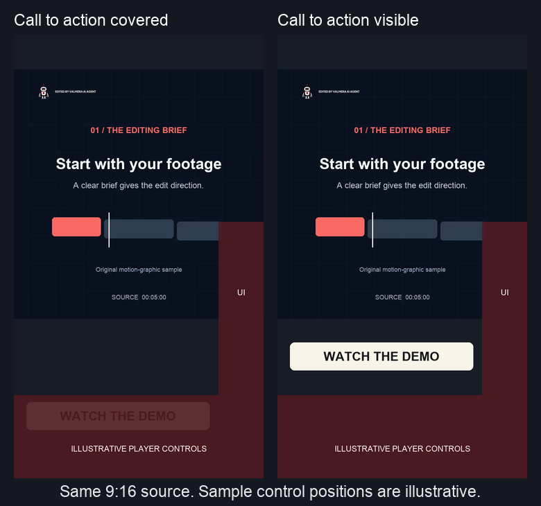

# Keep captions and calls to action visible in vertical ads

A 9:16 export can look clean in an editor while the ad player covers the last line. Check the downloaded MP4 in the actual placement preview. Pay particular attention to the first caption, the final call to action and anything near the bottom or right edge.

## Compare two exports from the same footage

We used the opening four seconds of [Valmera's published square export](https://valmera.io/examples/trim-and-reframe). Both test files place that same footage at the same position in a 720 × 1280 portrait canvas. The only layout change is the position of **Watch the demo**. The test files were assembled with FFmpeg.

| Test export | Call-to-action box at this fixture's resolution | Result with the illustrated overlay |
| --- | --- | --- |
| [Lower position](examples/vertical-ad-player-overlap/under-player-controls.mp4) | x = 36–564, y = 1060–1140 | The illustrated controls cover the entire box. |
| [Raised position](examples/vertical-ad-player-overlap/raised-above-controls.mp4) | x = 36–564, y = 888–968 | The box clears both control regions in this test. |

Both MP4s decode to **120 frames at 30 fps**. The picture shows their two-second frames under an illustrated bottom panel and right rail. The red regions are for this exercise. For actual delivery, use the placement's current overlay and verify your own export; the positions shown here are specific to this test canvas.

## Inspect each placement before approving the master

| Placement | Official check | What an approver should see |
| --- | --- | --- |
| TikTok Auction In-Feed | Use the correct [TikTok overlay file](https://ads.tiktok.com/resources/help/article/tiktok-auction-in-feed-ads?lang=en). The safe zone depends on the creative dimensions, ad-caption length and formats such as anchors. | Captions stay readable with the expected ad copy and selected format. TikTok notes that an ad preview can differ from the live version. |
| YouTube Shorts ads | Start with [Google's vertical video safe-zone guide](https://support.google.com/google-ads/answer/9128498), then use the [Shorts preview for your campaign](https://support.google.com/google-ads/answer/13459155) where available. | Overlays and buttons leave the key wording visible in the eligible format and device preview. |

Review the exact file your team will deliver. Inspect clips with long caption lines or animated text one frame at a time where the wording gets close to a control. For other exports such as 4:5 or 1:1, run the check on their own canvases. When a correction moves the caption, confirm that it still avoids the presenter, product label or other required content.

## Put the exact text and preview in the brief

> From [approved source or version], cut the 9:16 product ad and keep [first caption] and [exact final call to action] readable. Review each against [placement, preview link or supplied overlay]. Leave enough time for someone to read the final line. If one treatment cannot work in both placements, return a TikTok MP4 and a Shorts MP4 with clear filenames and send the checked timestamp for each.

Start a recurring editing engagement with one representative ad. Approve its source, edit, captions, final files and preview evidence before committing the monthly volume. Tell the editor whether your team supplies the placement previews or reviews them after handoff so they know how the final check is owned.

**[Plan a vertical reframe with Valmera](https://valmera.io/tools/auto-reframe?utm_source=valmera_mcp_docs&utm_medium=repository&utm_campaign=vertical_ad_caption_review)**. AI editing requires an eligible subscription. If your team delivers several ad variants every month, [scope a done-for-you pilot](https://valmera.io/paid-social-video-editing-service?utm_source=valmera_mcp_docs&utm_medium=repository&utm_campaign=vertical_ad_caption_review#scope) with one master, the intended placements, exact wording and the expected number of exports.
