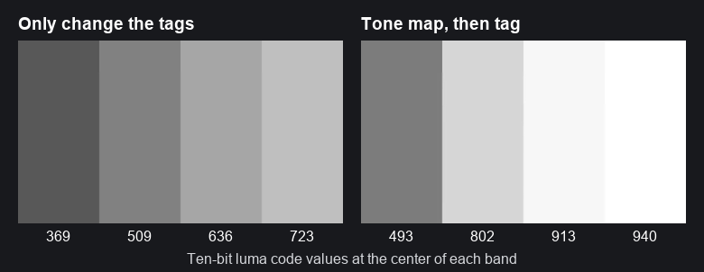

# How to check an HDR phone edit exported as SDR Rec.709

If the placement needs SDR, tell your editor to interpret the HDR source, tone-map the picture into SDR and export a Rec.709 MP4. Then inspect the downloaded file. A Rec.709 tag tells a player how to interpret the samples. It cannot tell you whether those samples were converted correctly.

## Give the editor an exact delivery request

> Edit the supplied product footage to the approved cut and deliver an SDR Rec.709 MP4. Identify the source color space and transfer function before applying a conversion. Keep the approved cut and framing. Review the brightest reflection, one skin-tone or neutral product shot, and the title card in the exported file. Provide the timestamps you checked.

Record the source filename, the intended platform and what must stay legible in highlights. If the placement specifies a codec, frame size or bitrate, include those separately. For mixed SDR and HDR shots, check the input interpretation per clip. Review an uploaded test on the target placement as well, since the platform can re-encode it.

Apple documents an SDR export workflow for HDR footage from an iPhone or iPad. Adobe describes how Premiere maps HDR highlights into an SDR sequence and where to inspect the color-management controls. Use the conversion for your footage's actual transfer function. The sample below is synthetic PQ. Camera footage may use HLG or carry Dolby Vision metadata, so check what your editor detects before choosing settings. [Apple's HDR editing guide](https://support.apple.com/en-us/102241) · [Adobe's tone-mapping documentation](https://helpx.adobe.com/premiere/desktop/correct-color/set-up-color-management/tone-mapping-in-premiere.html) · [ITU HDR production parameters](https://www.itu.int/rec/R-REC-BT.2100/en)

## Download and compare three real exports

All three files are four seconds of silent 640 × 360, 30 fps, 10-bit HEVC. The source encodes four neutral PQ bands at 18, 100, 400 and 1,000 nits. The numbers below are decoded 10-bit luma codes sampled at the center of each band at 2 seconds. They are code values, not measured display brightness.

| File | Declared transfer | Decoded luma, left to right |
| --- | --- | --- |
| [PQ HDR source](examples/hdr-to-sdr-check/pq-hdr-source.mp4) | SMPTE ST 2084 (PQ) | 369, 509, 636, 723 |
| [Rec.709 tags only](examples/hdr-to-sdr-check/retagged-only-bt709.mp4) | Rec.709 | 369, 509, 636, 723 |
| [Tone-mapped Rec.709](examples/hdr-to-sdr-check/tone-mapped-bt709.mp4) | Rec.709 | 493, 802, 913, 940 |

The two SDR files have the same declared Rec.709 matrix, primaries and transfer function. The tag-only file still matches the HDR source's decoded frame hashes across all 120 frames. The tone-mapped file uses FFmpeg's Möbius operator after linearizing the input. Its exact values are specific to this fixture and those conversion settings. [Measurements](examples/hdr-to-sdr-check/measurements.json) · [FFmpeg filter documentation](https://ffmpeg.org/ffmpeg-filters.html#tonemap)



## Check your delivery file

Run this on the downloaded MP4 to read the video stream metadata.

```sh
ffprobe -v error -select_streams v:0 \
  -show_entries stream=pix_fmt,color_space,color_transfer,color_primaries,color_range \
  -of json FILE.mp4
```

Next, open the export in your color-managed editor. Compare the same bright frames against the correctly interpreted source on an SDR display or waveform. Inspect highlights for lost detail, neutrals for a color cast, and titles for readability. Review the published preview separately if your placement transcodes the upload.

For footage already in SDR, [compare grades on your own clip in Valmera's browser preview](https://valmera.io/tools/color-grade-video?utm_source=valmera_mcp_docs&utm_medium=repository&utm_campaign=hdr_sdr_delivery_check). For recurring paid-social editing, [send Valmera's editing team your monthly volume and delivery specs](https://valmera.io/paid-social-video-editing-service?utm_source=valmera_mcp_docs&utm_medium=repository&utm_campaign=hdr_sdr_delivery_check). The HDR sample is an FFmpeg reference test. Confirm your camera format and delivery requirements with the team before handing off a batch.
