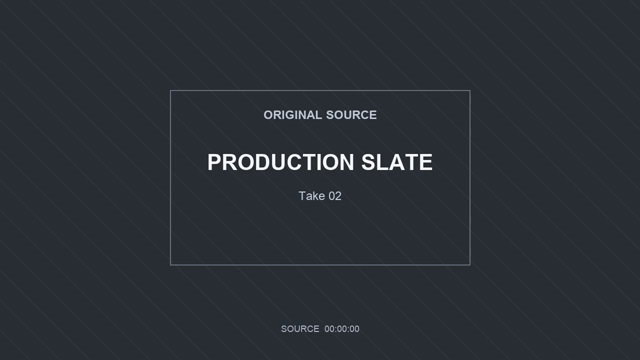
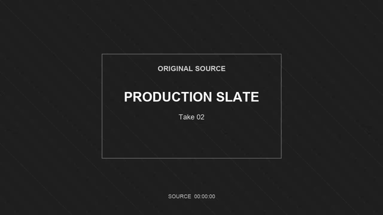
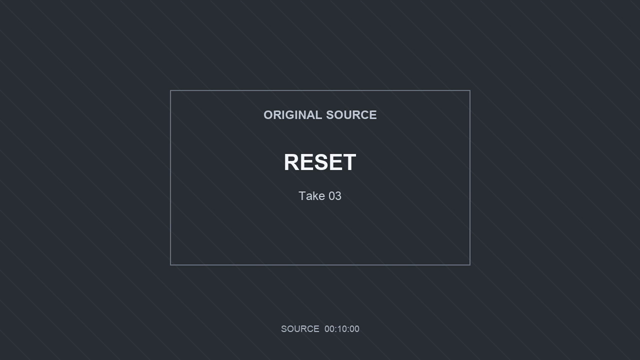
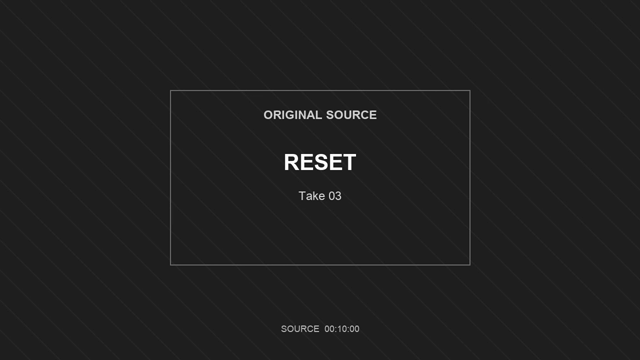
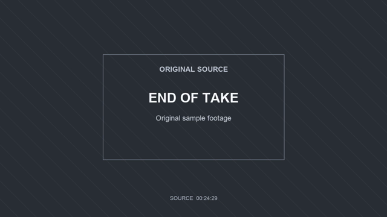
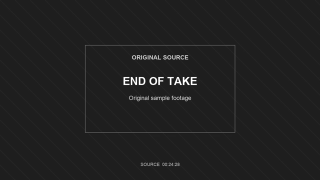

# Color grade a video online: inspect the source and the actual download

Changing the preview is only half the job. The downloaded video should carry the intended look, keep the moments you need and work in the player where you plan to use it. This guide walks through a real export from [Valmera's free browser color-grading tool](https://valmera.io/tools/color-grade-video?utm_source=valmera_mcp_docs&utm_medium=repository&utm_campaign=color_example).

**Published by Valmera; recorded November 7, 2026.** We used the manual B&W preset on a silent motion graphic. This is a specific browser-export example, not a test of AI grading, skin-tone accuracy, audio preservation or competing editors.

## Reuse a browser grade as a .cube LUT

Open the [free color grader](https://valmera.io/tools/color-grade-video#free-color-grade-preview), choose the coffee sample or your own video, then set the look, exposure, contrast, saturation and temperature. **Download selected look (.cube)** saves a 33 × 33 × 33 RGB lookup table. Comparing the original keeps your chosen settings in the download. The LUT contains color values and can be reused with another shot. No video, audio, captions or filenames are included.

### Test the result outside the browser

We downloaded the B&W look with all sliders at zero on November 15, 2026. Save the [RGB test chart](https://valmera.io/examples/color-grade/rgb-swatches.png) and the [reference LUT](https://valmera.io/examples/color-grade/valmera-mono.cube) in the same folder. Run:

```sh
ffmpeg -i rgb-swatches.png -vf lut3d=file=valmera-mono.cube -frames:v 1 graded.png
```

Compare your file with the [PNG rendered by FFmpeg](https://valmera.io/examples/color-grade/rgb-swatches-mono.png). The first three patches on the top row give you an easy channel-order check.

| Input patch (8-bit RGB) | Measured output (8-bit RGB) |
| --- | --- |
| Red (255, 0, 0) | (42, 42, 42) |
| Green (0, 255, 0) | (189, 189, 189) |
| Blue (0, 0, 255) | (0, 0, 0) |

The green patch should be the brightest of those three. The blue patch goes black under this grade. For a product shoot, check that blue fabric, packaging or lettering keeps the detail you want after the conversion. To test the temperature control independently, choose Warm, set only Temperature to +50 and export the new LUT. In our FFmpeg run the same three patches became (230, 15, 10), (45, 240, 22) and (12, 8, 211).

For a comparison against the actual preview, open the [two-second chart video](https://valmera.io/examples/color-grade/rgb-swatches.webm) and capture its original, B&W and Warm (+50 Temperature) views. In our browser the original red patch displayed near (234, 52, 35). Feeding the pure-red PNG to FFmpeg would compare different inputs. We applied each LUT to the ungraded browser capture and compared the median of a 5 × 5 interior area on each of six top-row patches with the graded preview. The largest per-channel difference across all six patches was 1 code value for B&W and 3 for Warm on a 0–255 scale. The [patch-by-patch measurements](https://valmera.io/examples/color-grade/preview-lut-measurements.json) include the original browser values and both outputs.

The browser samples the grade at 8-bit precision. This example uses an SDR RGB chart. For camera log or HDR footage, account for the input and output transforms and apply the creative look once. When comparing two applications, check the same source frame in the same color pipeline. The [FFmpeg lut3d reference](https://ffmpeg.org/ffmpeg-filters.html#lut3d) documents the interpolation options.

## Try the eight-step grayscale clip

[Download the two-second reference MP4](https://raw.githubusercontent.com/ABO3SKRALMASAOODI/valmera-mcp/main/docs/evaluation/color-strip/shadow-highlight-steps.mp4) and open it in the [free color grader](https://valmera.io/tools/color-grade-video#free-color-grade-preview). It is an original Valmera test pattern with eight equal-width gray strips. Every frame shows the same strips, so seeking slightly earlier or later gives you the same reference picture. The 320 × 180 H.264 file contains 48 frames and no audio.

1. Pause at one second, select **Cinematic** and leave all four adjustments at zero.
2. Select **Measure current frame**. Read the two percentages beside each brightness range. The first and last pairs of strips each occupy a quarter of the original frame.
3. Look at the three darkest strips. Can you still distinguish their edges after grading? Repeat for the three brightest. Two looks can put the same percentage in an end bin and still look different within that bin.
4. Change contrast and measure again. **Copy frame reading** gives you the source timestamp and both percentages to paste into an editing brief. Repeat in another editor with the same file and export settings.

| Sample at one second | Near black, 0–7 | Near white, 248–255 |
| --- | ---: | ---: |
| Original strips | 25.0% | 25.0% |
| Cinematic, default adjustments | 37.5% | 37.5% |

These are Chrome readings of browser-decoded pixels. For an independent check, we decoded one source frame with FFmpeg and sampled the center of each strip. The 8-bit RGB levels, from left to right, were 0, 2, 10, 30, 222, 242, 250 and 253, with equal red, green and blue in each strip. The two ranges therefore contain two strips apiece. Color-space conversion and decoding can change individual pixel values slightly. The MP4’s SHA-256 is `cb9d626a935daa8bb07b19eb37128e480a4ba86d14bdd56ec1f5d1ce0ef19bf0`.

**Try a real subject next.** Choose the coffee sample in the same tool. At 2.00 seconds, Cinematic with zero adjustments moved the near-black share from 10.3% to 23.3% in our browser. Inspect the dark beans and decide how much texture the shot needs. A pile-up on the left can include a naturally dark object. The histogram alone cannot tell whether the texture you care about survived.

### Compare grading tools with the same shot

- To inspect where levels fall across the image, try the waveform in KlikFrame and locate which part of your shot produces the peak. Its product guide also describes an RGB parade, histogram and vectorscope. [KlikFrame scopes](https://www.video-editor.com/klikframe-tools/color-grading)
- To test a LUT across several clips, Tellers documents local batch processing and H.264 export on compatible browsers. Apply the same LUT to the strips and a real subject, then compare the downloads. [Tellers standalone grader](https://tellers.ai/free-standalone-tools/color-grade-video)
- To adjust a clip in a timeline, Clipchamp documents exposure, contrast, saturation and temperature controls. Compare the shot with its adjacent clip and use the reset control to recover the source look. [Microsoft’s color adjustment guide](https://support.microsoft.com/en-gb/clipchamp/how-to-change-the-color-of-a-video)

Those links describe each vendor’s workflow. The measurements above were taken in Valmera. Valmera’s histogram samples approximate brightness from decoded RGB on a reduced frame. Choose a color-managed scope to check HDR delivery or individual channel clipping.

## Download both files

- [Original MP4](evaluation/recorded-run-20261107/original-source.mp4): 25 seconds, 1280×720, H.264, 750 frames at 30 fps, no audio track.
- [Unmodified browser download](evaluation/color-browser-20261107/export.webm): VP9 WebM, 1280×720, 748 decoded frames, no audio track.
- [Review record](evaluation/color-browser-20261107/evidence.json), [source metadata](evaluation/color-browser-20261107/source-metadata.json), [output metadata](evaluation/color-browser-20261107/export-metadata.json), [timestamp summary](evaluation/color-browser-20261107/frame-timing-summary.json) and [SHA-256 hashes](evaluation/color-browser-20261107/SHA256SUMS.txt).

Use GitHub's download control if the file does not preview. Open the WebM in a player that supports VP9. The original carries its own title, graphics and changing source counter; those are part of the input picture.

## Reproduce the settings

1. Open the [free tool](https://valmera.io/tools/color-grade-video?utm_source=valmera_mcp_docs&utm_medium=repository&utm_campaign=color_example) and choose the source MP4.
2. Select **B&W**. Leave **Exposure**, **Contrast**, **Saturation** and **Temperature** at **0**.
3. Use **Original** and **Preview** to compare the same source moment. The preset is separate from the four adjustment sliders: a zero saturation adjustment does not disable the B&W preset.
4. Select **Export graded video** and keep the tab active while it records.
5. Download the offered **WebM**, then inspect that file rather than relying on the page preview.

The page reported that the export was ready without audio. Our input was already silent, so this run cannot tell you whether a recording with sound would retain it. For speech or music, check the tool's audio-status message and listen to the downloaded file.

## What survived export, and what did not match exactly

The downloaded file decoded fully without an error and retained the source dimensions. It contains **748 video frames**, compared with **750 in the input**. Its first presentation timestamp is **0.000 seconds** and its last is **24.973 seconds**. The WebM does not provide a container-duration field in the saved metadata; the final frame's presentation time is not the full playback duration.

Do not turn the nominal `30/1` frame-rate field into a promise that every source frame was preserved. This tool records in real time, and this run has a different decoded frame count. A browser capture is useful for a quick graded clip; an edit that requires exact frame retention needs a separate timing check.

The sampled images below let you inspect the change from color to monochrome at the beginning, middle and ending. They are reduced-size extracts for review; the downloadable video itself has not been resized or modified after export.

| Source samples | Browser-export samples |
| --- | --- |
|  |  |
|  |  |
|  |  |

The first two pairs show counters `00:00:00` and `00:10:00`. The last source sample shows `00:24:29`, while the last export sample shows `00:24:28`: the final captured picture is one source frame earlier. The rows are samples from similar parts of the clip, not an assertion of identical source time. Use the counters inside the pictures to assess alignment. A full decode plus sampled images establishes file readability and those visible moments; it is not continuous human playback or inspection of every frame.

## Check your own footage before choosing a stronger look

Start with a representative passage. Include a bright detail, a dark detail, a color that matters and a cut between shots. If the footage contains a face, inspect the face as well as the background. Use the same frame when switching between Original and Preview, so changes in lighting or movement do not masquerade as the grade.

For a monochrome result, ask whether neighboring objects still separate when their colors disappear. A red label and a green background can be distinct in color but difficult to tell apart in grayscale. Check text, product details and any color-coded instructions. A stronger contrast setting can lose detail; it is not automatically an improvement.

After downloading, check the beginning, ending, motion through the clip, dimensions, audio and the moments you used to judge the preview. If the receiving app requires MP4, verify the actual container before delivery: a browser offering WebM has not produced MP4 merely because the input used that extension.

## Carry the creative direction into an AI edit

The local tool's **Continue with these settings** action offers a brief for the separate Studio workflow. It does not transfer the selected local file. Upload the original in Studio, describe the intended result and review the rendered preview on its own merits.

For example:

> Give this recording a restrained black-and-white look. Keep small text and product details readable, preserve highlight detail, and retain the original framing, timing and soundtrack. Show a preview. If two objects become hard to distinguish without their color, identify the moment so I can review it.

That is an editing request, not a guaranteed outcome. Account creation and upload are free; AI editing requires an eligible [subscription](https://valmera.io/subscribe). The [workflow guide](WORKFLOW.md) explains preview review and focused revisions, and the [recorded MCP example](MCP-RECORDED-EDIT.md) provides a separate edit-and-revise run with downloadable artifacts.
