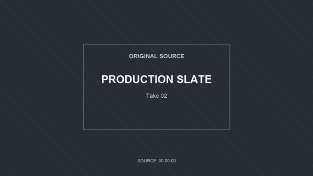
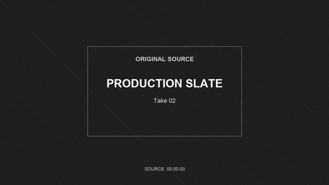
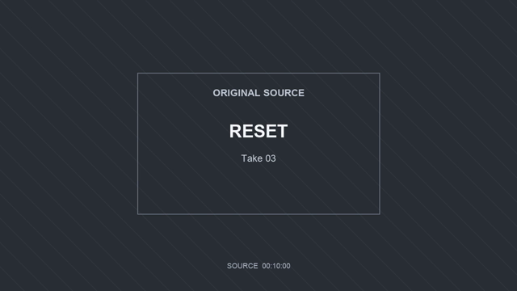
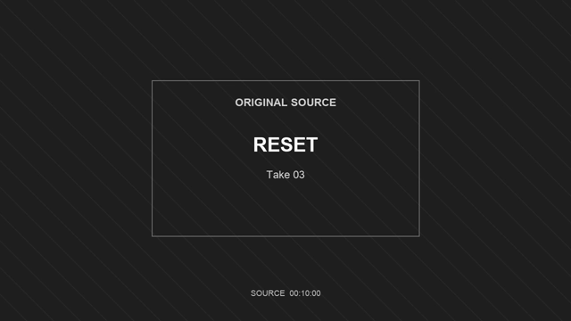
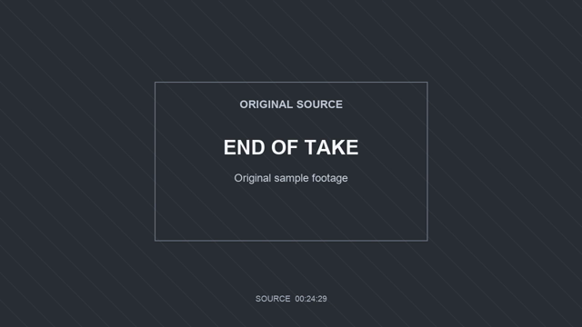
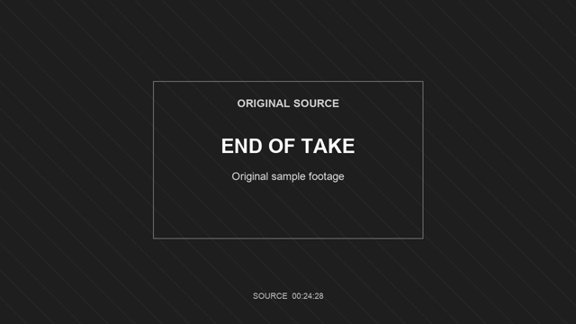

# Color grade a video online: inspect the source and the actual download

Changing the preview is only half the job. The downloaded video should carry the intended look, keep the moments you need and work in the player where you plan to use it. This guide walks through a real export from [Valmera's free browser color-grading tool](https://valmera.io/tools/color-grade-video?utm_source=valmera_mcp_docs&utm_medium=repository&utm_campaign=color_example).

**Published by Valmera; recorded November 7, 2026.** We used the manual B&W preset on a silent motion graphic. This is a specific browser-export example, not a test of AI grading, skin-tone accuracy, audio preservation or competing editors.

## Download both files

- [Original MP4](evaluation/recorded-run-20261107/original-source.mp4): 25 seconds, 1280×720, H.264, 750 frames at 30 fps, no audio track.
- [Unmodified browser download](evaluation/color-browser-20261107/export.webm): VP9 WebM, 1280×720, 748 decoded frames, no audio track.
- [Review record](evaluation/color-browser-20261107/evidence.json), [source metadata](evaluation/color-browser-20261107/source-metadata.json), [output metadata](evaluation/color-browser-20261107/export-metadata.json), [timestamp summary](evaluation/color-browser-20261107/frame-timing-summary.json) and [SHA-256 hashes](evaluation/color-browser-20261107/SHA256SUMS.txt).

Use GitHub's download control if the file does not preview. Open the WebM in a player that supports VP9. The original carries its own title, graphics and changing source counter; those are part of the input picture.

## Reproduce the settings

1. Open the [free tool](https://valmera.io/tools/color-grade-video?utm_source=valmera_mcp_docs&utm_medium=repository&utm_campaign=color_example) and choose the source MP4.
2. Select **B&W**. Leave **Exposure**, **Contrast**, **Saturation** and **Temperature** at **0**.
3. Use **Original** and **Preview** to compare the same source moment. The preset is separate from the four adjustment sliders: a zero saturation adjustment does not disable the B&W preset.
4. Select **Export graded video** and keep the tab active while it records.
5. Download the offered **WebM**, then inspect that file rather than relying on the page preview.

The page reported that the export was ready without audio. Our input was already silent, so this run cannot tell you whether a recording with sound would retain it. For speech or music, check the tool's audio-status message and listen to the downloaded file.

## What survived export, and what did not match exactly

The downloaded file decoded fully without an error and retained the source dimensions. It contains **748 video frames**, compared with **750 in the input**. Its first presentation timestamp is **0.000 seconds** and its last is **24.973 seconds**. The WebM does not provide a container-duration field in the saved metadata; the final frame's presentation time is not the full playback duration.

Do not turn the nominal `30/1` frame-rate field into a promise that every source frame was preserved. This tool records in real time, and this run has a different decoded frame count. A browser capture is useful for a quick graded clip; an edit that requires exact frame retention needs a separate timing check.

The sampled images below let you inspect the change from color to monochrome at the beginning, middle and ending. They are reduced-size extracts for review; the downloadable video itself has not been resized or modified after export.

| Source samples | Browser-export samples |
| --- | --- |
|  |  |
|  |  |
|  |  |

The first two pairs show counters `00:00:00` and `00:10:00`. The last source sample shows `00:24:29`, while the last export sample shows `00:24:28`: the final captured picture is one source frame earlier. The rows are samples from similar parts of the clip, not an assertion of identical source time. Use the counters inside the pictures to assess alignment. A full decode plus sampled images establishes file readability and those visible moments; it is not continuous human playback or inspection of every frame.

## Check your own footage before choosing a stronger look

Start with a representative passage. Include a bright detail, a dark detail, a color that matters and a cut between shots. If the footage contains a face, inspect the face as well as the background. Use the same frame when switching between Original and Preview, so changes in lighting or movement do not masquerade as the grade.

For a monochrome result, ask whether neighboring objects still separate when their colors disappear. A red label and a green background can be distinct in color but difficult to tell apart in grayscale. Check text, product details and any color-coded instructions. A stronger contrast setting can lose detail; it is not automatically an improvement.

After downloading, check the beginning, ending, motion through the clip, dimensions, audio and the moments you used to judge the preview. If the receiving app requires MP4, verify the actual container before delivery: a browser offering WebM has not produced MP4 merely because the input used that extension.

## Carry the creative direction into an AI edit

The local tool's **Continue with these settings** action offers a brief for the separate Studio workflow. It does not transfer the selected local file. Upload the original in Studio, describe the intended result and review the rendered preview on its own merits.

For example:

> Give this recording a restrained black-and-white look. Keep small text and product details readable, preserve highlight detail, and retain the original framing, timing and soundtrack. Show a preview. If two objects become hard to distinguish without their color, identify the moment so I can review it.

That is an editing request, not a guaranteed outcome. Account creation and upload are free; AI editing requires an eligible [subscription](https://valmera.io/subscribe). The [workflow guide](WORKFLOW.md) explains preview review and focused revisions, and the [recorded MCP example](MCP-RECORDED-EDIT.md) provides a separate edit-and-revise run with downloadable artifacts.
