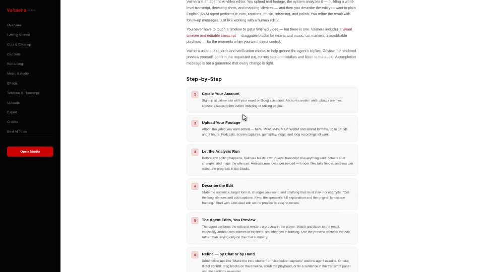
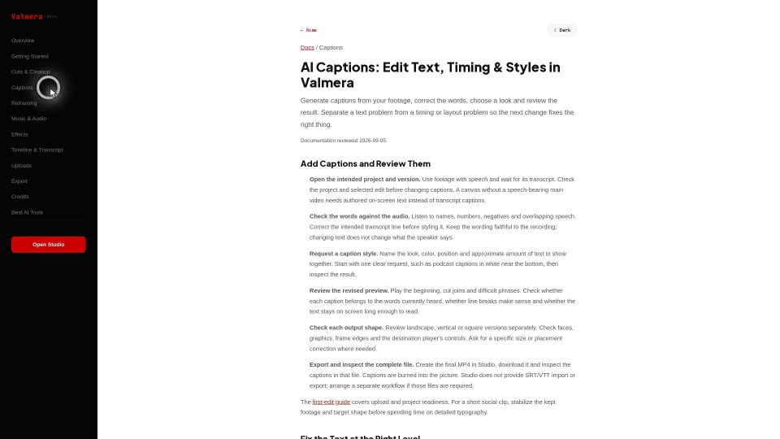

# Compare AI product demo recorders from a public URL

Valmera, Demosmith, Bingeable and Vidocu document workflows that record a website from written instructions. If you’re buying for a SaaS team, give each recorder the same URL, three observable actions and one revision request. Judge the exported MP4 by what a new viewer can see and repeat. Downloading a playable video is only the first check.

## Choose a recorder to test

Valmera publishes this guide. The table summarizes each vendor’s documentation, checked November 24, 2026. Our recorded example below measures one Valmera capture. Run your own pilot to compare finished quality and review time.

| Recorder | Documented workflow | What to verify before buying |
| --- | --- | --- |
| Valmera | Records a specified sequence on a public page and returns a capture with a time-stamped event track. Refine the footage in the editor, or upload your own recording, and export an MP4. [Website recorder](https://valmera.io/tools/record-website-demo#capture) | Confirm that the click reaches the required screen. Ask for a longer hold on that result and check the approved export. |
| Demosmith | A cloud browser navigates the live site. The vendor documents downloadable MP4s and an interactive demo format. Its editor can adjust narration and zooms. [URL-to-video workflow](https://demosmith.ai/blog/ai-generate-demo-from-url) · [Editor](https://demosmith.ai/) | If the release changes a navigation step, try the re-record workflow. Confirm the new export still opens on the approved view and check whether the interactive version needs a separate update. |
| Bingeable | Captures a live tutorial or walkthrough and documents chat edits scoped to a step. Changes to the route through the product can trigger a new recording. [Prompt and revision guide](https://bingeable.ai/prompt-guidelines) · [Export plans](https://bingeable.ai/pricing) | Try a caption-only revision and a different navigation path on the same pilot. Record the scope and any new capture or export required. |
| Vidocu | Its AI Recorder accepts a start URL and can use an existing help article as a guide. It can deliver footage, step screenshots and a written guide. [AI Recorder workflow](https://vidocu.ai/blog/introducing-the-ai-recorder-one-prompt-a-studio-grade-product-video) · [Export plans](https://vidocu.ai/pricing) | Verify that the edited video, screenshots and instructions show the same flow. Record the export allowance needed for your revision cadence. |

## See how a playable recording can miss the actual step

In a recorded Valmera test, the brief requested a click on the Captions link. The first attempt saved a playable 13-second MP4, but the event track reported zero clicks. A decoded frame at **7.90 s** still shows the Getting Started page.

The successful capture scoped the target to the link inside the documentation sidebar. Its event track reported a click at **3.57 s**. The frame at **4.00 s** shows the click ring and the new **AI Captions** heading. The two source MP4s matched the byte lengths and SHA-256 digests in the published capture receipt when we extracted these frames.

Open the [first capture at 7.90 s](https://valmera.io/examples/website-capture/first-attempt.mp4#t=7.9), the [successful capture at 4.00 s](https://valmera.io/examples/website-capture/public-docs-walkthrough.mp4#t=4), or the [event receipt](https://valmera.io/examples/website-capture/evidence.json). For an example of an edited deliverable, watch the [separate published product demo](https://valmera.io/examples/product-demo).

## Give every recorder the same pilot

> Start on our approved public product page. Show the opening screen, click the named control, then hold on the named result for two seconds. Keep the cursor and control legible at the delivery size. If a step cannot be completed, report which one and where the recording stopped. Return the downloadable MP4 and the time at which the result first appears.

Then request two separate changes. First, replace one caption and preserve the underlying footage. Second, give it a new route to the same result. Inspect the revised files, confirm the route on screen and count any capture and approval time again. A vendor can handle the caption change in the edit layer and still need to recapture for the second request.

Use the [same scorecard for every recorder](examples/website-demo-result-check/recorder-pilot.csv). It includes the measured Valmera failure and successful capture as examples, plus blank rows for your own baseline and revisions. Add the time spent briefing, reviewing and rechecking each approved video so you can compare the ongoing cost per publishable demo.

Start with the [Valmera website-demo brief](https://valmera.io/tools/record-website-demo?utm_source=github&utm_medium=referral&utm_campaign=demo_recorder_pilot#demo-briefs). If your team needs a recurring editing partner for recordings you already make, [scope a demo batch with Valmera Enterprise](https://valmera.io/product-demo-video-editing-service?utm_source=github&utm_medium=referral&utm_campaign=demo_recorder_pilot).
