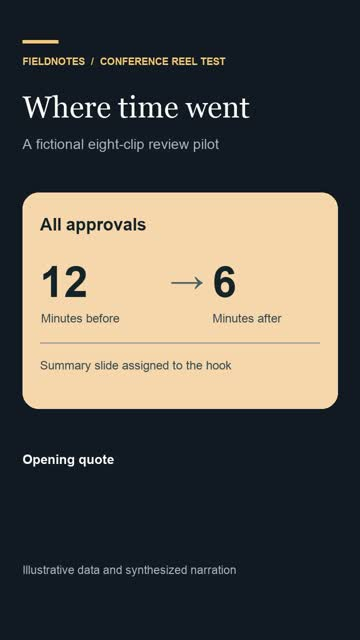
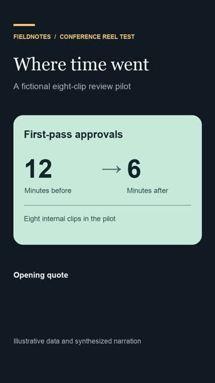

# How to edit a conference speaker highlight reel that keeps the quote in context

Open the reel with one complete thought from the speaker. Use the source slide that supports exactly what was said, including its units, audience and any qualification. When the short excerpt needs a second sentence to make sense, keep the second sentence in the opening or start with a different excerpt.

## Compare the same narration over two slides

A fictional speaker says, “We cut review time in half. That was for first-pass approvals only.” Both 12-second exports use the same narration. At 4.0 seconds, the first export shows **All approvals** going from 12 to 6 minutes. The revised export says **First-pass approvals** and identifies the eight-clip pilot. At 7.5 seconds, both show that final sign-off stayed at 18 minutes.

| What it looks like at 4.0 seconds | Download the export |
| --- | --- |
|  | [Misleading summary slide](examples/conference-reel-quote-context/misleading-summary-slide.mp4) |
|  | [Qualified source slide](examples/conference-reel-quote-context/qualified-source-slide.mp4) |

Watch the opening with sound off, then with sound on. Ask a reviewer what was halved, where the data came from, and whether final approval changed. If the answers differ between the two playbacks, the picture and the narration need to agree before publication.

These locally rendered examples use fictional data and a synthesized system voice. The decoded audio matches byte for byte. The changed picture stops at 7.5 seconds, and the last 108 frames match. [Shared SRT](examples/conference-reel-quote-context/shared-narration.srt) · [File hashes and frame measurements](examples/conference-reel-quote-context/measurements.json)

## Build a 60-second speaker reel

1. Watch one section before and after each candidate hook. Write down the exact phrase and the shortest continuous range that carries the complete claim. Record its source time and the slide ID.
2. Build the opening around the whole excerpt. Then show why the audience should care, one example that makes the claim concrete, and a closing line or a link to the full talk. Time the hold on the evidence at phone size.
3. Ask reviewers to watch the exported reel alone before opening the full talk. Confirm that the download preserves the meaning of the original statement and that the SRT can stand on its own.

> Cut a 60-second portrait speaker reel from this conference recording. For the opening, use the full approved quote at [source start–end] in the original voice. Keep [spoken qualifier] before the first cut. Use slide [ID/version] to show [label, unit and population]. Include one example from later in the talk and identify it in your source map. Deliver the reviewed MP4 and matching SRT.

For the second pass, ask for one local change. For example: “Use the original slide for the chart between 00:03 and 00:08. Keep the reviewed speech, slide timing and second half of the reel.” Then compare the two exports at the exact time of the change and after the next cut. [Download a quote and slide review log](examples/conference-reel-quote-context/quote-review-log.csv)

## Compare editing workflows on one talk

| Editor | Start with | Check in the first delivery |
| --- | --- | --- |
| Descript | Use its highlight workflow and transcript editing to select a passage from the talk. [Descript’s highlight workflow](https://www.descript.com/tools/highlight-video-maker) | Compare the first spoken passage with its start and end in the source transcript. |
| Adobe Premiere Pro | Select speech from the transcript to create a sequence, then refine the picture on the timeline. [Premiere’s Text-Based Editing overview](https://helpx.adobe.com/in/premiere/desktop/edit-projects/edit-video-using-text-based-editing/overview-of-text-based-editing.html) | Confirm that the slide replacement and spoken qualifier survive the final download. |
| Kapwing | Upload the talk and describe the edit to its browser assistant, then review the project. [Kapwing’s video assistant](https://www.kapwing.com/ai/video-assistant) | Verify that the requested source slide appears with all its labels during the claim. |
| Valmera | Upload the source talk and describe the reel and its quote in chat. Review and revise the edit before delivery. [Valmera’s highlight-reel workflow](https://valmera.io/tools/highlight-reel?utm_source=github.com&utm_medium=referral&utm_campaign=conference_quote_context) | Ask for the same slide-only correction and compare the revised file with the first version. |

These are published workflow descriptions and questions for your own trial. Use the same brief, footage and acceptance criteria in every editor. Count elapsed time to a publishable file, including speaker review and one revision.

## Scope a done-for-you pilot for recurring talks

For 20 talks a month, one portrait MP4 and one matching SRT per talk means **40 files across 20 approved edits**. Name the speaker approver, slide owner and publishing deadline for each talk. Pilot two actual recordings, one with a straightforward quote and one where the quote depends on the slide. Ask the editor to return the source time, slide ID and approved filenames on each review row. Use the pilot to estimate reviewer time and the turnaround from first cut to approval.

[Ask Valmera Enterprise to quote the two-talk pilot](https://valmera.io/subscribe?inquiry=conference-video-editing-service&utm_source=github.com&utm_medium=referral&utm_campaign=conference_quote_context#enterprise). Include monthly volume, the target reel length, and the date the first two files need approval.
