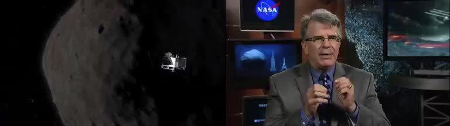

# Edit customer interviews into an evidence reel reviewers can trace

For a product decision, deliver the MP4 with a source map. Give every excerpt a short ID, the original recording and time range, and its time in the finished reel. A reviewer should be able to check the question or qualification in the original interview without having to find it by listening to the whole recording.

## First choose where the review will happen

| Workflow | What to try in the pilot |
| --- | --- |
| [Dovetail](https://docs.dovetail.com/help/projects/highlight-reels) | Build a reel from highlights in the research workspace. Try following one highlight back to its source, then open the exported video in the actual presentation format. |
| [Condens](https://condens.io/help/import-and-export/export/download-files-and-highlight-reels/) | Build a reel from clustered highlights. Check what your collaborators can see in the workspace and what they get from the downloaded file. |
| [Reduct](https://help.reduct.video/en/articles/export-and-download-media) | Review the selected lines on video. Try the reel export and, if a video editor will finish it, test the handoff to the editor you use. |
| [Valmera](https://valmera.io/ai-video-editor?utm_source=github.com&utm_medium=referral&utm_campaign=interview_evidence_reel) | Upload the recordings, give the editor approved source ranges and ask to keep the original voices. Review the preview and export one MP4. Keep the source map with the final edit. Hosted AI editing requires an eligible subscription. |

Valmera publishes this guide. The comparison uses the providers’ published workflows. Try the exact reviewer handoff that your team needs before you choose a service.

## Open a worked two-source example

[Play the evidence reel](examples/research-evidence-reel/evidence-reel.mp4) and [download the source map](examples/research-evidence-reel/source-map.csv). This demonstration uses archival NASA Goddard interviews about OSIRIS-REx. Valmera assembled these excerpts locally for the guide.

| Excerpt | Reel time | Original recording | What the excerpt shows |
| --- | --- | --- | --- |
| E01 | 00:00.00–00:12.44 | [Michelle Thaller, 00:09.40–00:21.84](https://svs.gsfc.nasa.gov/vis/a010000/a012700/a012713/Thaller_OSIRIS-REx_EGA_Interview.mp4#t=9.40,21.84) | The mission is named and Thaller explains why asteroids are of interest. |
| E02 | 00:12.44–00:20.68 | [Jim Garvin, 00:36.84–00:45.08](https://svs.gsfc.nasa.gov/vis/a010000/a012700/a012713/Garvin_canned.mp4#t=36.84,45.08) | Garvin describes selecting a sample and returning it to Earth. |

[Original interviews, captions and credits](https://svs.gsfc.nasa.gov/12713/) · [Measurements and file hash](examples/research-evidence-reel/measurements.json)

Pause the reel just before and after 00:12.44 to find the excerpt change. Open the matching source interval in the sheet. If your player ignores the time fragment, seek to the named start time. In your own file, keep the full interview available to authorized reviewers so they can hear the surrounding question.

## Run a paid pilot on a real research decision

1. Choose one claim the reel needs to support. Pick a supporting excerpt and one that qualifies it or raises a competing explanation. Log the interview ID and source times before requesting an edit.
2. Ask for an MP4 that preserves the original words and voice. When showing buyer quotes to stakeholders, keep phrases such as “only on mobile” if they affect the decision.
3. Ask for one correction after preview. If the second excerpt moves earlier in the reel, update its reel time and the times of every excerpt that follows. Keep original source times as recorded unless the selected passage changes.
4. Give a reviewer the downloaded MP4 and the source map. Ask them to choose one excerpt, find the same words in the original, and check that the surrounding exchange supports the note.

> Assemble a short evidence reel from the supplied interview recordings and source ranges. Keep the original wording and the important qualifications. Use my excerpt IDs. Show the preview and give me the MP4 with a list of its excerpt start times. I’ll match those times to the approved source map.

[Prepare an interview edit in Valmera](https://valmera.io/ai-video-editor?utm_source=github.com&utm_medium=referral&utm_campaign=interview_evidence_reel) or [scope recurring interview editing with Valmera Enterprise](https://valmera.io/subscribe?inquiry=testimonial-video-editing-service&utm_source=github.com&utm_medium=referral&utm_campaign=interview_evidence_reel#enterprise). Include the volume of recordings, who signs off on the quotes and where the approved reels will be used.
