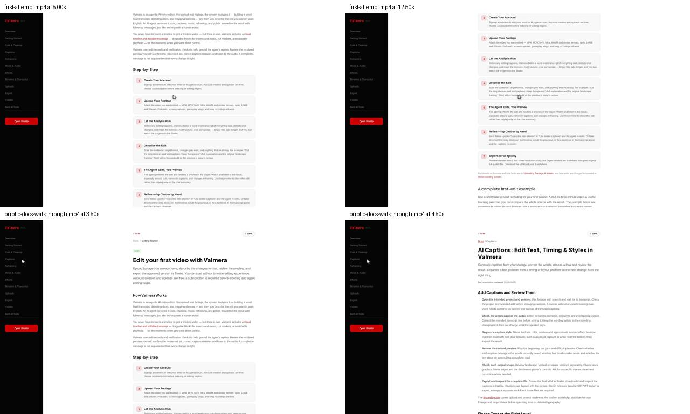

# DemoVisor vs Valmera for AI product demos from a URL

Use a public product or documentation page to test one action before you pay for a demo generator. Choose a control that reveals a visible result, such as a filter that narrows a list or a help link that opens the right instructions. Watch the delivered video at normal speed and see whether a viewer could repeat the action.

DemoVisor is worth trying when one walkthrough must become a narrated video, written guide and slide deck. Valmera is worth trying when you need to capture specific browser actions, review the result and make a directed revision, or you already have a recording to edit from chat. This is a Valmera-authored comparison. The other vendors' workflows below come from their documentation. We used two public Valmera recordings to check the demo test.

## Shortlist by the deliverable you need

| Tool | Where to start | What to check in a trial |
| --- | --- | --- |
| [DemoVisor](https://demovisor.com/product-demo-from-url) | Give it a product URL, review the proposed workflow and generate a narrated video, guide and deck. | Change one step and check that the video, guide and deck all reflect the same result. |
| [Valmera](https://valmera.io/tools/record-website-demo) | Use a public URL with requested browser steps or upload an existing recording and describe the edit. Review the video and export an MP4. | Request one timing revision. Confirm the click and the resulting screen are still visible in the exported file. |
| [Demosmith](https://demosmith.ai/) | Try a URL and prompt when the deliverables include an interactive demo alongside a video. | Check that the clickable version and the MP4 both teach the same steps, including any branching path. |
| [LittleDemo](https://littledemo.com/) | Try a URL workflow when you want to recapture a demo as part of a release pipeline. | Update one label in a test environment and check whether the new render follows the right path and shows the updated label. |
| [Clueso](https://www.clueso.io/features/screen-recorder) | Start with a screen recording when you want a narrated video and a matching how-to guide. | Check that the rewritten narration and screenshots still describe the actual interface. Clueso also advertises separate [agent-led recording](https://www.clueso.io/agents). |

## What a missed click looks like in the exported footage

We inspected two published MP4s from the same Valmera documentation capture. The task was to open **Captions** from **Getting Started** and show the resulting page. The first video scrolled the starting page and never showed the requested destination. The later video scoped the click to the visible desktop navigation and showed the Captions heading. Both files opened and played.

| Capture | What the reviewer can check |
| --- | --- |
| [First attempt](https://valmera.io/examples/website-capture/first-attempt.mp4) | The starting page is still visible at 5.00 s and 12.50 s. The late frame shows the last steps of Getting Started. |
| [Capture with the requested click](https://valmera.io/examples/website-capture/public-docs-walkthrough.mp4) | At 3.50 s, the pointer is by the sidebar link. At 4.50 s, the main heading reads **AI Captions: Edit Text, Timing & Styles in Valmera**. |

The [capture log](https://valmera.io/examples/website-capture/evidence.json) records the successful click at 3.57 s and scroll at 5.72 s. It records two skipped clicks before that success. These files show how to review a public capture and how selector ambiguity can affect the result. For a separate example that includes editing and final export, play the [finished Valmera product demo](https://valmera.io/examples/product-demo).

## Run the same test before you pick a tool

Give each editor the same scope. Choose a route you can share publicly and use demo data for anything that appears on screen.

> Start on [Getting Started](https://valmera.io/docs/getting-started). Hold until the page heading is readable. Click **Captions** in the visible desktop sidebar. Hold on the Captions heading for two seconds before scrolling to the first instructions. Export a landscape MP4. Preserve the pointer through the click and keep on-screen text clear of the heading.

Open each finished download and record the time where the viewer can see the starting page, the click target and the resulting heading. Pass the export only when the three are readable in that order. Repeat at the smallest size you plan to publish. If the edit will run vertically, check the sidebar and heading again after cropping.

Then ask for a revision. “Hold one second longer on the Captions heading before scrolling. Keep the previous section and the framing unchanged.” Record how many attempts and how much hands-on time it takes to get an approved file. If the workflow also generates a guide or deck, check the interface labels in those files too. Use those review times to estimate the work for your next release.

For a Valmera pilot, [try the website-demo workflow](https://valmera.io/tools/record-website-demo?utm_source=github.com&utm_medium=referral&utm_campaign=demovisor_url_capture). Website capture is available on Pro and Max. For a login-only workflow, start from an authorized screen recording and check current options on the [Valmera plans page](https://valmera.io/subscribe).

If the work is recurring, send the production queue to Valmera through [Enterprise editing](https://valmera.io/subscribe?utm_source=github.com&utm_medium=referral&utm_campaign=demovisor_url_capture#enterprise). Include the number of demos per month, the required output sizes, one representative recording you can share and who approves revisions. Ask for one pilot that uses the same delivery criteria you plan to use for the full batch.
