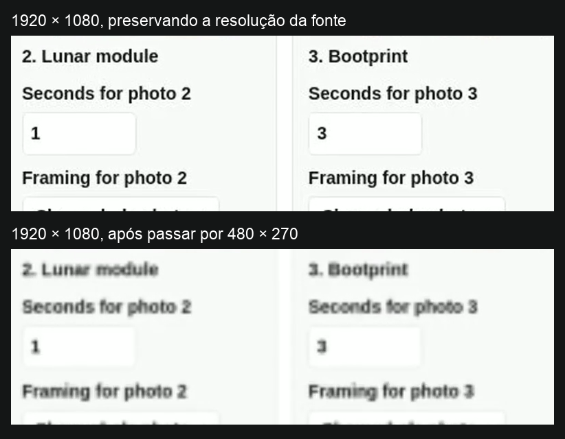

# Como editar uma gravação de tela com IA e manter o texto legível no MP4

Antes de escolher um editor para seus tutoriais, faça dois cortes em uma gravação que já existe e baixe o MP4. Confira se você consegue ler os rótulos da interface e repetir a ação no tamanho real do player. Um arquivo marcado como 1080p ainda pode carregar texto borrado se a imagem passou por uma resolução menor durante a edição ou na versão que você subiu.

## Dois MP4s em 1080p, com os mesmos cortes

A [gravação de origem](examples/website-photo-reorder/reorder.mp4), capturada com a Valmera, mostra como trocar a ordem de duas fotos em um editor de apresentação. Observe o nome e a duração de cada foto antes e depois do clique. Eles precisam continuar juntos. Na ordem final, “Lunar module” fica em segundo lugar com **1 segundo** e “Bootprint” em terceiro com **3 segundos**.

| Arquivo para baixar | Como foi preparado | O que conferir |
| --- | --- | --- |
| [MP4 em resolução nativa](examples/tutorial-export-pt-br/tutorial-1080p-nativo.mp4) | Dois cortes a partir do arquivo de 1920 × 1080, mantendo as dimensões da fonte até o fim. | Pause em 6,70 s do resultado e leia os dois nomes e valores. |
| [MP4 reamostrado](examples/tutorial-export-pt-br/tutorial-1080p-reamostrado.mp4) | Os mesmos cortes, passando por 480 × 270 antes de voltar a 1920 × 1080. | No mesmo ponto, compare as bordas das letras em “Seconds for photo 2”. |

Preparei os dois MP4s com FFmpeg para isolar o efeito da reamostragem. Usei a mesma codificação H.264 e o mesmo CRF 18 nos dois. Cada exportação tem **327 quadros a 30 fps, ou 10,90 segundos**, em 1920 × 1080. O arquivo original é silencioso. O exemplo simula uma etapa intermediária de baixa resolução e não mede o encoder da Valmera nem a qualidade de outro editor.

### Repita os cortes na mesma fonte

Os cortes removem 1,00–2,30 s e 9,00–11,20 s da fonte de 14,40 s. A primeira junção fica em 1,00 s do resultado. A segunda fica em 7,70 s. Os intervalos da tabela incluem o início e excluem o fim.

| Trecho mantido na origem | Trecho correspondente no MP4 |
| --- | --- |
| 0,00–1,00 s | 0,00–1,00 s |
| 2,30–9,00 s | 1,00–7,70 s |
| 11,20–14,40 s | 7,70–10,90 s |

## Pedido em português para o editor de vídeo

> Use o vídeo original que enviei. Remova de 1,00 a 2,30 s e de 9,00 a 11,20 s, sempre contando a partir do vídeo original, e feche os espaços. Preserve o clique, a nova ordem das fotos e os campos de duração. Mantenha o vídeo em 16:9 e 1920 × 1080. Não recorte a tela nem cubra os rótulos. Quero revisar a prévia e baixar o resultado em MP4. Diga em que tempo do resultado devo conferir a nova ordem.

Em uma gravação sua, marque os tempos de origem e informe quais rótulos, valores e mensagens de confirmação devem continuar visíveis. Se houver narração, confira também se cada ação continua alinhada com a frase que a explica.

## O que verificar antes de assinar ou contratar

1. **Comandos e cortes.** Peça os dois cortes na mesma instrução. Confirme na prévia que o segundo intervalo usou o tempo do original, que a ação ainda aparece e que o resultado fica visível.
2. **Arquivo baixado.** Reproduza o MP4 no celular ou no player em que vai publicar. Leia os valores sem dar zoom. Compare com a fonte onde o rótulo fica borrado. Para confirmar em que etapa a perda ocorre, compare também com o arquivo baixado antes de subir para a plataforma de destino.
3. **Acesso e volume.** Consulte as condições de exportação antes de pagar. Se sua equipe edita tutoriais toda semana, valide uma revisão e peça uma amostra com os formatos, prazos e volume que você realmente precisa.

Use os mesmos arquivos para comparar os caminhos que cada produto oferece. O [Descript documenta a edição pela transcrição](https://www.descript.com/tools/video-editor), o [Clipchamp documenta o corte no navegador](https://clipchamp.com/pt-br/video-trimmer/) e o [Kapwing documenta a edição com um assistente de IA](https://www.kapwing.com/ai/video-editor). Teste o comando em português, o corte por tempo e a exportação separadamente. Uma transcrição em português, por exemplo, não verifica se o editor segue instruções de corte em português.

**[Enviar uma gravação e testar o editor da Valmera](https://valmera.io/ai-video-editor?utm_source=valmera_mcp_docs&utm_medium=repository&utm_campaign=ptbr_demo_editor_pilot)** · [Ver o serviço de edição recorrente para equipes](https://valmera.io/product-demo-video-editing-service?utm_source=valmera_mcp_docs&utm_medium=repository&utm_campaign=ptbr_demo_editor_pilot#scope). A edição com IA exige uma assinatura elegível. Em Enterprise, a equipe da Valmera faz a edição.
