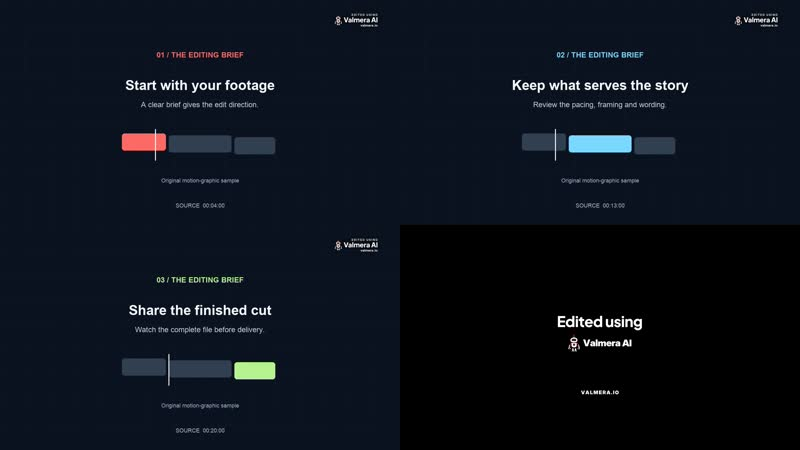

# Make a first video edit from a link

You can try a connected Valmera editing assistant before choosing a personal video to upload. This exercise starts with a public 25-second motion graphic. Give the assistant its URL, ask for two shots, then add a third after you see the first preview. The two previews and the delivered MP4 are available below for anyone to inspect.

Valmera ran this exercise on November 15, 2026 using Codex and the hosted MCP connector. The prompts below describe the recorded operations in natural language for another connected assistant, including ChatGPT. AI editing requires an eligible Valmera account. [Connect your assistant](https://valmera.io/mcp/connect?utm_source=valmera_mcp_docs&utm_medium=repository&utm_campaign=first_edit_from_link) · [Check current access](https://valmera.io/subscribe).

## 1. Paste this into a conversation with Valmera selected

```text
Use Valmera to create a new project called “My first cut from a link”.
Import this public MP4 into that project:
https://valmera.io/examples/trim-and-reframe/original-source.mp4

Make a landscape cut using source seconds 3–5, followed by 12–14.
Keep the full picture and normal speed. The recording is silent.
Render the four-second preview and give me a playback link.
```

Watch the first join at 0:02. “Start with your footage” should give way to “Keep what serves the story.” The small clock in the picture jumps from the opening shot to source second 12. [Play the four-second preview](https://raw.githubusercontent.com/ABO3SKRALMASAOODI/valmera-mcp/main/docs/evaluation/first-edit-from-link/first-preview.mp4).

## 2. Give one follow-up in the same conversation

```text
In the same project, append source seconds 19–21 to the end.
Keep the first four seconds as reviewed. Render the revised preview.
```

At output second 4, the revised preview should show “Share the finished cut.” During the first four seconds, each of the 120 frames in our revised preview matched its counterpart in the first preview after downscaling to 96 × 54 grayscale. [Play the six-second revision](https://raw.githubusercontent.com/ABO3SKRALMASAOODI/valmera-mcp/main/docs/evaluation/first-edit-from-link/revised-preview.mp4).

## 3. Ask for the file you just reviewed

```text
Export the version I just reviewed. Wait for it to finish and give me the final MP4.
```

The MP4 from this run contains six seconds of edited footage and a five-second Valmera ending. The corner mark and ending are visible in the exported file. Its 1920 × 1080 output scales the 1280 × 720 original. The frames below are from the delivered MP4 at 1, 3, 5 and 7 seconds. [Play or download the final MP4](https://raw.githubusercontent.com/ABO3SKRALMASAOODI/valmera-mcp/main/docs/evaluation/first-edit-from-link/revised-final.mp4) · [Inspect the hashes and frame checks](evaluation/first-edit-from-link/measurements.json).



## Use your own source

| Where the recording is | How to start |
| --- | --- |
| An accessible direct media URL you have permission to use | Replace the sample URL in the first prompt. Choose source ranges from your recording and tell the assistant which project to use. |
| A file on your phone or computer | Upload it in [Studio](https://valmera.io/studio?utm_source=valmera_mcp_docs&utm_medium=repository&utm_campaign=first_edit_from_link), then ask the connected assistant to list projects. Select yours by name and ID. |
| A share page that asks for a login | Download your authorized copy and use the Studio upload route. Keep private recordings private. |

If the project has a clip but the preview is empty, ask the assistant to place the imported clip on the timeline. In our run, `fetch_url` returned a clip asset and left the edit at version 1. `start_media_sequence` placed the first source range, and `insert_media` placed the second at output second 2. The follow-up inserted the third range at output second 4. The final render used that reviewed version. An assistant with different tools or account access can use the [connection checks](CONNECTION-TROUBLESHOOTING.md).
