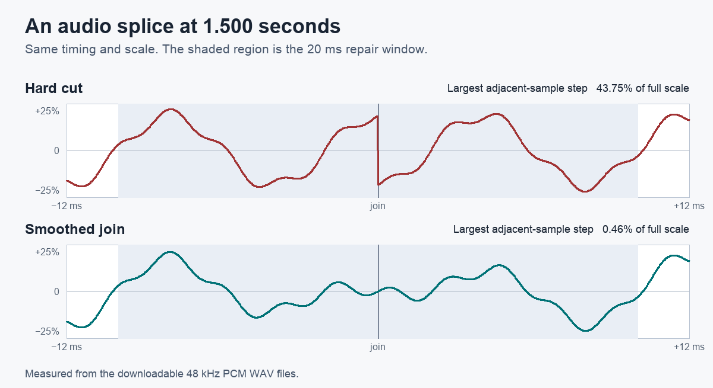

# Remove a click at a video cut without moving the edit

If you hear a click exactly where an AI editor removed a phrase, replay that join before applying noise reduction to the whole clip. Inspect the two sides of the cut. A sudden jump between adjacent waveform samples can produce a pop even when the words and picture are correct. Make the smallest local change that sounds clean and preserves the approved words.

## Compare two downloadable joins

Play the three-second files at the same volume and listen around **1.500 seconds**. Both are mono, 16-bit PCM at 48 kHz. They use synthetic tones so the splice is the only variable. The smoothed version blends two continuous signals over 20 milliseconds, with no change to the file length.

| Listen or download | Step between the two adjacent samples at the join | Largest step within the 20 ms window |
| --- | ---: | ---: |
| [Hard join](examples/audio-click-at-edit/hard-join.wav) | 14,336 PCM counts | 14,336 counts, or 43.75% of full scale |
| [Smoothed join](examples/audio-click-at-edit/smoothed-join.wav) | 57 PCM counts | 151 counts, or 0.46% of full scale |

Both WAVs contain 144,000 samples. Samples before **1.490 s** and from **1.510 s** onward are identical. The measured peak step is a waveform property, separate from perceived loudness or a pass threshold for speech. [Measurements](examples/audio-click-at-edit/measurements.json) · [Rebuild both WAVs with Python](examples/audio-click-at-edit/rebuild-audio.py)

## Choose the repair from the sound you hear

| What you hear at the cut | What to check or change |
| --- | --- |
| A single sharp tick | Look for a waveform jump at the boundary. Use a short audio fade or overlap within clean handles, then recheck. |
| Half of a word is missing | Restore the intended syllable from source and move the boundary away from speech. Recheck timing and meaning. |
| The room changes abruptly | Try matching room tone around the join or a smoother overlap on the background track. Preserve natural breaths and a deliberate pause. |
| The edit is smooth in preview but clicks in the MP4 | Verify the approved version was exported. Listen to the downloaded file and isolate the affected track before changing it. |

With independently editable audio, a near zero-crossing can help reduce an abrupt sample jump. For a crossfade, leave enough source audio on each side of the cut and listen for doubled syllables. A longer fade changes more of the performance, so judge it on your own recording. [Audacity’s cutting guide](https://www.audacityteam.org/features/cut/) · [Premiere’s audio transition guide](https://helpx.adobe.com/premiere/desktop/add-audio-effects/apply-audio-transitions/audio-crossfade-transitions.html)

## Give an editor the exact revision

> In the approved clip, listen at [edited timestamp], between “[last retained words]” and “[next retained words].” Smooth the audible tick at that join. Keep both phrases complete, preserve the approved picture cut and duration, and leave the rest of the edit alone. Send the revised MP4 and tell me what you changed at the boundary.

Compare the export with the approved cut at normal speed. Listen with the picture hidden once, then watch the transition once with sound on. If a fixed join time matters for captions, chapters, or a client review, check the MP4 and the first cue after the cut.

[Try a focused transcript cut in Valmera](https://valmera.io/tools/remove-filler-words-from-video?utm_source=valmera_mcp_docs&utm_medium=repository&utm_campaign=clean_dialogue_join), then review the actual export. The synthetic sample demonstrates the repair technique. Confirm the controls available in your editing workflow. For recurring work, [ask Valmera Enterprise to scope a video podcast pilot](https://valmera.io/podcast-video-editing-service?utm_source=valmera_mcp_docs&utm_medium=repository&utm_campaign=clean_dialogue_join). Include one problematic join, your episode and clip volume, and which words and timestamps must survive the revision.
