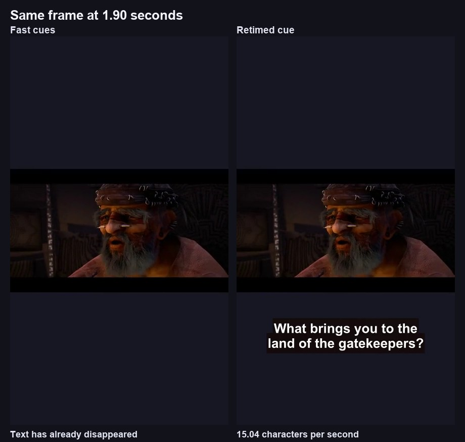

# Fix fast captions in podcast clips without changing the words

If captions flash by, first measure how many characters each cue asks viewers to read per second. Give the same approved words enough time by regrouping cues around phrases and aligning their start and end times to speech. Keep a separate subtitle file paired with the exact MP4 you approved.

## Run the buyer test on the same footage

1. Download the [uncaptioned vertical MP4](examples/caption-reading-pace/uncaptioned.mp4) and [fast SRT](examples/caption-reading-pace/fast-cues.srt). Open the SRT in the [Valmera reading-speed checker](https://valmera.io/tools/subtitle-reading-speed-checker?utm_source=valmera_mcp_docs&utm_medium=repository&utm_campaign=podcast_caption_pace). In your editor, open the SRT with the MP4 or use the cue text and times as a reference.
2. Give each tool or provider the same request. Time it from importing the approved clip to receiving a pair you would actually deliver.

   > Retain the approved cut, audio, crop and words. Regroup the existing English captions at natural phrase breaks. Aim for no more than 20 characters per second and two lines per cue for this pilot. Make sure the last words stay visible long enough and cues don't overlap. Deliver the preview and a matching SRT. Identify any cue that needs a timing or editorial decision before delivery.

3. Compare the returned files with the [retimed SRT](examples/caption-reading-pace/retimed-cues.srt) and [retimed MP4](examples/caption-reading-pace/retimed-cues.mp4). Review at **1.90 s** and **7.90 s**. Both lines of dialogue should have a readable cue at their respective checkpoint. Count rework and manual steps before you decide what to pay for.

## What changed in the files

Characters per second is the number of caption characters divided by the cue's time on screen. This test includes spaces and punctuation and treats a line break as a single space. The 20-character threshold is borrowed from Netflix's adult U.S. English timed-text specification for this test. Use the customer's specification and check readability on the actual phone layout. [Netflix's English style guide](https://partnerhelp.netflixstudios.com/hc/en-us/articles/217350977-English-USA-Timed-Text-Style-Guide) · [How Netflix counts characters](https://partnerhelp.netflixstudios.com/hc/en-us/articles/115001352212-How-is-reading-speed-measured-Do-punctuation-and-spaces-count)

| Measurement | Fast version | Retimed version |
| --- | --- | --- |
| Cue count | 4 | 2 |
| Highest reading speed | 36.47 characters/s | 15.04 characters/s |
| First phrase ends | 1.50 s | 3.125 s |
| Second phrase ends | 7.675 s | 8.375 s |
| Approved words and punctuation | Identical after normalizing whitespace | Identical after normalizing whitespace |
| Decoded audio | SHA-256 matches the uncaptioned MP4 | SHA-256 matches the uncaptioned MP4 |

Play the [fast MP4](examples/caption-reading-pace/fast-cues.mp4) and the retimed one at normal speed. Compare the two SRT files after removing cue numbers and timestamps. Check the intended punctuation, overlaps, line wraps and final tail. A passing reading-speed check still needs playback review.

## Choose the delivery route

For direct SRT work, [Subtitle AI documents cue splitting, merging and reading-speed checks](https://docs.subtitle.ai/docs/features). Confirm its counting convention against your specification. In [Premiere Pro](https://helpx.adobe.com/my_en/premiere/desktop/render-and-export/export-files/overview-of-export-settings.html#captions), use the caption track and verify that the SRT sidecar comes from the delivered timeline.

For prompt-driven editing on supplied footage, [preview a Valmera caption revision](CAPTION-STYLE-EXAMPLE.md) and [try the editor on your clip](https://valmera.io/ai-video-editor?utm_source=valmera_mcp_docs&utm_medium=repository&utm_campaign=podcast_caption_pace). Valmera Studio burns captions into its export. When you need a separate SRT too, plan and check that handoff as its own deliverable. For recurring shows, [send Valmera Enterprise your episode volume and MP4/SRT requirements](https://valmera.io/podcast-video-editing-service?utm_source=valmera_mcp_docs&utm_medium=repository&utm_campaign=podcast_caption_pace). Include the deadline and who approves caption changes.

The download test uses an excerpt of an animated film. Valmera prepared the cue files and rendered the comparison with FFmpeg. The measured difference comes from those supplied cues. [Measurements and audio hashes](examples/caption-reading-pace/measurements.json)

© copyright Blender Foundation | [durian.blender.org](https://durian.blender.org/). Excerpt from the [Sintel trailer](https://download.blender.org/durian/trailer/sintel_trailer-1080p.mp4), licensed under [CC BY 3.0](https://creativecommons.org/licenses/by/3.0/). The excerpt starts at source second 11.9 and runs for about 9.6 seconds. We fitted the picture to a vertical canvas, transcoded the clip and burned captions into two derivatives. Blender Foundation does not endorse Valmera.
