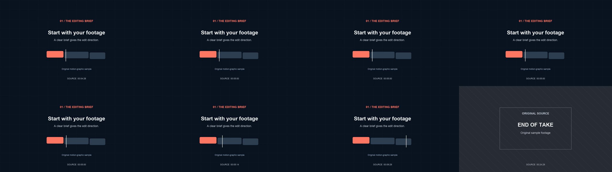

# Add a freeze frame online: a downloadable before-and-after

A freeze-frame preview is useful, but the downloaded video is the deliverable. Here is one recorded run through [Valmera's free browser freeze-frame tool](https://valmera.io/tools/freeze-frame?utm_source=valmera_mcp_docs&utm_medium=repository&utm_campaign=freeze_example), with the original source, unmodified export and checks you can inspect.

**Published by Valmera; run recorded November 7, 2026.** This example uses manual browser controls. It does not test Valmera's AI editing, Studio or MCP, and it is not an independent benchmark.

## Download the actual files

- [Original source MP4](evaluation/recorded-run-20261107/original-source.mp4): a 25-second, silent motion-graphic sample, 1280×720 at 30 fps. Its on-screen source counter makes timing changes visible.
- [Browser-exported WebM](evaluation/freeze-browser-20261107/export.webm): the downloaded output, unchanged after export.
- [Measurements and review record](evaluation/freeze-browser-20261107/evidence.json), [source metadata](evaluation/freeze-browser-20261107/source-metadata.json), [export metadata](evaluation/freeze-browser-20261107/export-metadata.json) and [file hashes](evaluation/freeze-browser-20261107/SHA256SUMS.txt).

On GitHub, use the file's download control if the media preview is unavailable. Download the WebM and open it in a player that supports VP9.

## The edit

1. Open the free tool and choose the source MP4.
2. Set **Freeze at** to **5.00 seconds** and **Hold for** to **2.5 seconds**.
3. Set darkening to **0%** and leave the optional text empty.
4. Export the freeze-frame video, then download the result.

The page predicted a 27.50-second output: 25 seconds of source plus a 2.5-second inserted hold. The browser supplied a WebM download. Its UI reported a decoded duration of 27.47 seconds and explicitly said the export had no audio.

The source has no audio track, so that message is **not evidence of lost sound or of working audio preservation**. Test a recording with sound separately before relying on the tool for speech or music.

## What the downloaded file shows

The file decoded successfully from beginning to end: **825 frames, 1280×720, VP9 video, no audio stream**. At its reported 30 fps, 825 frames correspond to 27.5 seconds. The WebM did not include a container-level duration field; the browser's decoded duration and the decoder's final timestamp are more useful observations here.

The sheet below contains eight sampled output frames, ordered left to right, then top to bottom. Their zero-based output frame indices are **149, 150, 180, 224, 225, 240, 374 and 824**.

| Output frame index | Counter visible in the source picture |
| --- | --- |
| 149 | `00:04:28` |
| 150, 180, 224 and 225 | `00:05:00` |
| 240 | `00:05:14` |
| 374 | `00:09:29` |
| 824 | `00:24:29` |

The source counter uses minutes, seconds and frames at 30 fps; `00:05:14` means second 5 plus 14 frames. The selected images show the same source moment during the hold, later motion resuming, and the original ending. The wording and end card visible in these images belong to the source sample.

This is **sampled visual inspection plus a complete decode**, not continuous human playback or an exact comparison of every source and output frame. Real-time browser recording can duplicate or skip source frames. A nominal frame rate and correct total length alone do not establish frame-exact timing.

## Repeat the check on your own clip

Choose a moment with visible motion or a clearly changing counter. Inspect immediately before the hold, during it and after it. Check that the selected picture stays still and that the intended source resumes afterward. Then watch the complete downloaded file, including the ending.

For speech, decide whether the original audio should pause with the picture or continue underneath it. Listen across both boundaries. Check the browser's export message and the actual file instead of assuming that a silent preview or an audio track proves the right behavior.

For a title card, choose a sharp frame and keep added text clear of the detail viewers need to see. Review at the destination size. If the picture is blurry, selecting a better source moment is more useful than expecting the freeze to recover detail that was never recorded.

This run does not establish performance on other browsers, long recordings, audio, every supported file type or repeated exports. It provides one inspectable output and a way to evaluate your own.

## From a manual hold to a larger AI edit

Use the [free local tool](https://valmera.io/tools/freeze-frame?utm_source=valmera_mcp_docs&utm_medium=repository&utm_campaign=freeze_example) when you already know the frame. Its **Continue with these settings** action carries the selected settings into an editing brief; it does not transfer the local video automatically.

For an AI-directed edit, upload the original to Studio and describe the moment, duration, sound and what should remain unchanged. Review the result before exporting. Account creation and uploads are free; AI editing requires an eligible subscription. See the [current plans](https://valmera.io/subscribe) and [creator workflow briefs](CREATOR-WORKFLOWS.md).
