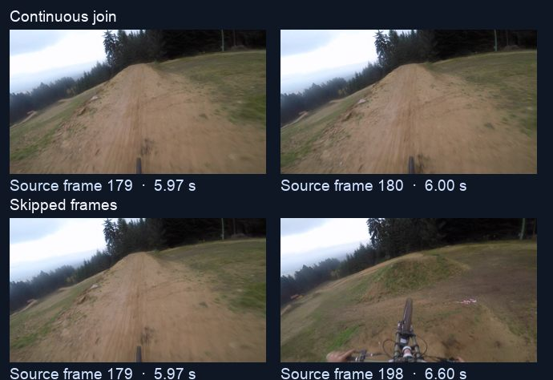

# Make a GoPro highlight reel without skipping action between chapter files

Keep the original chapter files from each camera recording together. Confirm their order by recording and chapter number. Then put the two consecutive chapter files end to end in an editor, or make one continuous master before uploading it. Mark any moment that crosses a file boundary before asking for highlights. Review the finished MP4 at the join, because the total duration can be correct even when it drops part of the action. [GoPro file naming and chapter numbers](https://community.gopro.com/s/article/GoPro-Camera-File-Naming-Convention?language=en_US) · [GoPro chaptering guide](https://community.gopro.com/s/article/GoPro-Camera-File-Chaptering-Information?language=en_US)

## Watch two eight-second cuts from the same ride

We used real downhill footage by Cabblers and treated the six-second point as a sample camera-file boundary. Both previews use a 30 fps copy of the recording and have the same 240-frame duration. In the second cut, the approach jumps forward at program time 00:04. Watch the front wheel and the mound just before it. The gap is missing media from the original sequence of frames, even though the export is a valid eight-second MP4.

| Example | Frames around program 00:04 | Result |
| --- | --- | --- |
| [Continuous MP4](examples/gopro-chapter-join/continuous.mp4) | Source frame 179 → 180 | The approach plays through in order. |
| [MP4 with skipped frames](examples/gopro-chapter-join/skipped-frames.mp4) | Source frame 179 → 198 | The next shot starts 18 frames late. The ending was shifted later to keep the total duration the same. |

These two examples were rendered locally. We checked all 240 picture-frame hashes in each lossless render before encoding the downloadable MP4s. The camera split was placed for this test. [Measurement and frame ranges](examples/gopro-chapter-join/measurements.json) · [Footage credit and CC BY-SA 4.0 license](examples/gopro-chapter-join/ATTRIBUTION.md)

## Choose the editor by what you need to control

| Editing route | When to try it | What to check before you commit |
| --- | --- | --- |
| **GoPro Quik** | You already work in GoPro’s mobile or cloud workflow and want automated highlights from captured media. GoPro documents its Auto Highlight Videos feature for subscribers. | Check whether your specific recording and capture mode are eligible, then confirm the suggested highlight includes the entire marked action. [Quik Auto Highlight Videos](https://community.gopro.com/s/article/GoPro-Quik-Auto-Highlight-Videos?language=en_US) |
| **RawClip** | You want a service designed to select highlights from action-camera footage. RawClip’s GoPro guide asks you to keep and upload all chapters. | Use the same source range for both trials. Ask how you can revise one specific selection and verify the returned video at the join. [RawClip GoPro workflow](https://rawclip.online/guides/how-to-make-a-highlight-video-from-gopro-footage) |
| **DaVinci Resolve** | You want direct timeline control over where the camera chapters meet, and someone is available to edit manually. | Put two verified consecutive files together on the timeline without a transition. Open the render and step across the join, then try the targeted revision. [Blackmagic Design editing documentation](https://www.blackmagicdesign.com/products/davinciresolve/edit) |
| **Valmera** | You have a continuous master and want an AI editor to follow a highlight brief, show a preview and take a focused revision in chat. Hosted AI editing requires a paid plan. | Confirm that the uploaded master already contains each required frame. Ask the editor to keep the marked crossing and check it in the final MP4. The recorded Valmera revision separately shows how an instruction shortened one shot and preserved the others. [Valmera recorded revision](MCP-RECORDED-EDIT.md) |

## Run a 60-second pilot from your own footage

1. **Choose two consecutive chapters from one continuous camera recording.** Make a copy and retain the original filenames. Check the last seconds of the first file and the opening seconds of the second. Leave out thumbnails and low-resolution proxies.
2. **Make a master if the editor expects one file.** Place the chapters in order with no transition at the file join. Check picture and audio there. If your export uses a different frame rate, write down the program timestamp from that master and count its frames on that clock.
3. **Specify one must-keep crossing and one permitted change.** Use the ranges from your actual master. Give reviewers a timestamp from each side so they know what continuity to watch for.
4. **Compare two exported files.** A good pilot lets the reviewer check that the opening and crossing survived and that only the requested later shot changed. Listen through the join at normal speed, then step through it frame by frame. Record editor time and revision turnaround for the paid workflow decision.

> Make a 60-second landscape highlight reel from this continuous master. Include the full approach, turn and exit around the marked chapter boundary. Keep that source range intact at normal speed with its original sound. Leave it unchanged when I ask to shorten the later pause. Show me the rendered preview and include the program time of the boundary in the review note.

[Open a highlight-reel brief in Valmera](https://valmera.io/tools/highlight-reel?utm_source=valmera_mcp_docs&utm_medium=repository&utm_campaign=gopro_chapter_highlights). If you need recurring reels edited for a team, include camera count, weekly recording volume, target length and review deadline. [Scope a recurring highlight edit with Valmera Enterprise](https://valmera.io/subscribe?inquiry=highlight-reel&utm_source=valmera_mcp_docs&utm_medium=repository&utm_campaign=gopro_chapter_highlights#enterprise)
