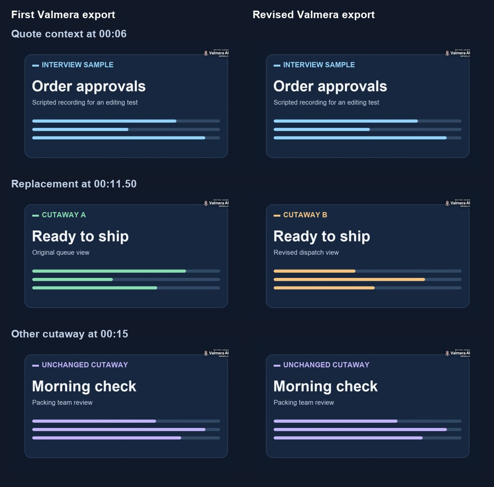

# Edit an interview highlight reel without losing the sentence that qualifies the quote

When a reviewer asks to replace B-roll in an approved interview reel, export the revision and check that the original words still play. For a testimonial, the adjacent sentence can be the difference between a result for one workflow and a claim about every customer.

This test starts with a 25-second scripted interview. The speaker says, “We cut the time it took to approve an order in half.” The next two sentences limit the result to repeat orders and explain that first-time orders still needed a second review. The recording uses synthetic speech and illustrated slides. It contains no customer statements.

| Open a file | What to check |
| --- | --- |
| [Download the source recording, three cutaway images and transcript timings](examples/interview-quote-swap/inputs.zip?raw=1) | The claim and qualifier are spoken back to back. The opening retake and closing outtake can both be removed. |
| [Play the first full Valmera MP4](examples/interview-quote-swap/first.mp4?raw=1) | At 00:10 the queue view appears. At 00:14 the next, separate cutaway begins. |
| [Play the revised full Valmera MP4](examples/interview-quote-swap/revised.mp4?raw=1) | At 00:10 the dispatch view replaces the queue view. Listen through the claim and qualifier and check the cutaway at 00:14. |

## What changed in the actual exports

The test used Valmera’s hosted editor through its MCP connector. The client specified the keep range and the two cutaways. The revision replaced one overlay in place. Valmera rendered both versions to full MP4s.

| Check | Measured result |
| --- | --- |
| Claim and qualifier survive the export | The waveform for the complete qualifier matched the source with correlation **0.999994** after decoding and aligning the audio. The claim scored **0.999985**. |
| The cutaway revision preserves the speech | The decoded mono audio samples across the entire 18-second story were **identical** between the two exports at 16 kHz. |
| Only the requested window shows a visible change | The replacement occupied all **90 frames** from 00:10 inclusive to 00:13 exclusive at 30 fps. Mean absolute channel difference was at least **4.66** per frame during that window and at most **0.24** in the rest of the story, on a 0–255 scale. |
| The rest of the delivery remains in place | Both files had 690 frames, including the five-second end card. The second cutaway still begins at 00:14. |

[Download the measurements and media checksums](examples/interview-quote-swap/measurements.json). The fixture tests a specified visual revision and the resulting MP4s. A longer interview also tests whether the editor can find and keep the right passage from a brief.

## Use the same two-step test before paying

1. Choose an interview with one approved result and at least one sentence that limits when it applies. Upload the same source and cutaway files to each editor. Ask it to make one reel, keeping both passages in the speaker’s original words. Save the first MP4.
2. Ask for a visual-only revision with a named file, a start and end, and the other cutaway left in place. Download the revised MP4. Record any manual repair time, including time spent restoring a sentence or replacing the wrong shot.

> Replace the queue cutaway with the dispatch image from 00:10 to 00:13 in the current reel. Keep the audio, the two sentences after the result, and the cutaway at 00:14. Export a second MP4 so I can compare it with the first.

If you want to edit the sentences directly, [Descript’s highlight workflow](https://www.descript.com/tools/highlight-video-maker) is an option to test. If the review happens in chat, [prepare a highlight reel in Valmera](https://valmera.io/tools/highlight-reel?utm_source=github.com&utm_medium=referral&utm_campaign=interview_qualifier_swap). Hosted AI editing requires an eligible subscription. For a recurring batch, [discuss an Enterprise interview-editing pilot](https://valmera.io/subscribe?inquiry=testimonial-video-editing-service&utm_source=github.com&utm_medium=referral&utm_campaign=interview_qualifier_swap#enterprise) and include the monthly interview count and approval process.

The source uses the [Piper LJSpeech voice](https://huggingface.co/rhasspy/piper-voices/blob/main/en/en_US/ljspeech/medium/MODEL_CARD). The words and illustrations were created for this test.
