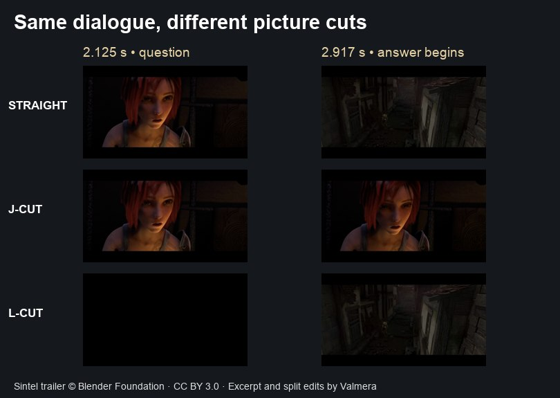

# J-cut or L-cut? Hear the difference on one line of dialogue

Play the straight cut first. A character asks what brings the visitor to the land of the gatekeepers. Listen for the answer, “I'm searching for someone.” Now play the J-cut. The answer starts in exactly the same place, but the close-up stays on screen a little longer. In the L-cut, the picture leaves the close-up while you can still hear the end of the question.

Each MP4 runs **5.75 seconds**. The dialogue track is identical across the three files. These are FFmpeg reference edits made from a licensed film excerpt for comparing editors. For an edit produced through Valmera, [watch the product cutaway and hear the uninterrupted narration](https://valmera.io/examples/b-roll-cutaway).

| Play or download the MP4 | When the sound changes takes | When the picture changes takes | Where to look |
| --- | --- | --- | --- |
| [Straight cut](https://raw.githubusercontent.com/ABO3SKRALMASAOODI/valmera-mcp/main/docs/evaluation/interview-split-edits/straight.mp4) | 2.625 s | 2.625 s | Sound and picture leave the first take together. |
| [J-cut](https://raw.githubusercontent.com/ABO3SKRALMASAOODI/valmera-mcp/main/docs/evaluation/interview-split-edits/j-cut.mp4) | 2.625 s | 3.250 s | At 2.917 s the answer has started and the close-up is still on screen. |
| [L-cut](https://raw.githubusercontent.com/ABO3SKRALMASAOODI/valmera-mcp/main/docs/evaluation/interview-split-edits/l-cut.mp4) | 2.625 s | 2.000 s | At 2.125 s the question continues over the incoming shot’s dark opening frames. |



## Ask an AI video editor for the transition

Use an interview where you have permission to edit both speakers. Choose a question and an answer that make sense together. Listen through the join with the picture hidden and decide how long a pause belongs between them. With that dialogue approved, give the editor one visual revision.

> Keep the approved dialogue and overall length. As the guest starts answering, hold the interviewer’s reaction for another 15 frames at 24 fps. Then reveal the guest at the moment that matches their voice. Keep the rest of the edit in place. Export the revised MP4 so I can compare both versions.

For the opposite effect, ask to show the listener 15 frames before the current speaker finishes. Fifteen frames is 0.625 seconds at 24 fps and 0.5 seconds at 30 fps. Pick the duration that fits the expression. Check the original before making the request: the reaction needs to exist for that long.

In these files, the **audio edit** is at 2.625 seconds and the **answer’s first words** begin around 2.8 seconds. Those markers describe different events. When the exact first word matters, give the editor the word as well as the time. For an independent description of the timeline technique, see [Adobe’s split-edit guide](https://helpx.adobe.com/premiere/desktop/edit-projects/trim-clips/perform-j-cuts-and-l-cuts.html).

## Check the exported file

1. **Listen before looking.** Play both versions from the question through the answer. A missing syllable or a repeated breath changes the dialogue even when the picture looks right.
2. **Pause inside the overlap.** At 2.917 s the J-cut should show the close-up. At the same instant the straight cut shows a wide view. At 2.125 s the L-cut is already dark. The fade belongs to the incoming source footage.
3. **Check again after the reveal.** When a speaking face is visible, check a clear lip closure against its sound. Moving a whole audio clip can create the expected lead at the join while leaving the rest of the interview out of sync.
4. **Check the last frame and media duration.** At 24 fps these examples have 138 picture frames. All three end at the same source position. AI editing of your footage in Valmera requires an eligible plan. [Start a recorded-footage edit in Studio](https://valmera.io/studio?utm_source=valmera_mcp_docs&utm_medium=repository&utm_campaign=interview_split_edit) or [connect a compatible assistant](https://valmera.io/mcp/setup).

## Rebuild the reference

Download the [9.6-second source MP4](https://valmera.io/examples/sintel-dialogo/original.mp4) and [build script](evaluation/interview-split-edits/rebuild.py). With Python 3 and FFmpeg on your path, run the following in the download folder.

```sh
python3 rebuild.py original.mp4 ./cuts
```

The source and outputs run at 24 fps. The audio uses source frames 0–62 followed by 153–227 (inclusive), with exactly 2,000 audio samples per frame per channel. After the picture splice the source clock advances by 90 frames. Moving only that splice creates the two 15-frame overlaps.

We compared every exported picture frame to its expected source frame at 96 × 54 grayscale resolution, and checked seven 100-ms audio windows against the source. The three exported audio streams decoded to identical PCM samples. The [measurement file](evaluation/interview-split-edits/measurements.json) includes file hashes and the results. To compare the decoded audio yourself, run this for each MP4:

```sh
ffmpeg -v error -i cuts/j-cut.mp4 -map 0:a:0 -c:a pcm_s16le -f hash -hash sha256 -
```

*Sintel* trailer © Blender Foundation, [CC BY 3.0](https://creativecommons.org/licenses/by/3.0/). Valmera trimmed and resized [the original trailer](https://download.blender.org/durian/trailer/sintel_trailer-1080p.mp4), rearranged the excerpt and extracted the comparison frames. Keep the credit and licence with redistributed files.
