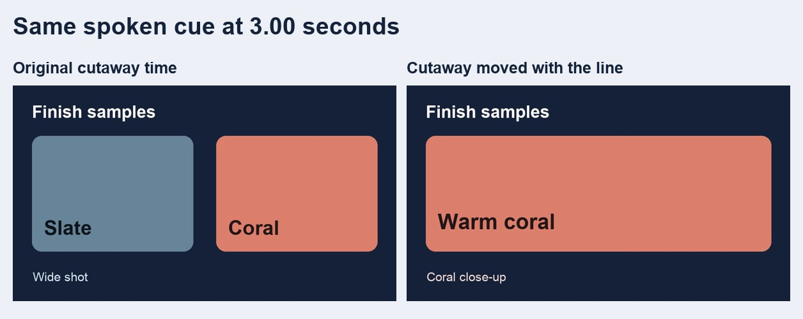

# Keep B-roll on the right words after removing pauses

When you close a pause before a spoken cue, the cue moves earlier by the amount you removed. Move the cutaway with it, or anchor the cutaway to the words in the revised timeline. If the deleted range overlaps the cutaway, review its start and end separately. The original timecode can be right for the source and wrong for the export.

## Hear what happens when the picture keeps its old timestamp

In the original, the close-up starts at **4.20 seconds**, just before “The coral swatch has the warmer finish.” Both shorter versions remove the same **1.50 seconds** from the pause before that sentence. In the stale version the close-up still starts at **4.20**. In the corrected version it starts at **2.70** and lasts for the same 56 frames.

| Play with sound | Duration | Close-up starts | What happens |
| --- | ---: | ---: | --- |
| [Original pause](examples/b-roll-after-pause-cut/full-pause.mp4) | 7.60 s | 4.20 s | The coral close-up arrives with the coral line. |
| [Pause removed, cutaway left behind](examples/b-roll-after-pause-cut/stale-cutaway.mp4) | 6.10 s | 4.20 s | The wide shot stays on screen when you first hear “coral.” |
| [Pause removed, cutaway moved with the line](examples/b-roll-after-pause-cut/synced-cutaway.mp4) | 6.10 s | 2.70 s | The close-up is on screen for the whole coral line. |

This controlled example uses synthetic narration, color cards and FFmpeg. We checked every decoded frame at 30 fps. The two shorter exports have identical decoded audio. At **frame 90** (3.00 seconds), the same narration plays over two different pictures. [Decoded frame boundaries and audio hashes](examples/b-roll-after-pause-cut/measurements.json)

## Tell the editor what should move with the words

> Remove the dead air between these two sentences while leaving a brief natural pause. In the revised timeline, show `coral-close-up.mp4` just before I say “The coral swatch has the warmer finish.” Hold it through “finish” and mute the shot’s own audio. Leave the wide shot on screen for the slate sentence. Show me the new cutaway start and the exported MP4.

For several pause cuts, add up the time removed before each cue. A shot at 12.40 seconds moves to 10.65 after two earlier cuts of 0.75 and 1.00 seconds. If the cut touches the shot’s range, locate the surviving words in the revised timeline and place a new in and out point there. Where there are captions, check that the caption, narration and picture still agree. Adobe documents text-based ripple edits and choosing the tracks that move with a change. [Premiere transcript editing](https://helpx.adobe.com/uk/premiere/desktop/edit-projects/edit-video-using-text-based-editing/edit-sequences-using-text-based-editing.html) · [Premiere Sync Lock](https://helpx.adobe.com/premiere/desktop/edit-projects/change-clip-sequence/sync-lock-to-prevent-changes.html)

To compare editors, bring a short recording with two distinct lines, a clean pause and one approved cutaway. Remove the pause after placing the shot once. Play the downloaded second export with sound, then step through the first and last picture frames. Record whether the cutaway stayed on the right sentence and how long the repair took. Use the same source and brief across tools.

[Try the edit with your own footage](https://valmera.io/tools/add-b-roll?utm_source=valmera_mcp_docs&utm_medium=repository&utm_campaign=b_roll_after_pause_cut). For weekly product videos, send one reference edit, the volume and your approval deadline. [Scope recurring editing with Valmera Enterprise](https://valmera.io/product-demo-video-editing-service?utm_source=valmera_mcp_docs&utm_medium=repository&utm_campaign=b_roll_after_pause_cut#scope)
