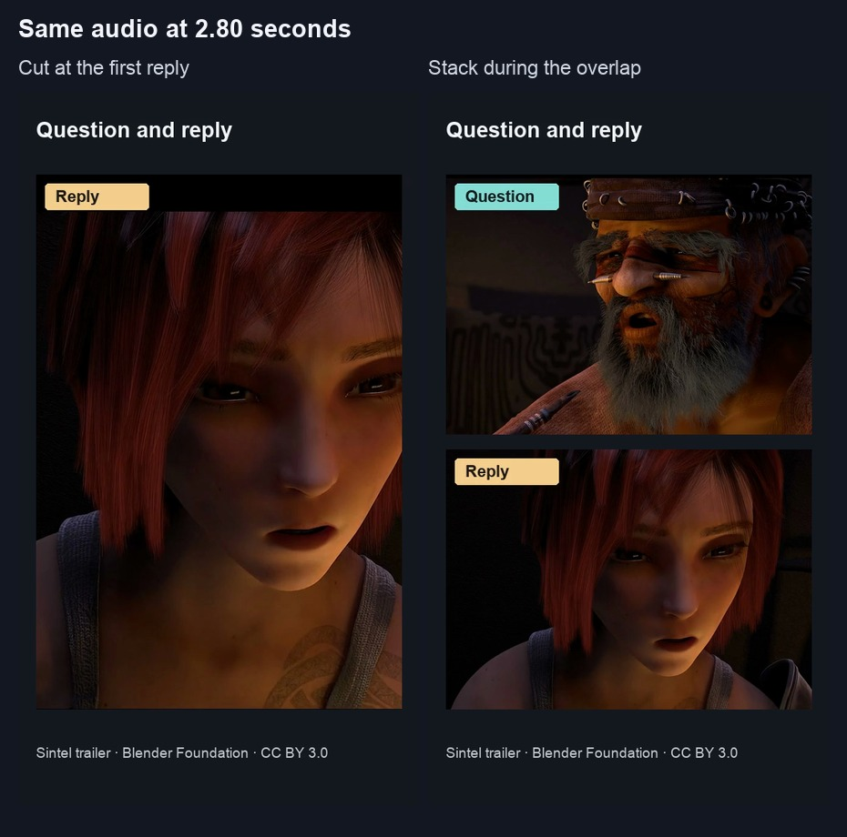

# Keep both speakers visible when a vertical podcast clip overlaps

An editor that follows the active speaker can switch to the reply while the first person is still talking. Keep both faces visible during an interruption when the viewer needs to see who said what or catch the reaction. Return to a single portrait once the reply has the floor.

## Compare two downloadable 9:16 edits

The two exports use the same five-second audio edit. We mixed two dialogue excerpts from the Blender Foundation's *Sintel* trailer to create a **0.65-second overlap**, then used stills from the same trailer to illustrate two camera layouts. Both MP4s are 540 × 960 at 30 fps.

| Output time | [Single-speaker cut](examples/two-speaker-portrait/single-speaker.mp4) | [Stack only during the overlap](examples/two-speaker-portrait/stacked-on-overlap.mp4) |
| --- | --- | --- |
| 2.40 s | Question visible | Question visible |
| 2.80 s | Reply visible. Both source excerpts are still in the mix. | Both visible, with the question above the reply. |
| 3.30 s | Reply visible | Reply visible again |

The speech excerpts overlap from **2.50 to 3.15 seconds**. The stacked view stays through **3.20 seconds**, holding for another 50 milliseconds after the source overlap before returning to the reply. We checked layout markers in the decoded frames at the three times above. Both audio tracks produce the same decoded PCM SHA-256. The sample demonstrates framing and timing using held images. It does not measure lip sync or automatic speaker detection. [Full measurements](examples/two-speaker-portrait/measurements.json)

## Choose the layout by what the audience needs to see

- **One wide camera.** Check that both heads survive the portrait crop. If the crop can only fit one person, make a separate panel from each side of the frame. Check each face at normal phone size.
- **Two camera recordings.** Align them against the same audio timeline before using a stack. Use the approved mix for both layouts and listen for doubled speech or a mic switching when the frame changes.
- **A reaction matters.** Give the listener's face time to register. A brief stack or held two-shot shows the exchange. Rapid automatic switches can obscure it.
- **The overlap makes the words hard to hear.** Address the sound on its own tracks. A second visible face cannot recover masked speech. [Riverside’s crosstalk walkthrough](https://riverside.com/university-videos/fix-crosstalk-in-your-podcast-edit)

CastKit describes selecting a stacked layout for one scene or the whole clip. SocialClip Studio describes a vertical layout that stacks both speakers. Valmera's podcast guide describes following individual speaker turns or keeping the full two-shot. Check the controls for a brief, bounded switch on a pilot before choosing a workflow. [CastKit framing](https://castkit.ai/tools/split-screen-video-maker) · [SocialClip Studio split-screen](https://socialclipstudio.com/split-screen-podcast-clips.html) · [Valmera podcast editing](https://valmera.io/use-cases/podcasters)

## Use this brief in a paid pilot

> Make a 9:16 cut from the approved interview. Use the single-speaker view before [edited time]. Show both people from [overlap start] through [overlap end], then return to the guest. Keep the dialogue mix, word timings and total duration in place. Show the overlap in a preview and send the final MP4 for review. Call out any layout the source cannot support.

Play the same export with sound and muted. Check the questioner's last word, who is visible when the reply starts, and whether any captions cover faces. If you compare vendors for a weekly show, measure how long it takes to revise one overlap and get the approved file back. [Try a highlight cut on your footage in Valmera](https://valmera.io/tools/highlight-reel?utm_source=valmera_mcp_docs&utm_medium=repository&utm_campaign=two_speaker_portrait) · [Scope a recurring video podcast pilot with Valmera Enterprise](https://valmera.io/podcast-video-editing-service?utm_source=valmera_mcp_docs&utm_medium=repository&utm_campaign=two_speaker_portrait)

© copyright Blender Foundation | [durian.blender.org](https://durian.blender.org/). Images and audio are excerpts of the [original Sintel trailer](https://download.blender.org/durian/trailer/sintel_trailer-1080p.mp4) under [CC BY 3.0](https://creativecommons.org/licenses/by/3.0/). Modifications include still extraction, cropping, new layouts and a mixed excerpt that overlaps the dialogue. Blender Foundation does not endorse Valmera.
