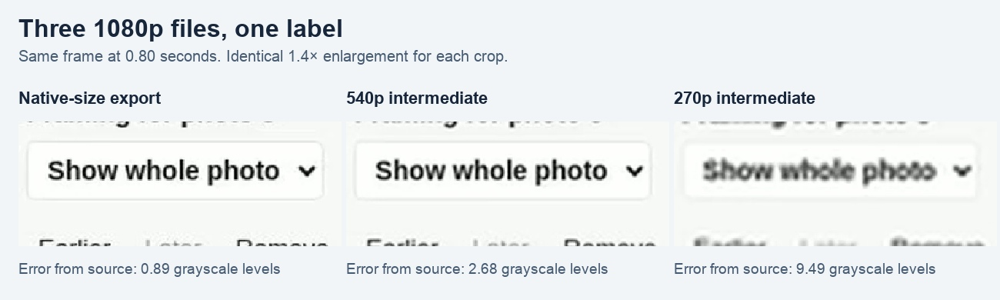

# Why screen-recording text gets blurry in a 1080p export

A 1080p file has 1,080 rows of pixels. Its dimensions don't tell you how much detail those pixels contain. Start with the original recording and the downloaded MP4. Pause both on the same label or menu, then compare them at the same size. If both files look sharp and the embedded video looks soft, check the stream quality and the size of the embedded player before changing the edit.

## Play three 1080p exports of the same screen

All three files show the same 5.6 seconds of a Valmera website walkthrough and open at 1920 × 1080. Pause at **0.80 seconds** and find the **Show whole photo** dropdown on the right. The last file looks soft even though its properties still say 1080p.

| Download and play | Image size before the final encode | Average difference from the source crop |
| --- | --- | ---: |
| [Native-size export](examples/screen-export-text/original-size.mp4) | 1920 × 1080 throughout | 0.89 |
| [Export after resizing to 540p](examples/screen-export-text/from-540p.mp4) | 960 × 540, then back to 1920 × 1080 | 2.68 |
| [Export after resizing to 270p](examples/screen-export-text/from-270p.mp4) | 480 × 270, then back to 1920 × 1080 | 9.49 |

The files use the same source range, 30 fps, H.264 and CRF 21. The two resize paths used Lanczos with no intermediate encode. The measurement is the mean absolute difference in 8-bit grayscale values between each decoded export and the same 300 × 116 pixel region in the original. It describes this frame and crop. [Source recording](examples/website-photo-reorder/reorder.mp4) · [Measurements and SHA-256 hashes](examples/screen-export-text/measurements.json) · [Walkthrough and sample image credits](WEBSITE-DEMO.md)

## Find the first place the text goes soft

1. **The original capture is already soft.** Recapture the affected passage with larger app or browser text, or record a tighter region that will fit at the intended player size. Pause on the smallest label your viewer needs to read.
2. **The source is sharp and the downloaded edit is soft.** Check which media the editor used for final rendering. Reconnect the full-resolution source if the timeline points to a smaller copy. Check project dimensions and look for an unnecessary downscale followed by an upscale. A lower-quality editing preview is common and can speed up playback while you work. [TechSmith’s troubleshooting guide for blurry exports](https://support.techsmith.com/hc/en-us/articles/203729528-Produced-Videos-are-Blurry-or-Low-Quality-Using-Camtasia-Editor-on-Windows)
3. **The downloaded edit is sharp and the hosted player is soft.** Wait for the host to finish processing, select its highest available quality and test the actual embed at its published width. If the text is clear full-screen and unreadable in the embed, give that step a tighter framing and verify the new file in the embed again.

## Give the editor one frame to match

> Use the original-resolution screen recording for the final render. Keep the approved cuts and timing. At [export timestamp], hold long enough to read [exact UI label] and see [result after the click]. Deliver the 1080p MP4 and a still from that point so I can compare them to the original. I’ll check the published player at its actual size.

For a walkthrough of a public site, start with its URL. For a signed-in product, capture a demo account and upload the recording. For weekly releases or several product walkthroughs, include your volume and one representative recording when you contact the editing team. [Record a website demo](https://valmera.io/tools/record-website-demo?utm_source=valmera_mcp_docs&utm_medium=repository&utm_campaign=sharp_screen_export#start-demo) · [Recurring product-demo editing](https://valmera.io/product-demo-video-editing-service?utm_source=valmera_mcp_docs&utm_medium=repository&utm_campaign=sharp_screen_export#scope)
