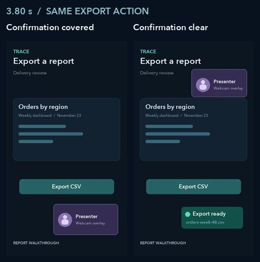

# Keep a webcam overlay from hiding a result in a screen recording

Watch the action and what happens after it. The Export button can stay visible while a webcam tile covers the confirmation that the export worked. With separate camera and screen tracks, move the camera layer out of the control, menu and result areas. Reopen the exported MP4 and check that the result survives at the intended playback size.

## Compare the same six-second software demo

All three MP4s use a mock product screen and the same synthetic narration. The click occurs at 2.00 seconds. The confirmation appears at 3.40 seconds and stays through the frame at 5.37 seconds. In the covered version, a viewer can see which button to click and hear the narration but has no visual confirmation that the file is ready.

| Video | Export button | Visible confirmation |
| --- | --- | --- |
| [Screen and narration](examples/product-demo-webcam-overlay/01-screen-recording.mp4) | Visible | 60 frames |
| [Webcam in front of the result](examples/product-demo-webcam-overlay/02-webcam-covers-result.mp4) | Visible | 0 frames |
| [Webcam moved away from the result](examples/product-demo-webcam-overlay/03-webcam-clear-of-result.mp4) | Visible | 60 frames |

The clips run at 30 fps. The [measurements](examples/product-demo-webcam-overlay/measurements.json) show where the confirmation indicator was detected in the decoded frames. The decoded audio matches across all three files. The example is a controlled layout test, rendered separately from Valmera.

## Fix it with the files you have

1. Play from before the click until the result disappears. Mark the button, any menu or dialog that opens, and the confirmation. The result may appear away from the cursor after the click.
2. With a separate camera layer, move it to an open part of the frame for the whole action. If there's no open region, use a side-by-side layout or hide the camera for that step. In Premiere, use Motion position and scale. In Descript, use the layer's Size & Position controls. [Premiere Motion](https://helpx.adobe.com/be_en/premiere/desktop/add-video-effects/commonly-used-effects/apply-motion-effect.html) · [Descript layer properties](https://help.descript.com/visuals/layer-properties)
3. If the camera tile is already baked into the only MP4, record a clean repeat of that action, starting in the same UI state, or use a matching clean screen take. Check the selected account, data and options before you splice the retake. [Check screen-demo retake continuity](REMOVE-SCREEN-DEMO-RETAKES-WITHOUT-BREAKING-STEPS.md)
4. Watch all the way to the result in the delivered file. Check the portrait version separately from the landscape version. Make sure the button's label, the confirmation and any filename viewers need are readable at the expected playback size.

If you're choosing a screen recorder, test it with one click that opens a distant message. Recorded documents corner, side-by-side and hidden camera settings. Clarcut documents a cursor-aware webcam and scene layout changes. Check the result area in the finished video because the cursor may never pass over it. [Recorded webcam layouts](https://recorded.app/en/docs/editing/webcam-overlay/) · [Clarcut webcam overlay](https://clarcut.com/en/features/webcam-overlay)

## Brief the AI editor on the visible result

Keep the screen recording as the main picture during the action. Use a presenter or product cutaway before the action as context, or after the confirmation has been read. If a presenter tile must remain on screen, lay it out over the clean screen recording first and verify the composite before asking an AI editor for content cuts.

> Use the presenter clip over the introduction. Show the clean screen from just before I click Export CSV until “Export ready” and the filename have been on screen for two seconds. Keep the original narration underneath and show me the preview through the confirmation.

[Plan a cutaway against your own source in Valmera](https://valmera.io/tools/add-b-roll?utm_source=github.com&utm_medium=referral&utm_campaign=webcam_overlay_confirmation). The cue planner is free. AI editing in Studio requires a subscription.

For a recurring batch of demos, share one clean take, its presenter clip, your desktop and portrait deliverables, and the release cadence. [Discuss a product-demo editing pilot with Valmera Enterprise](https://valmera.io/subscribe?inquiry=product-demo-video-editing-service&utm_source=github.com&utm_medium=referral&utm_campaign=webcam_overlay_confirmation#enterprise).
