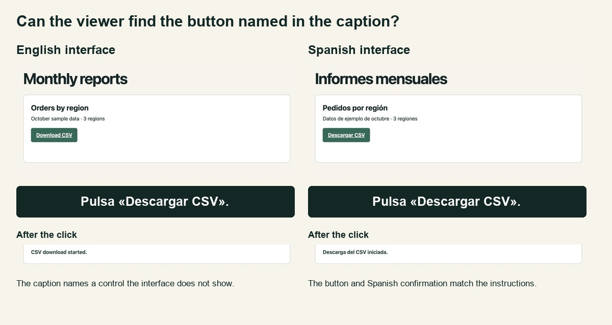

# Localize a software demo so Spanish captions match the screen

A caption that says **Descargar CSV** will confuse a viewer who sees only **Download CSV**. Record the workflow in the interface your audience will use, then match the instructions to the text they can see. Check the software outcome as well as the caption.

## Compare the same Spanish captions over two interfaces

Both 7.5-second clips have identical Spanish caption text and timing. The first shows the English interface. The second shows the actual Spanish interface. Both come from browser captures of a fictional reporting app. We assembled stills from before and after the clicks into silent MP4s.

| Download | Control visible at 1.00 s | Screen after the click at 4.00 s |
| --- | --- | --- |
| [English UI with Spanish captions](examples/localized-demo-labels/english-ui-spanish-captions.mp4) | **Download CSV**. The caption names **Descargar CSV**. | **CSV download started.** |
| [Spanish UI with matching captions](examples/localized-demo-labels/spanish-ui-spanish-captions.mp4) | **Descargar CSV**. The button matches the caption. | **Descarga del CSV iniciada.** |
| [Shared Spanish SRT](examples/localized-demo-labels/shared-spanish.srt) | Same two cues in both exports. | Pair it with the intended picture version. |

We clicked both controls in a browser. Both requests successfully served the same three-row CSV. The confirmation says the download **started**. Check that the file arrived and opens before calling the step complete. [Sample CSV](examples/localized-demo-labels/sample-report.csv) · [Checks and SHA-256](examples/localized-demo-labels/verification.json)

To repeat the test, put the [sample app](examples/localized-demo-labels/sample-app.html) and CSV in one folder and serve them locally. Open the English and Spanish versions using the language links. Click each download and inspect the file. In your own product, locale may change headers, delimiters or date formats. Check the values and structure against the approved output for each locale.

## Choose what to translate and what to record again

- **The product ships a Spanish interface.** Capture that interface. Use the exact button, menu and status labels shown in the build, including any terms that remain in English.
- **The product ships the same English interface everywhere.** Keep those visuals. Write Spanish instructions that quote the visible control, for example, *Pulsa «Download CSV» para descargar el archivo*. Use the actual English confirmation when telling users what to look for.
- **You only have an old MP4.** Translate narration and annotations while you arrange an updated capture. A translated graphic over a button can make text readable. Verify every affected step on the real product before using it as a training reference.

Braiv documents re-recording a walkthrough against a localized interface. Clueso documents translating the language layer and recapturing when the product interface is localized. Descript documents separate SRT and VTT subtitle exports. Check that your chosen route produces the localized picture and the required files on a pilot. [Braiv Capture](https://www.braiv.co/products/braiv-capture) · [Clueso workflow](https://www.clueso.io/blog/how-to-translate-a-video) · [Descript subtitle export](https://help.descript.com/hc/en-us/articles/10255811669773-Exporting-subtitles)

## Brief one pilot before outsourcing the batch

> On the approved Spanish software build, record [workflow] using the supplied test account and sample data. At each action, show the exact control and its result. Keep the localized labels consistent across the voiceover, callouts and captions. Deliver a review MP4 and matching SRT if requested. For each critical step, list the timestamp, visible label and result. Let us know which source steps need a new capture when the build changes.

If you maintain 12 walkthroughs across three locales, budget review for **36 picture versions** and up to 36 subtitle files. Start with one workflow in two locales. Give your reviewer both downloads and ask them to follow the instructions in the app, then time one correction from requested change through accepted re-export. Track who approves the copy, who signs off on the workflow, and which files should ship together.

[Record a public workflow with Valmera](https://valmera.io/tools/record-website-demo?utm_source=valmera_mcp_docs&utm_medium=repository&utm_campaign=localized_demo_handoff#start-demo). If you need ongoing done-for-you production, [send Valmera Enterprise your monthly walkthrough count, target locales and release calendar](https://valmera.io/product-demo-video-editing-service?utm_source=valmera_mcp_docs&utm_medium=repository&utm_campaign=localized_demo_handoff#scope). Confirm who supplies the localized capture and who verifies translated wording before the first delivery.
