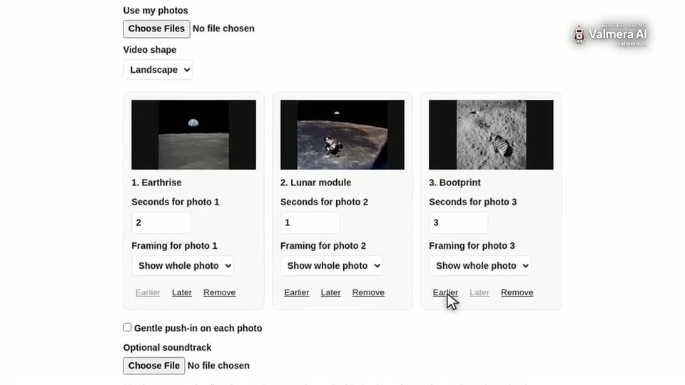

# Make a muted product demo loop for your website

Pick one action that proves what the product does. Show the starting state, the click and the changed result. Export a short, silent MP4 and save a poster frame that makes sense on its own. Give visitors a way to pause or play it, and test the actual embed before publishing.

## Download a real before-and-after example

The [full source recording](examples/website-photo-reorder/reorder.mp4) shows Valmera's public slideshow builder. The cursor moves to **Earlier** on the third photo. **Lunar module** moves from position 3 to 2 with its one-second duration, and **Bootprint** moves to 3 with its three-second duration. That visible change is what the short edit needs to keep. [Original recording and action timestamps](WEBSITE-DEMO.md)

| Download | What it shows | Size |
| --- | --- | ---: |
| [Full recording](examples/website-photo-reorder/reorder.mp4) | 14.40 seconds at 1920 × 1080, with setup, action and final view | 2,385,527 bytes |
| [Silent MP4 loop](examples/website-demo-loop/product-demo-loop.mp4) | 5.60 seconds at 960 × 540, starting at source second 3.20 | 693,753 bytes |
| [Result poster](examples/website-demo-loop/product-demo-poster.jpg) | Frame at loop second 4.80 with the new order and durations visible | 44,210 bytes |
| [Example HTML player](examples/website-demo-loop/player.html) | Muted inline playback, native controls, and a poster for reduced-motion visitors | — |

The MP4 and poster together use **69.1% fewer bytes** than the original MP4. That combines a shorter selection, smaller dimensions, re-encoding and removal of the audio track. Total page load also depends on the page, media hosting, network and browser. The loop begins with Bootprint in second place and ends with Lunar module in second place. The restart is a deliberate reset to the original view. [Measured file properties](examples/website-demo-loop/measurements.json)

## Use the same acceptance test with each editor

> Make a muted homepage demo from the supplied recording. Show [starting state], [exact action] and [visible result] in that order. Hold the result long enough to read [label or number]. Export an H.264 MP4 with no audio stream and a separate poster from the result. Keep a normal-speed hold after the click. Send the exact source range, poster timestamp and both file sizes.

For a public website, [record the action from a URL in Valmera](https://valmera.io/tools/record-website-demo?utm_source=valmera_mcp_docs&utm_medium=repository&utm_campaign=website_demo_loop#start-demo). For an existing recording, give the editor the source range and the evidence to retain. Evaluate any vendor on the actual MP4 and poster. Prepare the poster separately if the editor delivers only the video. For a release calendar with repeated variants, [ask Valmera Enterprise about recurring demo edits](https://valmera.io/product-demo-video-editing-service?utm_source=valmera_mcp_docs&utm_medium=repository&utm_campaign=website_demo_loop#scope). Include versions per release and the reviewer who signs off on UI changes.

## Verify the deployed player

1. Save the MP4, JPEG and HTML player in one directory and serve them through your local dev server. The player starts muted when reduced motion is off. With reduced motion enabled it leaves a static poster and a manual play control. Test both settings and pause the loop using keyboard controls.
2. On a phone at normal size, ask a reviewer to identify which item changed and what value stayed attached to it. Play through two loops and check that the reset reads as replay. Keep the nearby text explaining the result available even when playback is blocked.
3. On the real page, test on your audience's browsers and a slow connection with cache cleared. Check that the poster is visible before play when autoplay is disabled. Measure the actual requests and when the result becomes visible. In the supplied MP4, initialization metadata precedes media data and there is no audio stream. [Web video performance](https://web.dev/learn/performance/video-performance) · [WebKit inline video policy](https://webkit.org/blog/6784/new-video-policies-for-ios/) · [W3C guidance on pausing motion](https://www.w3.org/WAI/WCAG22/Understanding/pause-stop-hide.html)

The short variant and poster were prepared with FFmpeg from a recorded Valmera capture. The sample slideshow photos are courtesy of NASA.
