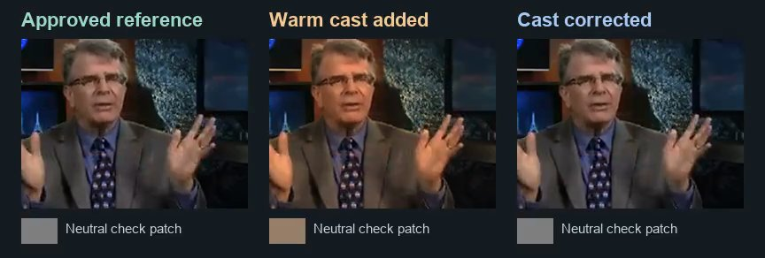

# Match color and lighting across a weekly batch of training videos

Give the editor one approved reference still for each repeatable camera and lighting setup. Ask for a pilot with the same presenter on a good recording and the hardest usable recording. Approve the two files side by side. Then test whether the editor can fix one color issue on the second file while keeping the lesson content, slide timing and captions intact.

This is a buying test for teams that record their own lessons on phones and webcams and need a consistent look across weekly deliveries.

## Watch a warm cast and its correction

[Play the 4.2-second comparison](examples/training-video-color-match/color-match-review.mp4). All three panels show the same timed excerpt. The middle panel adds a simulated warm cast. The last panel applies the inverse adjustment. A synthetic neutral patch below each picture goes through the same transformation. This reference example was assembled locally from openly available footage. Use actual camera recordings for a vendor trial.

| Check on the decoded MP4 | Reference | Warm cast | Corrected |
| --- | --- | --- | --- |
| Median neutral patch, 8-bit RGB | 126, 126, 126 | 150, 126, 104 | 126, 126, 126 |
| Mean absolute RGB difference from the reference across the picture region | 0 | 7.56 | 2.21 |

The picture region excludes labels and patches. The figures apply to this controlled transform and encode. A gray patch checks neutrality in that part of the image. Review faces, highlights and shadows independently, especially under mixed light. [Measurement details and file hashes](examples/training-video-color-match/measurements.json)

## What to hand off with your first batch

| Send | Ask the editor to check |
| --- | --- |
| One approved master and a timecode with the presenter clearly lit | Separate the approved look from the framing, slide graphics and caption treatment. Confirm which parts of the look should carry across takes. |
| Original recordings grouped by presenter, camera and lighting setup | Interpret the source color space before matching. Start with exposure and white balance per setup, then apply the approved series look where it fits. |
| A few seconds of a neutral reference under each lighting setup, if available | Check the reference and the presenter together. For mixed light, ask which area needs a separate correction. |
| A bright clip and a difficult clip with a side-by-side change during the lesson | Review the transition in motion. Ask the editor to flag lost highlight or shadow detail and insufficient focus before you contract for the full batch. |

## Compare the work you keep and the work you outsource

If the team already edits in Premiere, test Comparison View and Color Match against the approved frame. Watch the cuts and check exposure after applying the match. [Adobe color matching guide](https://helpx.adobe.com/uk/premiere/desktop/correct-color/add-color-effects/match-color-between-shots.html)

For a staffed editing workflow, ask how many approved lessons the provider can deliver each week with the same reference and reviewer. Mark Studios describes building one visual template and processing lessons in five-video batches. Valmera Enterprise describes editing supplied training recordings into lesson deliverables. Ask each provider how corrections affect the delivery date and which formats are included in the quote. [Mark Studios course editing](https://www.markstudios.com/services/video-editing/course-video-editing) · [Valmera training video editing](https://valmera.io/training-video-editing-service?utm_source=valmera_mcp_docs&utm_medium=repository&utm_campaign=training_batch_color_match)

> Match the two recordings to the approved still. Keep the presenter’s skin tones natural and retain detail in the brightest slide and darkest part of the face. Return one MP4 per lesson and the agreed caption files. In the second review, adjust only the webcam shot from [in] to [out] and leave the approved wording, picture timing and captions in place.

Review both exports on the screen learners use. Record the time to deliver two approved files, including the correction, before you commit to the monthly volume. [Scope a recurring training-video pilot on the Enterprise contact page](https://valmera.io/subscribe?inquiry=training-video-editing-service&utm_source=valmera_mcp_docs&utm_medium=repository&utm_campaign=training_batch_color_match#enterprise). Include lessons per month, available footage, the reference look and your first batch deadline.

Original excerpt: Jim Garvin, [OSIRIS-REx interviews and footage](https://svs.gsfc.nasa.gov/12713/), NASA’s Goddard Space Flight Center. The demonstration crops the excerpt, omits audio and applies the labeled color adjustments.
