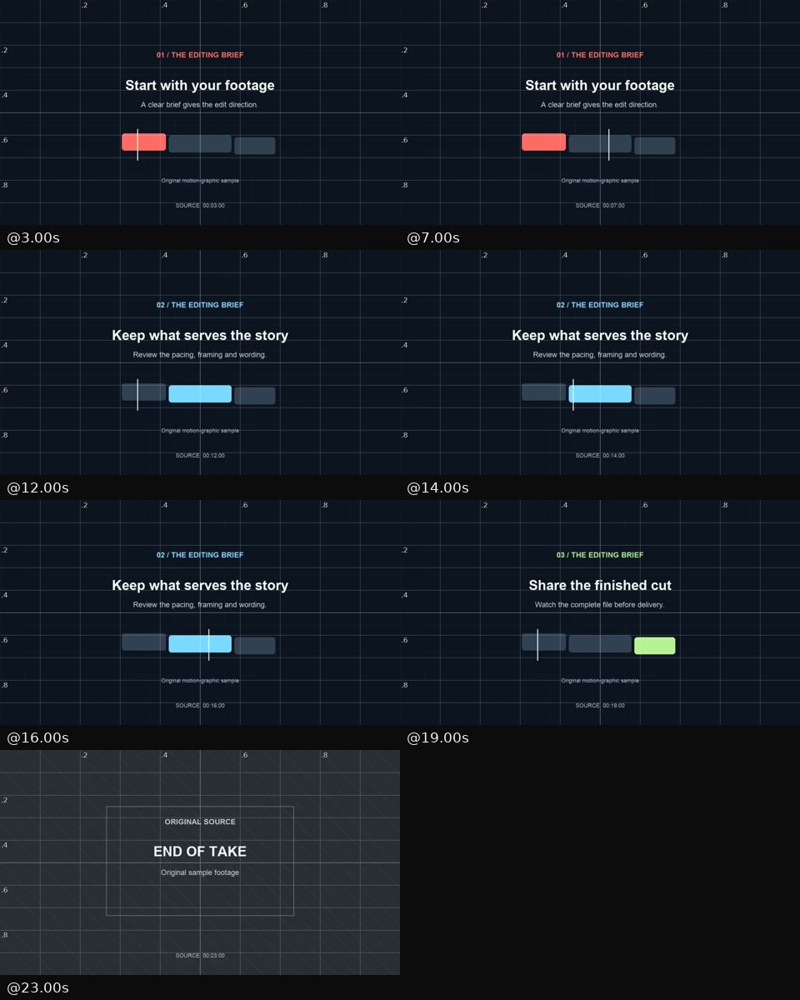
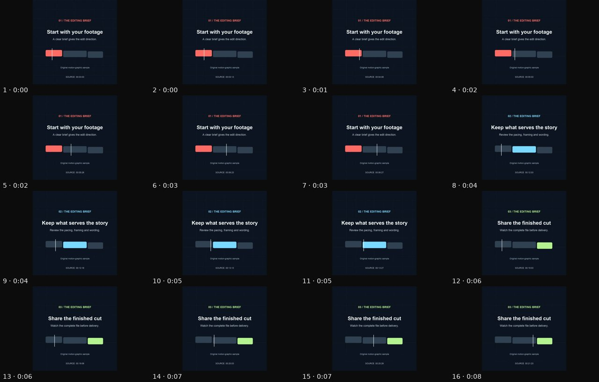
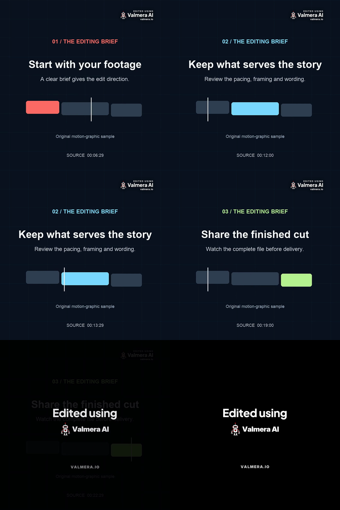

# A recorded MCP video edit: source, revision and downloadable result

On November 7, 2026, we ran Valmera's public edit-and-revise exercise through its MCP connector in a fresh project. It produced a 12-second square preview, accepted a request to shorten only the middle section, and exported the revised 10-second program. The downloaded MP4 lasts 15 seconds because this run includes a five-second branded end card.

**Published by Valmera.** This is one recorded run on our silent motion-graphic sample, not an independent comparison or a test of speech editing. The animation and wording already exist in the source. The connector performed the cuts, framing, revision, preview rendering and final export; we did not recreate the delivered video with a local editor.

[Source MP4](evaluation/recorded-run-20261107/original-source.mp4) · [First preview, 12 seconds](evaluation/recorded-run-20261107/first-preview.mp4) · [Revised final MP4, 15 seconds including branding](evaluation/recorded-run-20261107/revised-final.mp4) · [Evidence JSON](evaluation/recorded-run-20261107/evidence.json) · [Repeat the evaluation](EDITOR-EVALUATION.md)

## What the run establishes

| Stage | Observed result | Evidence |
| --- | --- | --- |
| Upload | Original 25-second, 1280 × 720, 30 fps silent sample analyzed successfully | Source file, hash and analysis result |
| First edit | Source 3–7, 12–16 and 19–23 seconds retained; centered square crop | EDL v3, preview frames and downloaded 12-second / 360-frame preview |
| Revision | Source 14–16 seconds removed from the existing edit | EDL v4 retains 3–7, 12–14 and 19–23; 10-second revised preview |
| Delivery | Final EDL v4 MP4 downloaded successfully | Export receipt and matching SHA-256 |
| Final dimensions | 1080 × 1080 at 30 fps; 450 video frames over 15 seconds | `ffprobe` on the downloaded file |
| Sound | AAC track containing decoded digital silence | FFmpeg `astats`: minimum and maximum sample level both zero |
| Branding | Corner mark, branded ending over the final program frame, five-second end card | Frames extracted from the exact final MP4 |

The final file's 1080-pixel dimensions exceed the 720-pixel source height. That is output scaling, not evidence of additional source detail. The preview was 720 × 720.

## 1. Use a source other people can inspect

The [public example](https://valmera.io/examples/trim-and-reframe) supplies this clip. We downloaded it, checked its SHA-256, created a new project and uploaded it using `upload_start` and `upload_finish`. Editing began after `index_status` returned `done`.

The source has three centered headings, animated bars and a source timecode, with no speech or audio track. Its timecode distinguishes a correct selection from a video that merely has the expected length.



This is a basic editing check. Use a representative interview, tutorial or moving subject to evaluate speech recognition, captions, meaning preservation and tracking.

## 2. Make the first cut and inspect its preview

We used the [evaluation kit's first brief](EDITOR-EVALUATION.md#2-submit-the-same-first-edit): keep source seconds 3–7, 12–16 and 19–23 in order, use a centered square crop, preserve normal speed and add no creative material.

After reading the initial EDL and source frames, the assistant called:

```json
{"tool":"keep_segments","arguments":{"project_id":5532,"segments":[[3,7],[12,16],[19,23]],"snap_to_words":false}}
{"tool":"set_frame","arguments":{"project_id":5532,"ratio":"1:1","mode":"crop","focus_x":0.5,"focus_y":0.5}}
{"tool":"render_preview","arguments":{"project_id":5532,"complete":true,"quality":"approval","report":true}}
```

These are recorded arguments, **not a project ID to reuse**. Create your own project and copy its returned ID into every call. These ranges belong to this sample; do not transfer them to another recording. Each line represents a separate call.

The result was EDL v3 and a 12-second preview. We inspected its source-timecoded frames, including both joins, and retained the original preview file for comparison.

## 3. Revise one section without replacing the edit

The follow-up was specific: keep source 12–14 instead of 12–16 in the middle section, leaving source 3–7 and 19–23, framing and speed unchanged. We used a local source-time cut:

```json
{"tool":"cut_range","arguments":{"project_id":5532,"start":14,"end":16,"snap_to_words":false}}
```

The EDL changed from v3 to v4. Reading it back showed these ranges and the same centered square framing:

| Retained source in revised edit | First preview location | Revised program location |
| --- | --- | --- |
| 3–7 seconds | 0–4 seconds | 0–4 seconds |
| 12–14 seconds | 4–6 seconds, followed by source 14–16 | 4–6 seconds |
| 19–23 seconds | 8–12 seconds | 6–10 seconds |

The second complete preview was 10 seconds. Its sampled frames still showed the headings in the required order. The last section moved two seconds earlier in program time; its source selection did not change.



## 4. Check the downloaded export

We called `export_final` with project 5532 and EDL version 4. It returned job 137424, not a finished file. After `wait_for_job` reported `done`, `download_url` returned the final MP4. Its locally calculated SHA-256 matched the export receipt.

The output contains 300 frames of program and 150 frames of appended branding at 30 fps. Branding also blends over the last program frame; the delivery is not ten seconds of completely unobstructed footage. These are observations of this account and run, not promises about every plan's branding rules.

The image below comes from the **downloaded final MP4**, not the preview. Read each row left to right:

| Row | Left frame | Right frame | Check |
| --- | --- | --- | --- |
| 1 | Program frame 119, source `00:06:29` | Program frame 120, source `00:12:00` | First join at output 4 seconds |
| 2 | Program frame 179, source `00:13:29` | Program frame 180, source `00:19:00` | Revised join at output 6 seconds |
| 3 | Program frame 299, source `00:22:29` under branding | Frame 300, branded card | Program ends at 10 seconds; delivery continues |

Source labels use seconds and frames at 30 fps: `00:13:29` is the last source frame before 14 seconds, not 13.29 decimal seconds. Frame numbers above are zero-based.



Inspect the downloaded file yourself:

```sh
ffprobe -v error -count_frames \
  -show_entries stream=codec_name,codec_type,width,height,r_frame_rate,nb_read_frames,duration \
  -show_entries format=duration,size -of json revised-final.mp4

ffmpeg -i revised-final.mp4 -map 0:a \
  -af astats=metadata=0:reset=0 -vn -f null -

shasum -a 256 original-source.mp4 first-preview.mp4 revised-final.mp4
```

Audio statistics establish silence in this output. They do not test speech, music or audio preservation on other inputs.

## What remains untested

Codex called the connected tools in this run. Claude, ChatGPT, Gemini or Grok may make different decisions with the same tools. We did not test competitors, score creative quality, measure per-edit charges, benchmark latency or establish reliability across repeated runs. The existing account's subscription tier and per-call charges were not independently established; no plan purchase or upgrade was made for this run.

Visual review covered sampled frames and the exact final-file boundaries above. We did not complete a continuous, human-equivalent playback review of every frame in an independent player. The evaluation kit's full-playback criterion remains untested; the files are provided for that review.

The preview emitted generic advisories about a speaker jump and shot-specific crop evidence. This synthetic source has no speaker. We did not treat those messages as proof of a visual defect or convert them into a quality pass. The centered crop and hard joins were intentional; the rendered headings remained visible in the inspected frames.

## Repeat it with your footage

[Connect Valmera to your assistant](https://valmera.io/mcp/setup?utm_source=valmera_mcp_docs&utm_medium=repository&utm_campaign=recorded_mcp_edit), create your own project and use the [same evaluation brief](EDITOR-EVALUATION.md). Then repeat with the recording you need to deliver. Check [current editing and account requirements](https://valmera.io/subscribe) before committing to a workflow.

Keep the first preview, request one precise revision, export the reviewed version and inspect the downloaded file. A useful comparison preserves failed attempts, unexpected branding and manual work alongside successful results.
