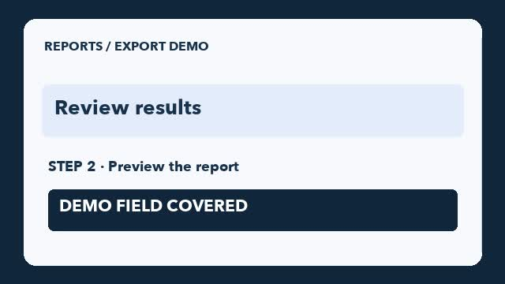

# Turn a recorded customer onboarding call into a short product demo

If you already recorded the walkthrough, start with the passage where the product does the work. Set out to deliver one 60–90 second MP4 that a new viewer can understand without the call. Keep the action and its confirmation, replace or remove call-specific speech, and export captions that belong to the release cut.

## Choose a workflow for the recording you have

| Workflow | When to try it | What to verify |
| --- | --- | --- |
| [Valmera](https://valmera.io/tools/record-website-demo?utm_source=github.com&utm_medium=referral&utm_campaign=onboarding_call_demo) | You have a screen recording and want to give an editing agent the passages to preserve or revise. Choose the existing-recording brief. AI editing requires an eligible subscription. | Open the actual MP4 and inspect the action, result, narration and final captions. |
| [Camtasia](https://support.techsmith.com/hc/en-us/articles/360031508171-How-to-Separate-Audio-From-Video-in-Camtasia-Editor-Video) | You want precise timeline control. TechSmith documents separating video from audio to edit independently. | Disable the old clip sound where you replace it. Watch the first complete action and replay the result at phone size. |
| [Descript](https://help.descript.com/export-and-share/subtitles.md) | Your team reviews through a transcript and needs a separate SRT or VTT delivery. | Export subtitles from the approved composition. Check the retained wording and timestamps against the same downloaded version of the MP4. |
| [Clueso](https://www.clueso.io/) | You want to start from uploaded material and make a polished product walkthrough. | Give it the same passage and test whether the edited voice, on-screen readout and pause on the result match the brief. |

Valmera published this guide. The first-party links describe each workflow. The downloadable exercise uses synthetic files and tests the output checks you can apply in any editor.

## Play the same demo with three handoffs

The six-second fixture has a filter choice, a result preview and a final confirmation. The middle interval contains a made-up account name and an audible high tone that represents a detail from the call. The tone is a measurement marker and contains no speech.

| Download | At 3 seconds | What the viewer can hear or read |
| --- | --- | --- |
| [Starting source](examples/onboarding-call-handoff/source.mp4) | The preview shows the fictional account. | A high tone plays. The [old subtitle file](examples/onboarding-call-handoff/source.srt) also contains the account name. |
| [Picture-only repair](examples/onboarding-call-handoff/picture-only.mp4) | An opaque cover hides the field. | The tone is still audible. Pairing this file with the old SRT also exposes the name. |
| [Release MP4](examples/onboarding-call-handoff/cleaned.mp4) and [release SRT](examples/onboarding-call-handoff/release.srt) | The same cover hides the field. | The affected audio interval is silent. The SRT retains the opening and confirmation cues. |

The picture-only and release versions both show **Export ready** at **4.000 seconds**, frame 120 at 30 fps. We decoded the audio from **2.25 to 3.75 seconds**. Its RMS amplitude was **0.17264** relative to full scale with only the visual cover, and **0** in the release file. Both kept the ending audio. The [measurements and MP4 hashes](examples/onboarding-call-handoff/measurements.json) identify these exact files.

## Apply the test to one real recording before committing

1. **Map the action and confirmation.** Write down the source time of the control changing and the first frame that proves the result. Start the final video where a new viewer can follow it.
2. **Review picture, sound and text separately.** List the affected frames, words and caption cues. If a screencast and customer audio share one track, test replacing just the required audio before changing the entire edit. Supply approved narration if you need it.
3. **Deliver a release pair.** Export a new MP4 and, if requested, its matching SRT. Have a teammate open those exact two files rather than relying on the preview. Listen once, read with sound off, and check the confirmation frame again after a crop or trim.

> From the approved walkthrough, make one standalone 60–90 second product demo. Keep the screen action and the visible confirmation. Omit the customer-specific picture, speech and captions at the marked times. Use the supplied wording for any replacement narration. Return the reviewed MP4 and its matching SRT if your route supports a separate file.

[Start an existing-recording brief in Valmera](https://valmera.io/tools/record-website-demo?utm_source=github.com&utm_medium=referral&utm_campaign=onboarding_call_demo#demo-briefs) or [ask Valmera Enterprise to scope a recurring product-demo pilot](https://valmera.io/subscribe?inquiry=product-demo-video-editing-service&utm_source=github.com&utm_medium=referral&utm_campaign=onboarding_call_demo#enterprise). For the pilot, include monthly recording volume, the usual delivery formats and who reviews the release.
