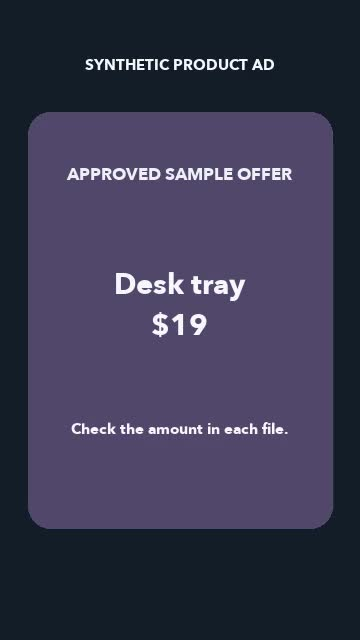

# Outsource paid-social video edits and test two hooks from the same footage

If your team wants to compare two openings, give the editor one approved product demonstration, offer and call to action for both versions. Get the final MP4s back and check the material after the join. A price, caption or ending can change during revision even when the two files have the same runtime.

[TikTok's split-test guidance](https://ads.tiktok.com/resources/help/article/split-testing-variables?lang=en) includes the opening hook as part of the creative asset variable. If the question is whether one opening works better, review like-for-like exports for the same placement, with the body held fixed. This example checks the files. It does not measure campaign performance.

## Compare editors on a scoped delivery

| Service | What it describes | Ask before booking |
| --- | --- | --- |
| [85thAgency](https://www.85thagency.com/ad-creative-video-editing/) | Edits supplied footage for direct-response creative, with hook and aspect-ratio variants. | Ask for a hook-only revision and require the file list for all three placements. |
| [Mark Studios](https://www.markstudios.com/services/video-editing/monthly-editing-plans) | Recurring editing from footage you send, with a schedule and a shared style sheet. | Specify which aspect ratios and alternate hooks count separately within your monthly scope. |
| [Cut Pro Media](https://cutpromedia.com/online-video-ads-editing/) | Edits online video ads for different placements. | Confirm that the same offer and body carry through both hooks within each placement. |
| [The Digitix](https://thedigitix.com/) | Describes multiple hooks and formats from one concept, including editing supplied footage. | If you want to use only your footage, include that in the quote and ask the editor to identify the source shots used. |
| [Valmera Enterprise](https://valmera.io/paid-social-video-editing-service?utm_source=github.com&utm_medium=referral&utm_campaign=paid_social_hook_file_test) | Recurring paid-social editing from existing recordings, with a tool for counting distinct cuts and delivery files. | [Send one scoped brief](https://valmera.io/subscribe?inquiry=paid-social-video-editing-service&masters=4&openings=1&placements=vertical-feed-square&utm_source=github.com&utm_medium=referral&utm_campaign=paid_social_hook_file_test#enterprise) and ask for the review order and final-file schedule. |

Valmera publishes this guide. Provider descriptions come from their own pages. Request the same pilot from the editors you shortlist.

## Play the take with the hidden difference

These are six-second portrait teaching files with fictional offers. All three use the same demonstration and closing shot. There is no audio. Hook A and hook B change only the opening before second 2. A third export accidentally alters the offer from second 4 up to second 5.

| Download | Opening | What happens after second 2 |
| --- | --- | --- |
| [Hook A](examples/paid-social-hook-test/hook-a.mp4) | A question-led opening | The approved body and offer. |
| [Hook B](examples/paid-social-hook-test/hook-b.mp4) | An action-led opening | The same 100 decoded frames through the end. |
| [Hook B with a changed offer](examples/paid-social-hook-test/hook-b-changed-offer.mp4) | The same action-led opening | The price differs for 25 frames even though the runtime and closing match. |

| Approved offer at 4.2 seconds | Changed offer at 4.2 seconds |
| --- | --- |
|  |  |

The [decoded-frame results and hashes](examples/paid-social-hook-test/measurements.json) identify the exact files. At 25 fps, the two good outputs match from frame 50 through frame 149. The altered offer changes frames 100–124. On a real export, compare the product proof, caption wording, price, disclosures, audible speech and end card in each requested placement. Compare like aspect ratios because cropping can change the frames.

## Quote the files and the revision separately

> Use our approved footage to make one ad body with two different openings. Keep the offer, demonstration, voice from the join onward, disclosures and closing fixed for both openings. Export each opening in 9:16, 4:5 and 1:1. After we approve the pilot, revise only the second opening and tell us which files to replace.

One master with two openings in three placements produces **two distinct cuts and six MP4s**. Four such masters per month produce **eight cuts and 24 MP4s**. Ask who confirms the file list and selects the replacement versions. Use a consistent ID for each creative and placement so the media buyer can connect the approved files to the actual ads.

[Send the 24-file scope to Valmera Enterprise](https://valmera.io/subscribe?inquiry=paid-social-video-editing-service&masters=4&openings=1&placements=vertical-feed-square&utm_source=github.com&utm_medium=referral&utm_campaign=paid_social_hook_file_test#enterprise), or [open a self-serve editing brief](https://valmera.io/ai-video-editor?utm_source=github.com&utm_medium=referral&utm_campaign=paid_social_hook_file_test). AI editing requires an eligible subscription.
