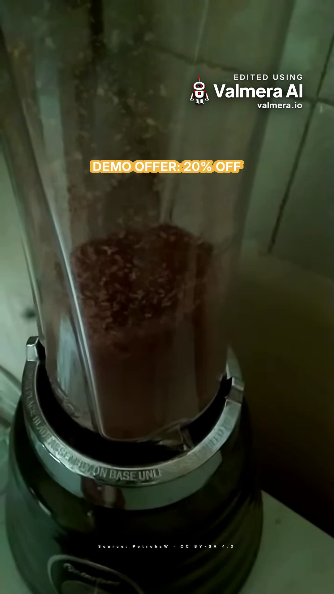
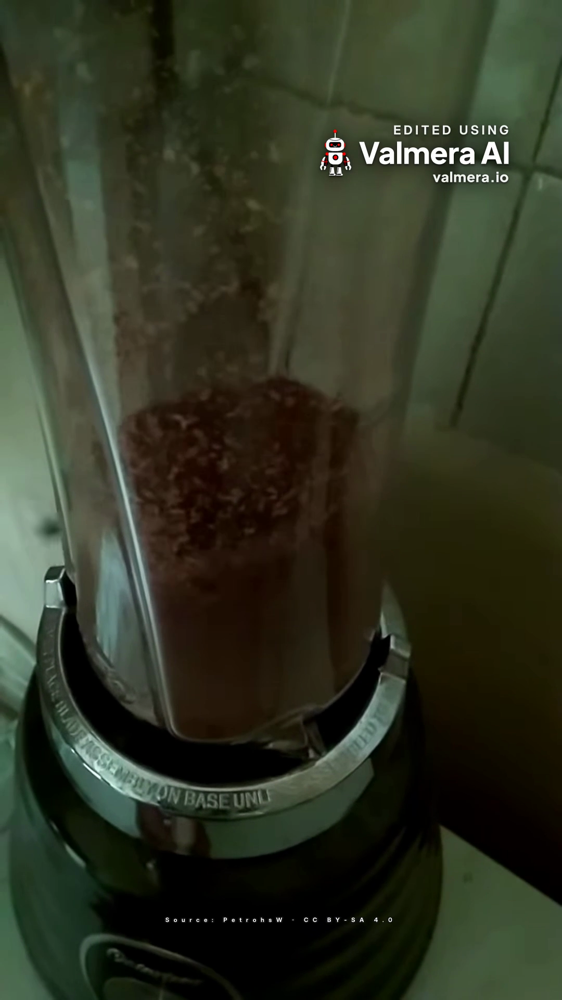

# Remove an offer from a product video: a recorded Valmera MCP example

An expired offer is easiest to revise when it remains a separate text element in the editing project. This example records an assistant adding a fictional offer to footage, rendering it, removing that identified element through Valmera, and comparing the two versions.

It uses a real, openly licensed recording of coffee being ground in a blender. It is **not** footage of the fictional manual coffee grinder in our [ecommerce planning guide](https://valmera.io/use-cases/ecommerce), a customer endorsement or an actual sale. The on-screen text says **“DEMO OFFER: 20% OFF.”**

## Inspect the files

The two images below are frames at output 14 seconds from downloaded final exports. They are sampled evidence, not a continuous playback review.

| Before: version 5 | After: version 6 |
| --- | --- |
|  |  |

- [Original source WebM](evaluation/product-offer-20261107/source.webm)
- [Before final MP4, 1080 × 1920](evaluation/product-offer-20261107/before-final.mp4)
- [After final MP4, 1080 × 1920](evaluation/product-offer-20261107/after-final.mp4)
- [Before preview MP4, 270 × 480](evaluation/product-offer-20261107/before-preview.mp4)
- [After preview MP4, 270 × 480](evaluation/product-offer-20261107/after-preview.mp4)
- [Exact version 5 edit record](evaluation/product-offer-20261107/edl-v5.json) and [version 6 edit record](evaluation/product-offer-20261107/edl-v6.json)
- [Measurement results](evaluation/product-offer-20261107/preview-measurements.json) and [original brief and review plan](evaluation/product-offer-20261107/brief-and-review-plan.json)

The MP4 exports include a corner brand mark and an end card. The preview files are low-resolution checks without those delivery additions. Compare the final files when approving placement and runtime.

## The request and the actual operation

The demonstration used a new account-owned project, not a customer's project. Its input was the unmodified source file. The source has audio but no detected speech transcript; no captions, voiceover or music were requested.

The brief kept the source selection, portrait framing and speed unchanged, added a persistent source credit, and placed the fictional offer at program 12–16 seconds. The first placement overlapped the export’s corner branding, so the assistant moved the offer from vertical position 0.14 to 0.28 and rendered version 5. The revision was to remove only that offer while retaining the credit and the rest of the edit.

The assistant used Valmera's public MCP tools:

1. `create_project`, `upload_start`, `upload_finish`, then `index_status` established the new source project.
2. `add_text` created the source credit (`tx1`) and the fictional offer (`tx2`).
3. After the export-layout correction, `render_preview(complete=true)` produced the version 5 preview; `export_final(edl_version=5)` produced the before export.
4. `remove_text(id="tx2")` produced version 6.
5. A second complete preview and `export_final(edl_version=6)` supplied the after evidence. Each export job finished before its exact-version download was retrieved.

Project-scoped calls used explicit project ID **5536**; job checks used the returned job IDs. The internal text IDs belong to this demonstration. Find the relevant element in your own project's current edit record; do not copy this ID into another project.

This demonstrates an external assistant using the editor tools. It is not a test of Valmera Studio's internal agent interpreting the same paragraph, and it does not establish automatic updates to published ads or store listings.

## What the comparison establishes

The version 6 edit record equals version 5 with exactly one change: text element `tx2` is removed. The retained source range remains 0–19.51 seconds. The source credit, framing field, speed, audio configuration and other edit fields are equal.

| Measurement | Before preview | After preview |
| --- | --- | --- |
| File duration | 19.498 seconds | 19.498 seconds |
| Video dimensions | 270 × 480 | 270 × 480 |
| Decoded video frames | 483 | 483 |
| Decoded audio | 48 kHz, stereo, signed 16-bit PCM | Same settings |
| Decoded audio bytes | 3,743,616 | 3,743,616 |

Both decoded preview audio streams have SHA-256 `978bb48e68a6eae5f6dc03277ce6ea9d1413433b78818a08cfd0ec106fc5240a`. This establishes that the two preview audio outputs are identical under the stated decoding settings. It does **not** establish that the rendered audio is bit-identical to the uploaded source, or that its sound has been independently reviewed.

The original source reports 19.506 seconds; the previews report 19.498 seconds. The comparison proves equal timing between these two previews, not lossless preservation of every source timestamp. No general video-quality or product-accuracy score is assigned here.

## What reached the final download

Both final exports measure **1080 × 1920, 610 frames and 24.564088 seconds**. Their decoded 48 kHz stereo signed 16-bit audio streams each contain 4,707,840 bytes and share SHA-256 `c54225c79f968ef7fdb37109de98c3c75892d22aea84e56ade27774deeb60220`. The [final measurement record](evaluation/product-offer-20261107/final-measurements.json) includes each file’s hash and byte size.

These are upscaled exports from a 720 × 1280 source, not newly captured 1080p detail. The measured final runtime is about five seconds longer than the preview. Inspection at 22 seconds shows the [Valmera end card](evaluation/product-offer-20261107/export-end-card.png); the corner mark also appears during the source footage.

The first before export placed the offer at vertical position 0.14, where it collided with the corner mark. Reviewing only the draft preview would have missed that collision. After the version 3 → 4 trial, the assistant re-added the offer at 0.28 for version 5, then removed it again for version 6. The published 14-second frames show the corrected before layout and the resulting removal, with the source credit retained.

This is a focused functional revision, not a creative-quality benchmark. Matching edit fields and audio hashes do not establish pixel-identical video: each MP4 is encoded separately. The source credit is small; open the original-size frame to inspect it.

## An export check needed a false-positive review

Valmera's picture check reported a speaker's face at the left edge during 12.2–16.2 seconds and initially refused the first version 3 export. Directly inspected frames at 12.50, 14.00 and 15.50 seconds showed a blender, coffee and the surrounding surface, with no person visible. The complete previews for the final comparison, versions 5 and 6, repeated the same finding.

The assistant used the documented `justify_verification_findings` operation with that direct visual evidence. Valmera accepted the justification separately for each immutable version. The source was not cropped to satisfy the erroneous face finding. The detector issue remains open in the engineering issue tracker; an accepted justification is a workaround, not a root fix or a general quality certification.

A separate text-overlap advisory was also checked visually: the offer appears near the top and the source credit near the bottom in the inspected preview frames.

## Apply the method to an actual offer update

For your own footage, identify the project and reviewed version, the exact offer text, and its output-time window. Preserve the product appearance and approved claims. Review the new preview, export the intended version and inspect the downloaded file. Then replace each affected published copy; another ad or a store page will not change merely because this edit changed.

A separate text element can be removed without reconstructing the underlying picture. Text already burned into an uploaded video is a different operation; this example does not test its removal.

[Open the ecommerce planning guide](https://valmera.io/use-cases/ecommerce?utm_source=valmera_mcp_docs&utm_medium=repository&utm_campaign=recorded_offer_revision) · [Connect an assistant](https://valmera.io/mcp/setup) · [Current editing plans](https://valmera.io/subscribe)

## Source credit and reuse

Source: **[MoliendoCafeEnLicuadora ohs02.webm](https://commons.wikimedia.org/wiki/File:MoliendoCafeEnLicuadora_ohs02.webm)** by **PetrohsW**, dated 25 May 2021, licensed **[CC BY-SA 4.0](https://creativecommons.org/licenses/by-sa/4.0/)**. The original file is included unchanged. The derivatives add source-credit text and, in the before version, a fictional offer; the after version removes that offer. Exports also upscale the picture and add Valmera branding and an end card. The source, derived media and extracted frames in this example are distributed under CC BY-SA 4.0. No endorsement by the creator or equipment manufacturer is implied. See the accompanying [attribution record](evaluation/product-offer-20261107/ATTRIBUTION.txt).

Recorded 7 November 2026. Maintained by Valmera.
