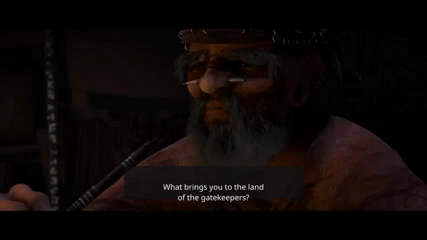
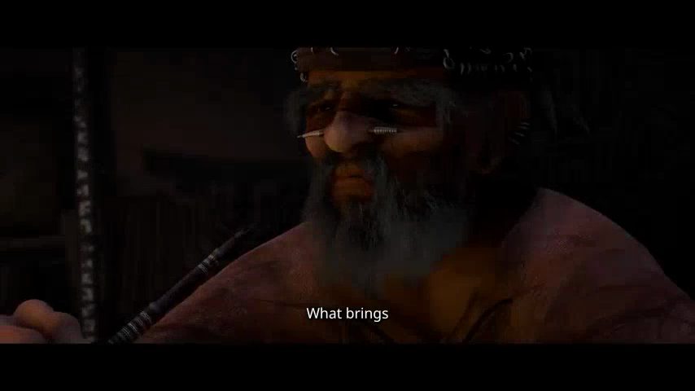

# AI video editing prompts: first edits, revisions and finished files

A useful video editing prompt identifies the recording, describes the result, names what must stay and asks for a preview you can review. Start with one of the 45 task prompts below, replace the bracketed details, then give feedback on the actual video.

These requests are for **footage you already have**. Use them in [Valmera Studio](https://valmera.io/studio?utm_source=github&utm_medium=docs&utm_campaign=editing_prompts) or with an authorized [connected assistant](CLIENTS.md). An assistant without editing tools can prepare the brief; it has not changed your video merely by describing an edit. The prompts express editorial intent, not a guarantee that every client or current tool can execute every request.

[Build a brief interactively](https://valmera.io/prompts?utm_source=github&utm_medium=docs&utm_campaign=editing_prompts#prompt-builder) · [Download the first-edit, revision and export templates](PROMPT-HANDOFF.txt) · [Inspect recorded examples](#three-requests-with-recorded-evidence)

## Choose your starting point

| Your next decision | Go directly to |
| --- | --- |
| What should the first cut accomplish? | [Talking-head cleanup](#talking-head-and-youtube-cleanup), [shorts](#shorts-reels-and-tiktoks-from-long-videos) or [screen recordings](#screen-recordings-and-product-demos) |
| How should the approved cut look and sound? | [Captions](#captions), [framing](#reframing-and-aspect-ratios), [graphics](#b-roll-overlays-and-graphics), [audio](#music-and-sound-design) or [color](#color-and-finishing) |
| How do I change just one thing? | [A complete revision request](#write-the-next-request-against-a-specific-version) and [recorded comparisons](#three-requests-with-recorded-evidence) |
| Why did a prompt produce the wrong result? | [Diagnose the missing decision](#when-the-result-is-wrong) |
| How do I finish? | [Review and delivery](#review-and-delivery) |

## A first-edit prompt you can adapt

> Use [recording name or project]. Make a [format and approximate length] video for [audience] that helps them [understand or do one thing]. Build the story around [specific moments or quoted lines]. Keep [required explanation, qualification, demonstration or ending]. Use [caption and visual treatment]; keep [audio preference]. Inspect the recording, make the edit and show me a preview. Explain any requirement you could not fulfill and identify the version I am reviewing.

For example, a **fictional brief for your own tutorial**:

> Use my uploaded spreadsheet tutorial. Make a landscape lesson for someone sorting a table for the first time. Begin with the correctly sorted result, then show selecting the full table, choosing the column and checking that the rows stayed together. Remove the failed demonstration and loading waits. Keep the warning about selecting the entire table. Use readable captions, preserve my voice and leave enough time to see each setting. Show me the preview before final export.

The editor still needs to find those moments in your recording. Do not invent timestamps to make the brief look precise. If two takes contradict each other, resolve which instruction is correct before cutting them into a single explanation.

## Write the next request against a specific version

After the first preview, the most useful prompt describes a difference:

> In [preview version], at [time on that preview], change [one thing] to [desired result]. The moment is [exact phrase or visible action]. Preserve [approved cuts, other captions, framing and sound]. Render the revised version and identify any additional change.

**Name the clock.** “At 0:06” could refer to the original recording, the current preview or an exported file with an intro. Include the filename/version and a spoken phrase when possible. If you restore footage, later captions and overlays may need to move with it; preserving their appearance does not mean freezing their old timestamps.

The [recorded cut-and-revision example](MCP-RECORDED-EDIT.md) provides a concrete map: keeping source 3–7, 12–16 and 19–23 produces a 12-second program. Shortening only the middle section to source 12–14 produces a 10-second program. The last section moves from program second 8 to second 6 even though its source content stays the same. Export end cards are separate from these program durations.

## Three requests with recorded evidence

These are reusable brief formulations for operations in recorded Valmera demonstrations. **The recordings establish the tool operations and downloaded artifacts; they do not prove that submitting these exact sentences to every assistant produces the same result.** All three are first-party examples dated 7 November 2026.

| Request to adapt | Inspect the result | What the record establishes |
| --- | --- | --- |
| “Shorten only the middle section from source 12–16 to 12–14. Keep source 3–7 and 19–23, their order, square framing and normal speed.” | [Cut and revision](MCP-RECORDED-EDIT.md) | A silent source, recorded operations, previews, final MP4 and timing checks. This does not test spoken-word editing. |
| “Change the captions to shorter groups. Preserve the selected passage, original sound, framing and speed.” | [Caption-style revision](CAPTION-STYLE-EXAMPLE.md) | Two 9.6-second previews of the same dialogue passage, with identical decoded audio between previews. The branded final export is longer. |
| “Remove only the separate text reading ‘DEMO OFFER: 20% OFF’ at program 12–16 seconds. Retain the source credit and the rest of the approved edit.” | [Offer removal](PRODUCT-OFFER-REMOVAL-EXAMPLE.md) | One identified text element removed between versions 5 and 6, with matching other edit fields and matching decoded final-file audio. Includes an export-check workaround. |

Inspect the same moment in the caption previews:

| First treatment | Revised treatment |
| --- | --- |
|  |  |

Modified *Sintel* footage © Blender Foundation, [CC BY 3.0](https://creativecommons.org/licenses/by/3.0/). Valmera selected the excerpt and added captions; [attribution and modifications](evaluation/sintel-captions-20261107/ATTRIBUTION.md). No endorsement is implied. The images show presentation at one time; the linked videos and evidence explain the measured scope.

## Talking-head and YouTube cleanup

1. **Natural cleanup:** “Tighten [recording]. Remove unintentional dead air and verbal restarts. Keep pauses that separate ideas, establish emotion or let a demonstration finish. Preserve complete words and the speaker's qualifications. Show a preview and identify the affected source ranges.”
2. **Choose a retake:** “Find the repeated attempts at explaining [topic]. Keep the complete, factually correct take with the clearest delivery. Preserve the setup it needs. Do not assume the last take is the correct one. Show the selected wording and preview the joins.”
3. **Shorten a chapter:** “Bring [recording] toward [target duration] while retaining [required points]. Shorten repeated explanations first. If the target would remove an essential step or qualification, identify that tradeoff. Render the revised story before adding decorative effects.”
4. **Trim an opening and ending:** “Begin with the complete phrase ‘[opening words]’ and finish after ‘[closing words]’ in [source]. If a phrase appears more than once, use the occurrence associated with [visible action]. Keep the first consonant and a natural ending.”
5. **Faster pacing:** “Make the pacing more energetic in [section] using tighter unintentional gaps and occasional punch-ins at changes of idea. Keep intentional pauses, complete speech and interface demonstrations. Show me the most altered passage before applying the treatment across the episode.”
6. **Emphasize a line:** “Add a restrained punch-in on ‘[exact line]’. Preserve the full face or object being demonstrated and return to the existing frame afterward. Keep screen-share sections at their current readable size.”

Listen across the joins with the picture hidden once: a cut that looks clean may still clip a word. See the [speech-cleanup workflow](SPEECH-CLEANUP.md) and [YouTube trial](YOUTUBE-EDITOR-TRIAL.md).

## Captions

7. **First caption treatment:** “Caption the spoken words in [section]. Use bold white text with a yellow active-word highlight, no more than two lines, positioned clear of [face/product/interface]. Preserve the recording and render a sample containing both short and long phrases.”
8. **Correct a name:** “In [preview version], correct the caption spelling of ‘[wrong text]’ to ‘[correct text]’ where the audio names [person/product]. Check each occurrence against the recording. Keep timing and style unchanged unless the corrected wording needs a new line break.”
9. **Move an obstruction:** “In [preview version] at [preview time], the captions cover [important detail]. Move the caption area to [clear region] and reduce its size only as needed. Check the entire affected passage for overlap. Keep the cut, wording and sound.”
10. **Remove accidental captions:** “Remove captions from the non-speech music section at [identified source or preview range]. Retain captions for speech before and after it, with their existing words and styling. Check the boundary so no spoken line disappears.”
11. **Replace existing subtitles:** “Replace the Spanish subtitles with the supplied English text. First identify whether the existing subtitles are a separate track, editable text or burned into the picture. Preserve the original voice. Use the matching route and show a short comparison before processing the full video.”

Changing subtitle wording does not replace a voice. Burned-in text removal changes picture content and needs a different review from deleting a separate caption element. Use the [caption repair guide](CAPTION-REVISIONS.md) or [subtitle translation workflow](SUBTITLE-TRANSLATION.md) for the relevant case.

## Shorts, Reels and TikToks from long videos

12. **Select a clip set:** “From [recording], choose [number] distinct, self-contained stories for [audience], approximately [duration] each. List source ranges, opening lines and the context each needs. Make the strongest candidate into a vertical draft with readable captions and the relevant speaker or action in frame.”
13. **Keep a surprising answer honest:** “Make a short around ‘[quote]’. Include the question or condition needed to understand it. Preserve the speaker's qualification. The opening title should describe the actual claim without exaggerating it.”
14. **Music-led highlights:** “Build a [duration] highlight reel from [uploaded clips] with the uploaded, licensed track [filename]. Cut around musical phrases where it helps the sequence. Preserve [must-include moment] and its natural sound. Show the proposed sequence before final delivery.”
15. **Webinar Q&A:** “Create [number] clips for [destination] from this webinar's Q&A. Each should answer one question without requiring the full replay. Keep any slide needed to understand the answer readable. Give every clip its own preview and descriptive title.”
16. **Locate every derivative:** “For the clips in [batch], list each project or version, source ranges, opening quote, title and preview link. Identify repeated source moments across clips. Keep the main episode unchanged.”

Review the selected stories before spending time styling six versions of the same idea. The [podcast selection worksheet](PODCAST-CLIP-WORKSHEET.md) helps compare candidates.

## Podcasts and interviews

17. **Two-person portrait edit:** “Make a portrait version of [interview section]. Keep the active speaker visible and use a two-person composition where the interaction matters. Preserve reaction shots that explain the exchange. Show the speaker changes and overlapping dialogue in the preview.”
18. **Remove a tangent:** “Remove the weather tangent and the guest's restart request from [interview]. Keep the question, complete final answer and any qualification it depends on. Show the new joins and confirm that the next answer still matches its question.”
19. **Speech-first mix:** “Make speech comfortable and consistent across [recording]. Keep the music below the dialogue and avoid pumping between sentences. Use [delivery loudness/peak specification, if supplied], report the measured result and let me compare the loudest and quietest passages.”
20. **Accurate callouts:** “Add callouts for the important numbers in [section]. Copy each number, unit and qualification from the recording. Keep the relevant picture visible. Flag any unclear number instead of guessing it.”

The [interview paper edit](INTERVIEW-PAPER-EDIT.md) explains how to preserve a claim together with the language that limits it.

## Reframing and aspect ratios

21. **Three deliverables:** “Keep the approved 16:9 master and make separate 9:16 and 1:1 versions for [destinations]. Preserve the story and sound. Adapt framing and text placement per version, then show each complete preview so I can check faces, products and captions.”
22. **Keep the demonstration visible:** “Reframe [passage] for portrait viewing while preserving the whiteboard area I point to. Use a readable layout when one crop cannot contain both me and the diagram. Keep the relevant labels visible throughout the explanation.”
23. **Change the layout within a fixed canvas:** “Deliver one 9:16 video. Present the landscape opening inside that canvas, then switch to a portrait composition when [product demonstration] begins. Keep proportions correct and make the layout transition at that visible action.”

Name the final canvas separately from the layout within it. See [slide readability](SLIDE-READABILITY.md) when a narrow crop loses context.

## B-roll, overlays and graphics

24. **Evidence-matched B-roll:** “Use [uploaded or approved licensed assets] to support [specific claims]. Match each insert to the line it actually demonstrates. Preserve the speaker's audio and keep [important reaction] visible. Identify any line for which the supplied assets do not provide a truthful match.”
25. **Place a logo:** “Add uploaded [logo filename] at [corner] at [desired opacity]. Preserve its proportions. Keep clear of faces, captions and any export branding. Show a frame from each substantially different shot.”
26. **Introduce a speaker:** “Add the lower-third ‘[exact name] — [exact title]’ on the first appearance of [speaker]. Show it long enough to read, then remove it. Keep it clear of captions and retain the existing source credit.”
27. **Finish with a useful action:** “Add a closing card with ‘[exact action]’ and ‘[channel or URL]’. Match the existing visual style. Give viewers enough reading time, keep the final spoken sentence intact and report the total delivery duration including the card.”
28. **Text behind a subject:** “Place ‘[headline]’ behind [subject] during [range], with the subject remaining in front. Preserve the subject's appearance and motion. Show a sample with hair, hands and movement so I can inspect the separation before using the treatment throughout.”

For revising an existing graphic, name its exact words and time window. The [offer-removal record](PRODUCT-OFFER-REMOVAL-EXAMPLE.md) shows why “remove this text element” is more specific than “clean up the video.”

## Music and sound design

29. **Music under speech:** “Use uploaded [track filename] under [passage]. Lower it during speech and bring it up gently in the closing non-speech section. Preserve the voice's pace and pitch. Preview the transition from speaking to music.”
30. **Cut to a supplied song:** “Use the authorized audio file [filename] for this montage. Align [key visual moment] with [musical moment or supplied timestamp]. Preserve the required shot order and show the sequence with sound.”
31. **Restrained effects:** “Add sound effects only at [identified transitions or graphic reveals]. Keep them below the important dialogue and consistent with [tone]. Preview the busiest section so I can judge whether the effects help or distract.”
32. **Reduce unwanted sound:** “Reduce [fan noise/hiss/background music] in [passage] while retaining intelligible speech and natural tone. Preserve the cut and speech timing. Provide a matched-volume before-and-after sample; identify any words that remain unclear.”

A track name alone does not supply a licensed audio file. For cleanup, compare the result at similar listening levels; louder can sound better without actually being clearer. See [noise removal](VIDEO-AUDIO-NOISE-REMOVAL.md).

## Color and finishing

33. **Warm treatment:** “Give [recording] a warm treatment while preserving natural skin tones and the real color of [product]. Keep detail in bright windows and dark clothing. Show the same frame before and after plus a preview across the lighting changes.”
34. **Brighter social version:** “Lift the dark midtones in [section] and add moderate contrast. Preserve highlight detail, readable screen content and consistent skin color. Match adjacent shots so the change does not flicker between cuts.”
35. **Opening and ending fades:** “Add a short fade from black at the beginning and to black at the end. Keep the first visible instruction and the final important frame long enough to understand. Let the final spoken word finish before fading the sound.”

The [browser color example](COLOR-GRADE-EXAMPLE.md) supplies downloaded-file evidence for a manual preset change; it is not an AI grading benchmark.

## Screen recordings and product demos

36. **Capture a public workflow:** “Record [public website URL] showing [specific actions] in order. Use only public pages. Preserve enough time to read [required labels]. Turn the capture into a concise demo and show me the actual recorded actions and preview.”
37. **Teach a task:** “Edit this screen recording into a tutorial for [audience]. Shorten loading waits and repeated attempts. Keep every required setting, the cursor action that changes it and the successful result. Enlarge the relevant interface area where necessary without hiding the surrounding context.”
38. **Product walkthrough:** “Make a [duration] product video from [recording]. Connect [customer problem] to the matching demonstration, then finish with ‘[action]’. Preserve accurate product behavior and the qualification ‘[words]’. Use captions and supplied music without covering important controls.”

Use the [website-demo workflow](WEBSITE-DEMO.md) for capture, [screen-recording guide](SCREEN-RECORDING-TUTORIALS.md) for instruction, or [course lesson guide](COURSE-LESSON-EDITING.md) when the video also needs learning materials.

## Privacy and repair

39. **Face redaction:** “Obscure the background person's face in [identified passage], including their entrance, movement and exit. Keep the main subject and sound unchanged. Show the affected segment at normal speed so I can check the coverage.”
40. **Plate redaction:** “Obscure the license plate on [vehicle description] throughout [passage]. Follow it through movement and changes of scale. Preserve the rest of the picture and check the exported file, including the first and last frames where the plate appears.”
41. **Remove an old date:** “Remove ‘[old date]’ from [position and time window]. Identify whether it is a separate editable element or part of the uploaded picture. Keep the source credit and other approved text. Show the affected region before and after.”

Redaction must be checked throughout the affected footage; one successfully obscured screenshot is insufficient. Do not use an unreviewed preview as the public delivery.

## Review and delivery

42. **Review a draft:** “Render [project/version] and check the requested cuts, text, framing and sound. Report each item as checked, changes needed or not inspected, with the relevant moment. Give me the preview and identify any review you could not perform.”
43. **Restore a pause:** “In preview [version], the answer beginning ‘[words]’ at [preview time] starts too abruptly. Restore the natural lead-in from the source. Keep other editorial decisions and caption styling; move later timed elements as needed to follow the restored footage. Preview the join.”
44. **Undo one change:** “Undo only [identified last change] in [project/version]. Retain [other approved revisions]. If restoring the whole earlier version would also discard those revisions, explain that difference before replacing it. Show the resulting preview.”
45. **Export the approved version:** “Export the version I approved: [project and preview/version]. Use [required dimensions, format and delivery conditions]. Give me the completed download, identify the exported version and report its total duration and any branding. Do not substitute a different draft.”

Play the downloaded file independently, including its ending. The [free-export check](FREE-EXPORT-CHECK.md) helps distinguish editing access, preview availability and final-file conditions.

## When the result is wrong

| What happened | Useful next instruction |
| --- | --- |
| The editor changed the wrong occurrence | Quote the words, identify the source or preview version and describe the visible action. |
| A duration target removed an essential explanation | Restore that explanation and make the length a preference; name a less important section to shorten. |
| New captions also changed the cut | Refer to the approved selection and ask for a caption-only revision; compare the same words and duration. |
| Restoring a pause misaligned later overlays | Keep their relationship to the source moment and recompute their program times after the restoration. |
| A separate offer disappeared but its burned-in copy remains | Identify both representations; review the picture-level change separately. |
| The assistant returned a plan, with no new preview | Confirm the authorized editing route and ask it to execute the agreed brief with the available tools. |
| The export differs from the preview | Identify both files and versions, then export the approved version again after resolving the mismatch. |
| A request is unavailable or fails | Keep the specific failure and project/version details for support; rephrasing does not establish a product fix. |

## Tips that make results better

Choose the smallest request that resolves the current editorial decision. A detailed first brief is useful; repeating the entire brief for every correction can obscure what changed. Preserve the approved version, compare like-for-like previews, and keep source timestamps distinct from program timestamps.

The library is free to read and reuse. Creating a Valmera account and uploading are free; AI editing requires an eligible subscription. An external assistant's access and fees are separate. [Current plans](https://valmera.io/subscribe) · [Set up a connection](https://valmera.io/mcp/setup?utm_source=github&utm_medium=docs&utm_campaign=editing_prompts) · [Open Studio](https://valmera.io/studio?utm_source=github&utm_medium=docs&utm_campaign=editing_prompts).

For the companion website guide, read [how to write AI video editing prompts](https://valmera.io/blog/ai-video-editing-prompts). For a reusable source with known expected timing, use the [edit-and-revise evaluation kit](EDITOR-EVALUATION.md).

Maintained by Valmera. Updated 7 November 2026. Prompt formulations were prepared with AI assistance; the linked demonstrations disclose their own evidence and limits.
