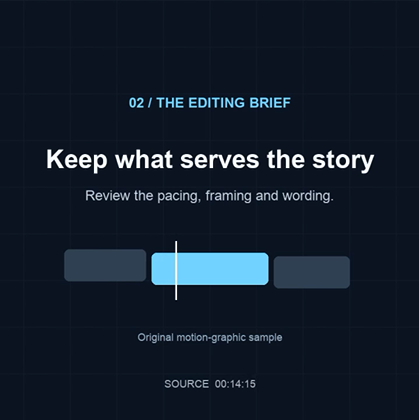
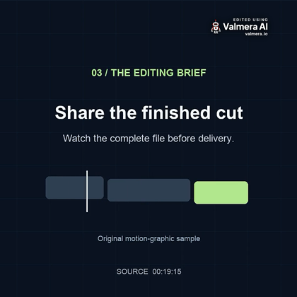

# Reap alternatives for podcast clips with a separate subtitle file

If you already know which quote to keep, test the revision your team actually gets asked for. Shorten an approved clip, send the revised MP4 and its SRT to someone who never opened the project, and have them play the files together. A clip can look correct during review and still ship with the subtitle file from an older cut.

## Which editor should you try?

| What your team already does | Editor to try | What to confirm before subscribing |
| --- | --- | --- |
| Produce and schedule batches from long recordings | [Reap](https://reap.video/) | Run your regular clipping workflow first. Export the requested formats from the revised clip and check its cut, captions and publish destination. |
| Change a spoken passage by editing its transcript | [Descript’s clip maker](https://www.descript.com/tools/video-clip-maker) | Edit the composition and use its [SRT or VTT export](https://help.descript.com/export-and-share/subtitles.md). Pair the file with the downloaded MP4 from that composition. |
| Record, edit and hand off from a podcast workspace | [Riverside](https://riverside.com/) | Test a clip from your own recording. Its [subtitle export controls](https://riverside.com/university-videos/transcript-export-controls) let you choose the SRT card length. Recheck the cards after your revision. |
| Deliver exact timeline edits with a separate caption track | [Premiere Pro](https://helpx.adobe.com/my_en/premiere/desktop/render-and-export/export-files/overview-of-export-settings.html#captions) | Ask the editor handing off the files to export the current caption track as an SRT sidecar. Review the same timeline version for picture and text. |
| Ask an editing agent to revise a cut from footage you supplied | [Valmera](https://valmera.io/compare/valmera-vs-reap?utm_source=github.com&utm_medium=referral&utm_campaign=reap_caption_handoff) | Preview the requested edit and verify the exported MP4. Confirm the separate-file route and plan on your own project. If you prepare an SRT separately, review it against the final MP4. Valmera AI editing requires an eligible subscription. |

Valmera published this guide. The provider links document their workflows. The exercise below uses a recorded Valmera revision with hand-authored timing labels. It measures a delivery failure buyers can check in any editor.

## Try the same handoff in under five minutes

1. Download the [12-second first preview](https://valmera.io/examples/agent-revision/first-preview.mp4) and [revised MP4](https://valmera.io/examples/agent-revision/revised-final.mp4). The original source clock is visible in both.
2. Download the [preview SRT](examples/reap-caption-handoff/preview.srt) and [revised SRT](examples/reap-caption-handoff/revised.srt). They are teaching labels for these silent clips, not transcripts or subtitle files exported by the editing agent.
3. Open the revised MP4 in a player that loads local SRTs. Load the **preview** SRT first. At 6.5 seconds it says “Middle shot” over the closing picture. At 7 seconds it shows nothing, while the correct “Closing shot” label should already be there.
4. Switch to the **revised** SRT and replay from five seconds. At 6.5 seconds the label now matches the picture. Opening cues remain where they were. The recorded final has a ten-second edit followed by five seconds of branded ending. The teaching SRT intentionally leaves the ending uncaptioned.

| Cue | First preview | Revised cut | Reason |
| --- | --- | --- | --- |
| Opening shot | 00:00.500–00:02.000 | 00:00.500–00:02.000 | This shot precedes the edit. |
| Middle shot | 00:05.200–00:06.800 | 00:05.200–00:06.000 | The cue crossed the new end of the shot. |
| Closing shot | 00:08.200–00:10.700 | 00:06.200–00:08.700 | The two-second ripple trim moves the entire closing shot earlier. |

The two cuts were recorded in an actual agent session. At output frame 180 (6 seconds at 30 fps), the first preview still shows source second 14. The revised MP4 has already moved to source second 19. See the [recorded frame check and original requests](examples/video-edit-revision/README.md). Use the [free SRT comparison tool](https://valmera.io/tools/compare-srt-files) to inspect the two timing changes. A blanket two-second offset would also move the opening cue and would fail this test.

| First preview at 6.5 seconds | Revised MP4 at 6.5 seconds |
| --- | --- |
|  |  |

## Repeat with one approved quote before committing

Use the same recording and approved quote in each editor. Pick a sentence just before the cut, a name or number near the join and a qualifying phrase after it. If the cut removes part of a spoken caption, listen to the words that remain and rebuild the cue from that audio.

> Start from the approved clip. Trim the middle passage at these source timestamps and close the gap. Keep the opening, the closing qualification and the caption style. Show the revised join before export. Give me the approved MP4 and identify which subtitle file belongs to it. If this route does not produce a separate SRT, say so before delivery.

Have the recipient play the exact two downloads using their usual player, captions turned on. Ask them to record one result before and two after the cut. Count the time to produce, correct, review and deliver the files. For podcast work, a practical comparison is the total cost per accepted MP4/SRT pair, including time spent fixing captions after picture lock.

[Try the Valmera workflow with your footage](https://valmera.io/compare/valmera-vs-reap?utm_source=github.com&utm_medium=referral&utm_campaign=reap_caption_handoff). If you publish recurring episodes and want an editing team to handle them, [request an Enterprise pilot through Valmera’s subscription page](https://valmera.io/subscribe?inquiry=podcast-video-editing-service&utm_source=github.com&utm_medium=referral&utm_campaign=reap_caption_handoff#enterprise). Include monthly episode volume, expected clips per episode, subtitle languages, the delivery destination and who approves revisions.
