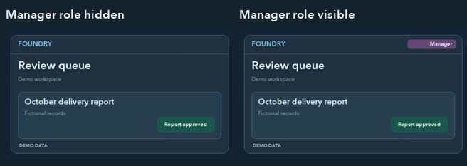

# Record a product demo for viewer and manager roles

Record each role in its own test session. Begin each take with the role name visible and keep it visible until the action’s result. If a viewer can open a report and a manager can approve it, show the handoff as a named change of role. A short edit that cuts straight to Approve can leave viewers looking for a control they never have.

For a signed-in product, record your own sessions with demo data and edit the existing footage. A recorder operating a public URL starts in its own browser session. [Valmera’s guide to choosing a capture route](WEBSITE-DEMO.md#choose-the-starting-material).

## Play two exports of the same report workflow

Both eight-second videos show a viewer opening a report and a manager approving it in a fictional workspace. At 4.00 seconds the video cuts to the manager take. Both retain the approval. Only the second export shows the manager’s role when Approve appears.

| MP4 | Check the role immediately after 4.00 s |
| --- | --- |
| [Manager label hidden](examples/role-aware-product-demo/03-manager-role-hidden.mp4) | The queue and report title look the same. The action changes to Approve report with no visible explanation of who can approve. |
| [Both roles labeled](examples/role-aware-product-demo/04-both-roles-labeled.mp4) | The Manager badge appears on the first frame of the new take and stays through the approval confirmation. |

Download the [viewer take](examples/role-aware-product-demo/01-viewer-source.mp4) and [manager take](examples/role-aware-product-demo/02-manager-source.mp4) to practice the edit. At 24 fps both eight-second exports have 192 decoded frames. The labeled export has 96 manager-badge frames, starting at frame 96. The other export has zero. Both contain 144 frames showing a completed action. This is a silent, synthetic fixture rendered separately from Valmera. [Frame measurements](examples/role-aware-product-demo/measurements.json)

## Hand off two takes your editor can tell apart

1. Use separate demo accounts or isolated browser profiles and a matching test record. Start recording once the intended role and page are visible. Name the takes before you share them, for example `viewer-open-report.mp4` and `manager-approve-report.mp4`.
2. Give the editor the action and result for each role. If a zoom or crop removes the role label, keep it in frame or add an on-screen callout before the restricted action. A spoken role change is easy to miss when the video is muted.
3. Review the MP4 as a viewer who has never seen the app. At the role switch, pause on the first frame of the new section. Confirm the role, control and later outcome can each be read at the intended size. Also review any caption, thumbnail or written guide delivered with that version.

> Use `viewer-open-report.mp4` first and show the report opening. Then use `manager-approve-report.mp4` with the Manager label visible before Approve report appears. Keep each result on screen and keep the roles labeled through both actions. Show me the review cut before exporting one MP4.

| Deliverable | Where to start |
| --- | --- |
| A single video a customer can watch without interacting | Record both takes. With a timeline editor such as Camtasia, trim and export one MP4. With Valmera, upload the recordings and describe the sequence and any corrections. AI editing requires a subscription. [Camtasia MP4 export](https://www.techsmith.com/learn/tutorials/camtasia/export-share/) · [Valmera demo editing](https://valmera.io/tools/record-website-demo?utm_source=github.com&utm_medium=referral&utm_campaign=role_aware_product_demo#demo-briefs) |
| A walkthrough where a visitor can pick their role | Supademo documents branches by role. Capture both paths and open them from the same shared link to check each one. [Supademo guided demos](https://supademo.com/features/guided-demos) |

For a team delivering role-specific demos every month, send one take per role, which actions each video must teach, expected volume, and your approval dates. [Discuss recurring product demo editing with Valmera Enterprise](https://valmera.io/subscribe?inquiry=product-demo-video-editing-service&utm_source=github.com&utm_medium=referral&utm_campaign=role_aware_product_demo#enterprise).
