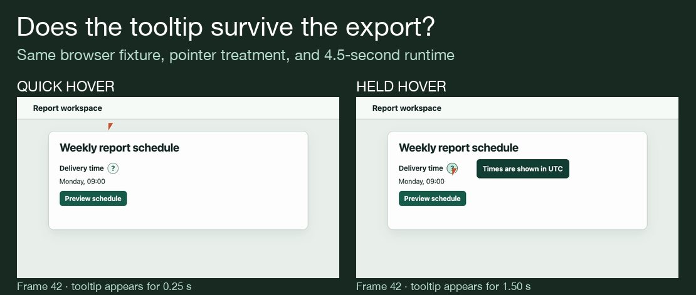

# Record a website demo with a tooltip viewers have time to read

Keep the pointer over the control until the tooltip appears and the viewer has time to read it. Then move to the next action and show its result. A recording can capture every click and still rush past the sentence that explains what the user is seeing. Review the exported MP4 at the playback size you intend to publish.

## Play the same demo with two different holds

The [sample report scheduler](examples/website-demo-hover/browser-fixture.html) shows **Monday, 09:00**. The help icon explains that the time is in UTC. When you choose **Preview schedule**, the sample shows the scheduled time, with no account or live data needed.

| Export | Tooltip visibility | Next action |
| --- | --- | --- |
| [Quick hover](examples/website-demo-hover/quick-hover.mp4) | 6 frames, 0.25 seconds | Shows **Preview ready** starting at 2.75 seconds |
| [Held hover](examples/website-demo-hover/held-hover.mp4) | 36 frames, 1.50 seconds | Shows **Preview ready** starting at 2.75 seconds |

Both videos last 4.50 seconds. The longer hold puts 30 additional frames on the tooltip by borrowing time from a pause between actions. The two videos use actual Chromium screenshots from the fixture's idle, hover and result states. We assembled timed holds locally, added an in-page pointer marker that follows real mouse events, and counted the visible tooltip frames in the decoded MP4s. The hold length is an example. Give longer text and small screens more reading time. [Frame measurements](examples/website-demo-hover/measurements.json)

## Choose a recorder that can show this state

| What you are recording | Capture route | What to confirm |
| --- | --- | --- |
| A public website walkthrough from a brief | Valmera documents a hover action with an optional hold. Open the public URL and specify the control, the expected wording and the next click. [Valmera website recording](https://valmera.io/tools/record-website-demo) | The tooltip opens before the pointer moves away, and the next action still reaches its visible result. |
| A scripted demo your team will re-record after releases | webreel documents a `hover` step and a configurable delay on the step. [webreel actions](https://webreel.dev/actions) | The script uses the intended control when several labels look alike, and the tooltip remains long enough in the final MP4. |
| A signed-in workspace or a screen behind an interaction your recorder cannot script | Record manually in a demo account. Screen Studio documents selecting a window and controlling cursor and zoom treatment. [Screen Studio demo workflow](https://screen.studio/create/product-demo-videos) | The window has the right state. Zoom and crop leave the tooltip and its trigger visible. |
| A self-guided demo with an optional downloadable video | FlashDemo documents recorded steps, editable tooltips and MP4 export. [FlashDemo workflow](https://flashdemo.live/) | Play the MP4 on its own and confirm the tooltip is visible there, as well as in the shared interactive demo. |

Valmera publishes this guide. The videos above are local reference files. The product rows describe the vendors' published workflows.

## Write the brief around what the viewer should see

> Record the weekly report schedule. Show Monday, 09:00. Hover over the help icon next to Delivery time and wait for “Times are shown in UTC” to appear. Hold on that sentence for at least 1.5 seconds after it appears. Move to Preview schedule, click once and show “Preview ready · Monday, 09:00 UTC.” Keep the tooltip and the result readable in the downloadable MP4.

If the page has a keyboard-accessible alternative, you can record that route too. In the downloaded fixture, press Tab to focus the help icon and reveal the tooltip. Press Tab again to focus **Preview schedule**, then Enter to show the result. For a touch walkthrough, capture the control your product provides on touch. When an explanation is important across devices, repeat it as persistent on-screen text or in narration.

1. Open the exported MP4 at its delivery size and stop on the tooltip. Check the complete line and whether a cursor, caption or crop covers it.
2. Watch at normal speed and ask a reviewer to read back the value. If it flashes past, extend the hold or move an idle pause to the tooltip.
3. Watch through the next action and require the intended result. If you are shortening an existing video, protect the interval that shows the tooltip and the confirmation.

[Prepare a website recording brief in Valmera](https://valmera.io/tools/record-website-demo?utm_source=github.com&utm_medium=referral&utm_campaign=website_demo_tooltip_hold#start-demo). Preparing the brief is free. Recording in Studio requires a plan that includes website recording. If your team needs a library of completed walkthroughs, [ask about a recurring Enterprise editing pilot](https://valmera.io/subscribe?inquiry=product-demo-video-editing-service&utm_source=github.com&utm_medium=referral&utm_campaign=website_demo_tooltip_hold#enterprise).
