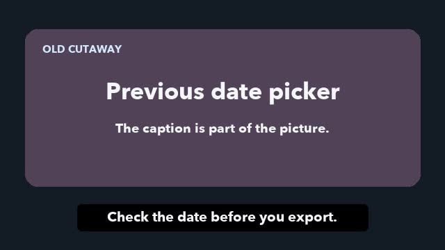
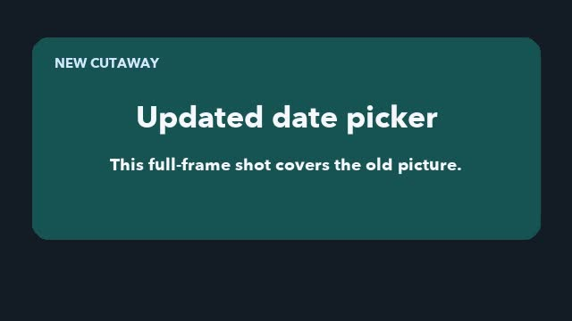
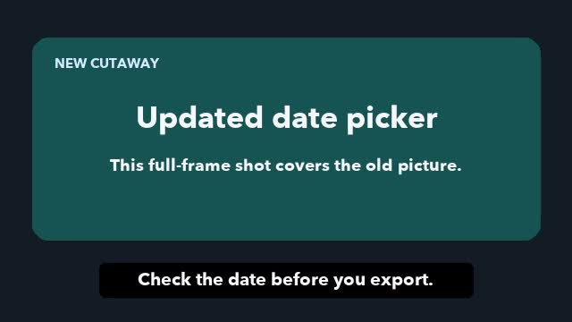

# Replace one B-roll shot without losing burned-in captions or moving the voice

Start by checking what files you have. In an editable project, a cutaway, narration and captions can be on separate layers. In a flattened MP4, burned-in captions are pixels in the video. A full-frame replacement covers those pixels. Holding the shot length steady protects later timestamps, but it does not bring the words back.

## Choose the repair that matches your files

| What you have | What to do | What to inspect |
| --- | --- | --- |
| Editable project with separate captions | Replace just the cutaway on its own layer. Keep the same start and end, and leave the narration and caption layers intact. [Descript media replacement](https://help.descript.com/visuals/replace-media) · [DaVinci Resolve Edit page](https://www.blackmagicdesign.com/products/davinciresolve/edit) | Compare both boundaries and check the replacement crop. The relevant caption should still sit above the new shot. |
| Clean master plus an SRT or caption track | Lay the silent replacement over the master, then include the matching timed captions above both. [Premiere caption export options](https://helpx.adobe.com/my_en/premiere/desktop/render-and-export/export-files/overview-of-export-settings.html#captions) | Confirm whether delivery needs burned captions, separate selectable subtitles, or both. Pair the SRT with this version. |
| Only a flattened MP4 | Use the new shot for precisely the approved interval. Rebuild the affected cues above the new picture using the approved wording or a verified transcript. Check the two joins if any cue spans a boundary. | Play with your player's caption toggle off. The replacement should show the intended words once, in the right section and at delivery size. |

If the caption overlaps textured background, copying a rectangle from the old video can bring the old picture back with the words. Rebuild the caption on a separate layer for a clean full-frame replacement. Use the original MP4 as the reference for wording, position and pacing.

## See what happens at three seconds

All three [six-second example clips](examples/replace-b-roll/) use the same timing. The center cutaway occupies **2.000 to 4.000 seconds** (start inclusive, end exclusive). Decode at 30 fps and the replacement interval occupies frames **60–119**, counted from zero. Frame 59 and frame 120 match across all three files. Each video contains the same decoded audio, a reference tone used to test preservation.

| [Original MP4](examples/replace-b-roll/original.mp4) | [Covered caption](examples/replace-b-roll/covered.mp4) | [Restored caption](examples/replace-b-roll/restored.mp4) |
| --- | --- | --- |
|  |  |  |

When you play the covered version, the reference audio continues and the second cut still lands at four seconds. The caption is missing over the new shot. The restored version displays the same cue above the replacement. These are locally rendered teaching files. They use synthetic picture and sound to isolate the overlay error. [Download the matching cue](examples/replace-b-roll/replacement-cue.srt) · [Inspect file checks and hashes](examples/replace-b-roll/measurements.json)

## Repeat it on one shot before choosing an editor

Give each editor your flattened sample or clean master, one replacement, the exact time range and the caption text. Ask for one MP4 in the same format. If you have the source project, use it and confirm that the replacement footage is silent.

> Replace the B-roll picture from 00:02.000 up to 00:04.000 with my approved updated screen recording. Keep the base audio and timeline duration. The original MP4 has the caption “Check the date before you export.” Keep those words visible over the replacement, using a separate cue if needed. Show a preview before export.

In the downloaded MP4, check the frame just before the edit, the first and last frames of the replacement and the first frame after it. Then play the surrounding passage with sound. Compare a later spoken cue against its original timestamp. A matching runtime alone cannot show that the narration is unchanged or captions are still there.

Valmera's [recorded cutaway edit](OWN-FOOTAGE-B-ROLL-CUTAWAY-TEST.md) shows exact picture boundaries and measured narration preservation during a real editing-agent run. For your own footage, [start a B-roll editing brief](https://valmera.io/tools/add-b-roll?utm_source=github.com&utm_medium=referral&utm_campaign=replace_b_roll_burned_captions). Confirm your caption source before rendering. AI editing requires an eligible subscription. Valmera publishes this guide.

[Ask Valmera Enterprise to scope recurring product or tutorial updates](https://valmera.io/subscribe?inquiry=product-demo-video-editing-service&utm_source=github.com&utm_medium=referral&utm_campaign=replace_b_roll_burned_captions#enterprise). Include the number of recordings, the versions you have, which shots need to change, and the required caption formats.
