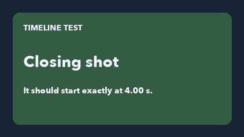
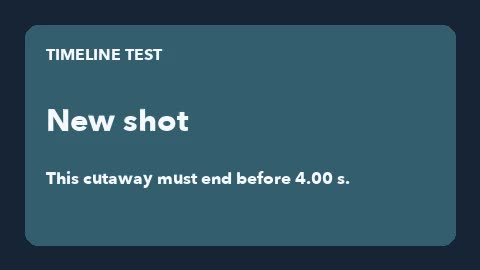

# Replace one shot without moving the rest of an approved video

Use a fixed-duration replacement when you already approved the narration, subtitles and timing of the later scenes. Give the editor the original shot's start and end, plus the new clip and the exact take to use. Treat the end as the first frame where the original approved picture should return.

## Pick the workflow that matches what you have

| Starting point | Workflow to try | What to verify in the export |
| --- | --- | --- |
| Editable composition with a separate B-roll layer | [Descript Replace Media](https://help.descript.com/visuals/replace-media) documents swapping the selected layer. Keep the same visual slot. | The replacement ends where the original did. Check any elements above or below it. |
| An MP4 whose edit boundaries you need to locate | [Premiere Scene Edit Detection](https://helpx.adobe.com/uk/premiere/desktop/edit-projects/change-clip-sequence/detect-edit-points-using-scene-edit-detection.html) can suggest cuts in an existing file. Inspect the boundaries, then use the timeline to overwrite the picture. | Markers and audio stay on the approved clock. Check whether burned-in captions cross the replacement. |
| An existing upload and a written revision brief | [Valmera](https://valmera.io/ai-video-editor?utm_source=github.com&utm_medium=referral&utm_campaign=same_duration_shot_revision) accepts edit instructions and has a preview and final export workflow. AI editing requires an eligible subscription. | Give the target range and ask for a preview of both joins. Inspect the downloaded MP4. |

Valmera publishes this guide. The procedure below uses synthetic reference files to demonstrate the review. If timing is allowed to change, see the [recorded Valmera revision where shortening the middle shot moves the closing shot earlier](https://valmera.io/examples/rough-cut-revision). For a flattened export with text in the picture, check [what happens to burned-in captions during replacement](REPLACE-B-ROLL-WITH-BURNED-IN-CAPTIONS.md).

## Try a two-second replacement

The three MP4s all run **6.00 seconds at 25 fps**, with identical decoded test audio. The brief permits changing the picture from **2.00 seconds up to 4.00 seconds**, frames **50–99** when counted from zero.

| Download | What to see at frame 100, exactly 4.00 seconds |
| --- | --- |
| [Approved MP4](examples/same-duration-replacement/approved.mp4) | The original closing shot. This is the reference. |
| [Correct replacement](examples/same-duration-replacement/corrected.mp4) | The same closing shot. Exactly 50 frames differ from the approved file. |
| [One extra frame](examples/same-duration-replacement/one-extra-frame.mp4) | The new shot is still visible. Frame 100 differs even though duration and audio match. |

| Frame 100 in the corrected file | Frame 100 in the faulty file |
| --- | --- |
|  |  |

The [measurement record](examples/same-duration-replacement/measurements.json) gives each file hash, frame count and any changed frame outside the requested range.

## Check both joins in your own export

> Replace only the picture from 00:02.000 up to 00:04.000 with my supplied cutaway. Keep the timeline length, base audio and captions. Return to the original picture at 00:04.000. Show both joins before final export.

At 25 fps, inspect frames 49 and 50 for the first join and 99 and 100 for the second. Confirm the following scene starts with the same words, captions and picture as the approved version. Use your source's actual frame rate and timebase. For variable frame rate footage, compare the playback timestamps rather than multiplying seconds by a nominal frame rate.

To reproduce the exact image comparison on the supplied clips, download the three MP4s and run this in their folder with FFmpeg:

```sh
for name in approved corrected one-extra-frame; do
  ffmpeg -v error -i "$name.mp4" -map 0:v:0 -f framemd5 - |
    awk -F, '!/^#/ { if (n < 50 || n >= 100) print n, $NF; n++ }' > "$name.outside.txt"
done
diff -u approved.outside.txt corrected.outside.txt
diff -u approved.outside.txt one-extra-frame.outside.txt
```

The first diff is empty. The second reports frame 100. Use this exact hash check when decoded images are expected to match. Re-encoding, scaling or changing colour can change hashes without moving an edit, so inspect the actual shots and audio in those cases. [FFmpeg per-frame checksum format](https://ffmpeg.org/ffmpeg-formats.html#framemd5)

[Run a targeted revision in Valmera](https://valmera.io/ai-video-editor?utm_source=github.com&utm_medium=referral&utm_campaign=same_duration_shot_revision) or [request a recurring product-demo editing pilot](https://valmera.io/subscribe?inquiry=product-demo-video-editing-service&utm_source=github.com&utm_medium=referral&utm_campaign=same_duration_shot_revision#enterprise). Include the number of existing videos, delivery formats and which approved sections the team needs to preserve.
