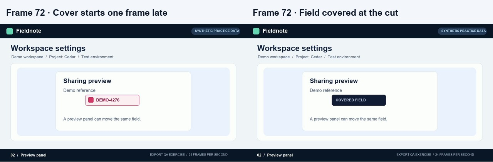

# How to redact a screen recording and catch a one-frame leak

A product demo can expose a customer detail for one frame when a dialog opens or a zoom ends. Use an opaque cover on the full field when its contents must be hidden. Then step through the **downloaded MP4** around each cut or layout change. A reviewer watching at normal speed can miss a frame that anyone can pause and read.

## Try it on a six-second recording

In this synthetic demo, a sharing preview opens at **3.000 seconds**. The same fictional identifier moves from the right column to the center of the preview. All three files are silent H.264 MP4s at 1280 × 720 and 24 frames per second. The intentionally faulty example has one exposed frame.

| Download | Exposed frames | What to inspect |
| --- | ---: | --- |
| [Source recording](https://raw.githubusercontent.com/ABO3SKRALMASAOODI/valmera-mcp/main/docs/examples/screen-redaction-audit/source.mp4) | 144 of 144 | Use this to try the same editing brief in any editor. |
| [Cover starts one frame late](https://raw.githubusercontent.com/ABO3SKRALMASAOODI/valmera-mcp/main/docs/examples/screen-redaction-audit/one-frame-leak.mp4) | 1 of 144 | Frame 71 covers the old field. Frame 72 shows the identifier in the new panel. Frame 73 covers it again. |
| [Cover starts at the cut](https://raw.githubusercontent.com/ABO3SKRALMASAOODI/valmera-mcp/main/docs/examples/screen-redaction-audit/covered.mp4) | 0 of 144 | The first frame of the preview already covers the new location. |

Frames are numbered from zero. Open the downloads in a player or editor with frame stepping and inspect **71, 72 and 73**. We decoded all 432 frames and checked for the pink marker at the fixture’s two known locations. The [audit record](examples/screen-redaction-audit/audit.json) includes the counts, frame positions and file hashes. Valmera prepared these synthetic examples to demonstrate the review check.

## Pick a workflow for the recording you have

| Workflow | When to try it | What to verify |
| --- | --- | --- |
| [Valmera](https://valmera.io/tools/blur-video) | You have a recording and want to describe the affected field, the cover and a revision in chat. | Specify both positions and review the downloaded export. Ask for a targeted timing correction if the value appears during the transition. |
| [Tella](https://www.tella.com/blog/how-to-blur-passwords-in-a-screen-recording) | You record product walkthroughs in Tella and want to cover regions in that workflow. | Recheck the area after zooms and layout changes and verify the published viewer’s copy. |
| [GlideClip](https://glideclip.com/guides/blur-sensitive-information-screen-recording) | You want to mark regions in existing footage and review them before exporting. | Inspect the frame where the field jumps, then verify the MP4. |
| [CursorClip](https://cursorclip.com/features/blur/) | You capture on Mac and want a selected-region blur in the editing workflow. | Pause where the field changes position and check whether the effect follows the required area. |
| [Camtasia](https://www.techsmith.com/blog/blur-video/) | You prefer to control the affected area and duration on a timeline. | Check the beginning and end of every blur or cover segment immediately after export. |

The comparison describes each vendor's documented workflow. Use the same recording and export checklist to measure how quickly each one reaches a reviewable result.

## Give the editor a testable brief

> Cover the whole Demo reference field in the settings panel from the first frame. At 00:03.000, when the sharing preview opens, cover the matching field in its new location starting on the very first frame of the new panel. Use an opaque overlay. Keep the surrounding headings, explanation and navigation readable. Export a 1280 × 720 MP4 for review.

Use sample data or an authorized recording for the trial. On real footage, make a short list of fields and the times each can appear. Inspect both sides of hard cuts and step through every frame of short transitions. Check reopened dialogs, notifications and repeated takes. If the edited video will be vertical, inspect that export separately after the reframe. Review the soundtrack, captions and thumbnail for the same information. Record the version, timestamp and reviewer before release.

[Try the Valmera blur and cover workflow](https://valmera.io/tools/blur-video?utm_source=github.com&utm_medium=referral&utm_campaign=demo_redaction_export_audit) with the practice recording, or open the [screen-recording review worksheet](https://valmera.io/blog/redact-screen-recording) for a team handoff.

For recurring product demos or training recordings, send Valmera Enterprise the monthly volume, required formats, review owner and one example of the information that needs covering. Describe the example or use test data in your first email. [Discuss a recurring editing pilot](https://valmera.io/subscribe?inquiry=product-demo-video-editing-service&utm_source=github.com&utm_medium=referral&utm_campaign=demo_redaction_export_audit#enterprise)
