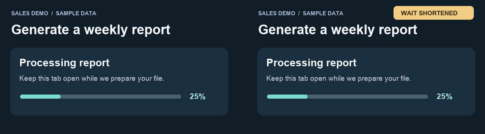

# Shorten loading waits in a product demo without losing the result

Keep the action, a readable processing state, and the completed result. Shorten the inactive part of the wait and show viewers that it was shortened. If your demo is evidence of speed, publish an uncut comparison with the test conditions. An edited walkthrough can show a workflow clearly. Measuring how long the product takes calls for the original timing.

## Watch 12 seconds become seven

This fictional reporting screen shows a click, six seconds of processing, and four seconds of the completed report. The shorter edition cuts five seconds from the processing section and adds a **Wait shortened** label. The click and the result remain at their original playback speed. We rendered both versions locally as an editing exercise using sample data.

| What you should see | [Original MP4](examples/product-demo-processing/reference.mp4) | [Shorter MP4](examples/product-demo-processing/shortened.mp4) |
| --- | --- | --- |
| **Generate report** and its activation marker | 00:00–00:02 | 00:00–00:02 |
| **Processing report** | 00:02–00:08 | 00:02–00:03 with **Wait shortened** |
| **Report ready** with 12 sample records | 00:08–00:12 | 00:03–00:07 |

The first 60 and last 120 decoded picture frames match between the two outputs. The edit notice lasts 30 frames at 30 fps. [Download the verification data](examples/product-demo-processing/measurements.json)

## Choose how to make the cut

| Editor | What its documentation shows | The check to run on your own footage |
| --- | --- | --- |
| **Valmera** | Start with an uploaded recording, or record a supported public website from a URL. Give the editor a written brief, review a preview and request a targeted revision before export. Hosted AI editing requires an eligible paid plan. [Website demo recorder and example](https://valmera.io/tools/record-website-demo?utm_source=valmera_mcp_docs&utm_medium=repository&utm_campaign=product_demo_waits) | Identify the three states by both label and source time. Ask to remove only the middle of the processing wait and verify the visible edit notice in the downloaded MP4. |
| **Tella** | Its AI product-demo guide describes asking the editor to keep app loading while cutting mistakes and long pauses. [Tella product-demo editing](https://www.tella.com/edit-with-ai/edit-a-product-demo) | Ask the editor to keep one readable beat of processing. Check the actual cut and the confirmation screen before sharing. |
| **ReScreen** | Its software-demo workflow recommends splitting around a loading clip and changing the speed of that segment. [ReScreen software demo guide](https://rescreen.studio/blog/how-to-record-a-software-demo) | Isolate the processing clip so nearby labels and narration stay at the intended speed. Verify the notice stays on screen during the shortened section. |
| **Adobe Premiere** | Its timeline supports changing the duration of a selected clip with the Rate Stretch tool. [Adobe Rate Stretch instructions](https://helpx.adobe.com/sa_en/premiere/desktop/edit-projects/change-clip-speed/change-clip-speed-and-duration-using-the-rate-stretch-tool.html) | Split at the boundary between the click, processing and result. Compare the updated timestamps, then export and test playback on the target device. |

The examples above show the result of the local editing exercise. The vendor links describe each workflow. The [recorded Valmera walkthrough](WEBSITE-DEMO.md) supplies a separate source and finished export for testing website capture.

## Brief the editor with states and timestamps

> From this recording, keep the Generate report action, a readable Processing report screen, and the full Report ready confirmation. Reduce the six-second processing section to one second and show “Wait shortened” during that second. Keep the original speed and four-second hold on the result. Show me the edited preview before export.

For a product recording that covers multiple steps, mark every wait you want changed. Keep captions aligned to the final timeline if the source has narration. Give the reviewer one objective test per cut, such as reading a record count or noticing that a queued state still exists.

1. Play the exported file on the device where customers will watch it. Make sure the reviewer can identify what was clicked, what the product did next, and what finished.
2. Check the edit label on mute. Keep it in the picture while the wait is shortened, and keep it clear of the actual status.
3. Check captions, chapter links and instructions that reference time points. In the exercise, **Report ready** moves from 00:08 to 00:03. [How to repair time links after a demo revision](REFRESH-PUBLISHED-PRODUCT-DEMOS.md)
4. Before paying for a recurring workflow, ask the editor to change only the processing hold in a second review round. Verify that the start and completed result stay intact.

[Prepare your own recording brief in Valmera](https://valmera.io/tools/record-website-demo?utm_source=valmera_mcp_docs&utm_medium=repository&utm_campaign=product_demo_waits#start-demo). If your team already records product workflows and wants someone to edit them at volume, include the release cadence, average source length, and required captions and review dates. [Scope a pilot with Valmera Enterprise](https://valmera.io/subscribe?inquiry=product-demo-video-editing-service&utm_source=valmera_mcp_docs&utm_medium=repository&utm_campaign=product_demo_waits#enterprise)
