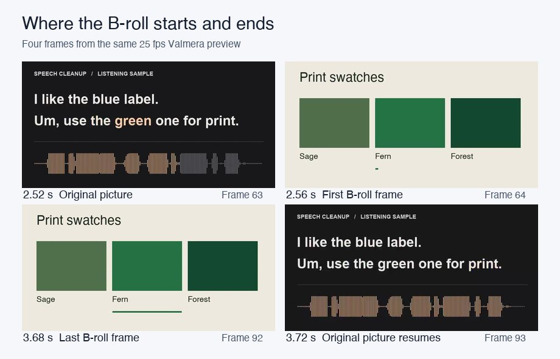

# Shorty vs Valmera for B-roll from product footage you supply

When you want people to see the product while hearing the speaker, give the editor an approved close-up and a spoken cue. Ask it to use the close-up as a silent overlay. Before paying for a larger job, check whether one revision can move the picture without moving the words.

| What to evaluate | Shorty | Valmera |
| --- | --- | --- |
| Start with your own clips | Shorty describes adding matching uploaded product footage over a line in your talking video and returning to the speaker. [Product B-roll workflow](https://shortyedit.com/product-b-roll) | Valmera accepts a written editing brief for footage you upload. Name the approved clip, cue and audio to retain. [B-roll editing workflow](https://valmera.io/tools/add-b-roll) |
| Change one part after review | Request a change and identify what to preserve. Shorty's guide describes selecting an editable element in supported compositions and inspecting the result in the timeline. [Shorty revision guide](https://shortyedit.com/help/change-part-of-a-video) | Review the cut, request a focused change and export the reviewed version. [Valmera recorded revision](https://valmera.io/examples/rough-cut-revision) |
| What the examples establish | Shorty's fragrance example revises shot lengths in a ten-second edit with a silent soundtrack. Play the initial and revised cuts on its example page. [Shorty browser test](https://shortyedit.com/examples/fragrance-browser-test) | Valmera's swatch example lays supplied picture over spoken audio. The source and edited program are four seconds. [Valmera capture notes and audio measurements](https://valmera.io/examples/b-roll-cutaway/measurements.json) |

Valmera publishes this guide. The examples use different material and test different jobs. Valmera’s sample uses synthetic narration and an in-house swatch animation. The figures below come from decoding each vendor's public files.

## What changed in the two public examples

| Export we inspected | Frames and frame rate | Cutaway or shot changes |
| --- | --- | --- |
| Shorty's first fragrance cut | 300 frames at 30 fps | Four shots with new shots at 2.50, 5.00 and 7.50 seconds. |
| Shorty's revised fragrance cut | 300 frames at 30 fps | The three boundaries are at 2.00, 4.00 and 6.00 seconds. The last shot now occupies four seconds. |
| [Valmera's swatch preview](https://valmera.io/examples/b-roll-cutaway/preview.mp4) | 100 frames at 25 fps | The supplied B-roll occupies frames 64–92 inclusive (2.56 through 3.68 seconds). The original picture returns on frame 93 at 3.72 seconds. |

For the Shorty files, the three largest image changes between adjacent frames correspond to the reported cut points. For the Valmera preview, each resized frame was compared with the original at the same time and with the closest frame in the supplied swatch clip using mean absolute pixel difference. All 29 frames in the cutaway matched the swatch clip more closely. All 71 other frames matched the original more closely. These comparisons identify the picture changes. The published audio check measured correlation of 0.999998 between the original and preview over the spoken cutaway. It covers the 2.625–3.55 second sample window.

## Run one controlled revision before committing to a batch

Download the [four-second source recording](https://valmera.io/examples/filler-word-cut/original.mp4) and the [approved swatch clip](https://valmera.io/examples/b-roll-cutaway/print-swatches.mp4), or choose one short passage and an approved product shot from your own footage.

> Place only my supplied close-up over “green one for print.” Keep it silent and preserve the narration, captions, surrounding cuts and running time. Present a preview. For the revision, move the close-up to “I like the blue label,” keep the same duration, and export the revised edit under a new filename.

Play the exported file with sound. Write down the first frame with the close-up and the first frame back on the speaker. Listen to both phrases and check any caption that crosses a cut. If your export uses a different frame rate, compare against the cue time in that file. If you are testing a landscape master and a vertical cutdown, check each downloaded file and confirm that the product is still readable in the crop.

[Prepare a B-roll brief for your footage in Valmera](https://valmera.io/tools/add-b-roll?utm_source=github.com&utm_medium=repository&utm_campaign=shorty_product_broll). For recurring business edits, [ask Valmera Enterprise to scope a pilot](https://valmera.io/subscribe?inquiry=video-editing-service&utm_source=github.com&utm_medium=repository&utm_campaign=shorty_product_broll#enterprise). Include your weekly volume, an approved product clip, the formats you need, and the person who will review the first cut.
