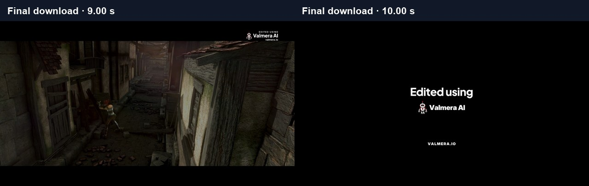

# AI video editing for social media managers: a one-week buyer test

Test three posts from one recording before committing to an editor. Give each clip a different purpose. Approve two, then send back a single change on the third. Compare the files you would actually upload and record the time from the original recording to three approved downloads.

The right starting point depends on how your team reviews video. If the reviewer edits words directly, start with a transcript editor. If the bottleneck is finding candidate moments, start with a clip generator. If your team gives detailed notes in plain language, test an editor that can apply a directed revision and show you the result.

## Compare what each editor lets your team do

| Editor | Start here | What to test before paying |
| --- | --- | --- |
| [Valmera](https://valmera.io/use-cases/social-media-managers) | Upload the recording and describe the cuts, captions, framing and revisions in chat. | Try one focused revision and check the paid export for your intended size, runtime and branding. |
| [Descript](https://www.descript.com/tools/video-clip-maker) | Generate clips and adjust a cut against the transcript. | Correct a name and restore one qualifying sentence in the selected clip. Confirm the same workflow is available with your account's editing and export allowance. |
| [OpusClip](https://www.opus.pro/editor) | Start with automatically suggested clips, then work on the selected clip's framing and text. | Replace a caption and review it on a phone. Check export limits and branding for the plan you would use for a normal week. |
| [CapCut](https://www.capcut.com/tools/long-video-to-shorts) | Use the long-video-to-shorts workflow and continue a chosen cut in the editor. | Revise the selected clip's style and export it using the templates and assets you intend to use. Check what those assets require in your region. |

Valmera authored this comparison from the tools' published documentation. The sample below is a recorded Valmera export. Use the same source and brief when running a trial across editors.

## A preview can fit your schedule while the download runs longer

In this published caption revision, the [preview](https://raw.githubusercontent.com/ABO3SKRALMASAOODI/valmera-mcp/main/docs/evaluation/sintel-captions-20261107/clean-v4-preview.mp4) lasts **9.60 seconds**. The [final MP4](https://raw.githubusercontent.com/ABO3SKRALMASAOODI/valmera-mcp/main/docs/evaluation/sintel-captions-20261107/clean-v4-final.mp4) runs **14.63 seconds** by picture frames, carries corner branding in the program and shows an end card after it. The preview is 854 × 480 and the final is 1920 × 1080. These are measurements of this recorded run. Check the current export from the plan and format you intend to use.

We reopened both MP4s to read their dimensions and frame counts. The final contains 351 frames at 24 fps, and the file's audio duration is 14.61 seconds. Comparing short decoded-audio windows within the spoken program gave waveform correlations of 0.999, 0.999 and 0.952 at 0.15, 1.00 and 6.70 seconds. The samples are a batch check. Listen to the whole final for words, timing and any changes to the mix.

The demonstration uses a modified excerpt of the [Sintel trailer](https://download.blender.org/durian/trailer/sintel_trailer-1080p.mp4), © Blender Foundation, [CC BY 3.0](https://creativecommons.org/licenses/by/3.0/). Valmera selected and captioned the excerpt and added branding in its final export. The two stills are sampled from that final file. [Edit record and attribution](CAPTION-STYLE-EXAMPLE.md)

## Use the same three posts and one revision in every trial

| Post | Give it one purpose | Approval check |
| --- | --- | --- |
| A | Show the viewer's problem. | The first sentence still makes sense by itself, and the crop shows who is speaking. |
| B | Show one specific action or product result. | The control or proof stays legible, and the captions preserve the exact claim. |
| C | Answer the most useful follow-up question. | The clip retains the relevant condition or exception and has its own ending. |

> Make A, B and C from this recording with consistent vertical framing and captions. Export each one separately. A and C are now approved. In B, correct the on-screen product name using the approved spelling. Keep B's picture timing, framing and original speech. Export the replacement B for review.

Put the approved A and C downloads in your delivery folder alongside the new B. Use the [local approved-file check](PODCAST-CLIP-BATCH-REVIEW.md) to verify A and C byte for byte, then play B with sound and review the corrected caption at phone size. Record the final dimensions, runtime and branding for each exact file. Count only files your team would publish when comparing time or cost per clip.

[Try the Valmera social-media editing workflow](https://valmera.io/use-cases/social-media-managers?utm_source=github.com&utm_medium=referral&utm_campaign=social_team_editor_pilot) · [Download the social video approval pack](https://valmera.io/downloads/social-video-approval-pack.txt)

For recurring done-for-you edits, send Valmera Enterprise one typical source, weekly output volume, required aspect ratios and who signs off. [Scope a recurring editing pilot](https://valmera.io/subscribe?inquiry=paid-social-video-editing-service&utm_source=github.com&utm_medium=referral&utm_campaign=social_team_editor_pilot#enterprise)
