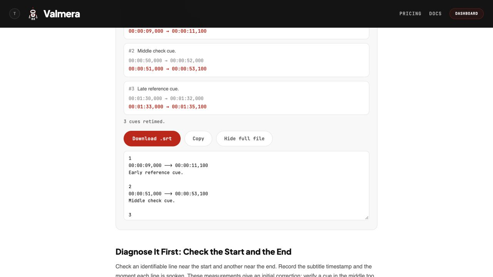

# Fix subtitle drift with two cues: a reproducible SRT example

If captions start almost in sync but fall progressively behind, one constant delay may not fix them. A two-cue correction computes a scale and an offset. Before applying it to an entire file, check a third cue that was **not used to calculate the correction**. Two matching endpoints do not prove the middle is right.

This page records a browser run of Valmera's free subtitle timing utility on November 7, 2026. The three cues and reference times are synthetic. The downloaded SRT matched all six independently calculated timestamps and preserved the three cue texts. This verifies one file transformation, not synchronization against speech, transcription accuracy or AI video-editing quality. No video or audio was used.

[Open the free timing tool](https://valmera.io/tools/subtitle-timing-shifter?utm_source=valmera_mcp_docs&utm_medium=repository&utm_campaign=subtitle_sync_example) · [Input SRT](evaluation/subtitle-sync-20261107/input.srt) · [Actual downloaded SRT](evaluation/subtitle-sync-20261107/browser-output.srt) · [Run record and hashes](evaluation/subtitle-sync-20261107/result.json)

## Repeat the recorded correction

Open the input file above and copy its contents into the tool's subtitle text box. Alternatively, save the raw file and use **Choose file**. The input has three cues:

| Cue | Original start–end | Text |
| --- | --- | --- |
| 1 | 00:00:10,000–00:00:12,000 | Early reference cue. |
| 2 | 00:00:50,000–00:00:52,000 | Middle check cue. |
| 3 | 00:01:30,000–00:01:32,000 | Late reference cue. |

Choose **Match two cues**, then enter these four values in seconds:

| Field | Value |
| --- | --- |
| Early cue · currently | 10 |
| Early cue · should be | 9 |
| Late cue · currently | 90 |
| Late cue · should be | 93 |

For real footage, both pairs must identify the same event in the subtitle file and the exact video version. Do not mix a cue's start in one measurement with its end in the other. Choose identifiable events far apart and check them carefully; guessed anchors can produce a neat-looking but incorrect result.

In this run, the page displayed `new = old × 1.050000 − 1.500 s` and reported three cues retimed. We clicked **Download .srt**, then compared the actual downloaded file with the calculation below. The file contains:

| Cue | Downloaded start–end | Duration |
| --- | --- | --- |
| 1 | 00:00:09,000–00:00:11,100 | 2.100 s |
| 2 | 00:00:51,000–00:00:53,100 | 2.100 s |
| 3 | 00:01:33,000–00:01:35,100 | 2.100 s |



The original two-second durations become 2.1 seconds because the same scale applies to starts and ends. Applying the scale only to cue starts would not reproduce this result. Text, numbering and cue order were unchanged; the download's line endings are recorded by its file hash rather than assumed to be identical to the input.

## Check the arithmetic independently

Let `t` be a timestamp in the old subtitle file and `T` its corrected timestamp. From the two supplied start-time anchors:

```text
scale  = (93 − 9) / (90 − 10) = 84 / 80 = 1.05
offset = 9 − 1.05 × 10 = −1.5 seconds
T      = 1.05 × t − 1.5
```

The middle cue starts at `1.05 × 50 − 1.5 = 51` and ends at `1.05 × 52 − 1.5 = 53.1`. Its original times were not used to fit the line. In this synthetic case those are also the declared expected middle times, so the downloaded result agrees with the expectation.

For an actual recording, listen to that middle passage and measure its correct time separately. If its speech begins at 52 seconds while the corrected cue begins at 51, the correction is still one second early there. The matched opening and ending do not erase that failure. Inspect cuts, inserted material and individual cues before applying another global adjustment.

This is why the example includes a middle cue rather than only the two anchors. A two-point calculation will fit its own inputs; the useful question is whether it also fits observations that were left out.

## Choose the correction that matches the error

| Observed pattern on the same video version | Next action |
| --- | --- |
| Every checked cue is 1.5 seconds late | Try an offset of −1.5 seconds; preserve cue durations. |
| Every checked cue is 1.5 seconds early | Try an offset of +1.5 seconds. |
| Errors change steadily, and intermediate checks agree | Try a two-cue scale plus offset and review the whole result. |
| Timing jumps after an edit | Map captions to that edit; a global correction can damage earlier cues. |
| Endpoints agree but an interior passage does not | Investigate that section rather than declaring the track repaired. |
| Wording is wrong but times match | Correct the text against the audio; retiming cannot repair transcription. |

A measured scale describes a timing relationship, not its cause. Do not label a file as having a particular frame-rate problem merely because the fitted ratio is close to a preset. The [WebVTT timing specification](https://www.w3.org/TR/webvtt1/#webvtt-cue-timings) defines cue timestamps against media playback time. Check the actual version and events you intend to deliver.

For local or irregular timing work, [Subtitle Edit's Point Sync documentation](https://github.com/SubtitleEdit/subtitleedit/blob/main/docs/features/point-sync.md) describes multiple reference points. For captions invalidated by cuts, the [caption revision guide](CAPTION-REVISIONS.md) walks through source-to-program mapping and a cue crossing a removed passage. These are different tasks from applying one line to every timestamp.

## Deliver the matching file

Keep the original subtitle file. Give the corrected file a new name and record the video version it belongs to. Review cue starts **and ends**, overlaps, opening cues near zero, the final cue and the words around every changed join. Then watch the complete video with the corrected track in the intended player. A displayed preview or a correct arithmetic sample alone is not the final delivery check.

This browser run checked one three-cue SRT with positive output times. It did not exercise VTT settings, overlapping cues, negative-time clamping, long files, multiple languages or player compatibility. The screenshot, downloaded file and hashes make the recorded result inspectable without extending that claim.

The [free timing utility](https://valmera.io/tools/subtitle-timing-shifter?utm_source=valmera_mcp_docs&utm_medium=repository&utm_campaign=subtitle_sync_example) retimes an existing file; it does not change video pixels or spoken audio. For a captioned video edit, bring your recording to [Valmera](https://valmera.io/tools/add-captions-to-video#start-captioning) or [connect an assistant](CLIENTS.md), identify the approved cut and request a preview. Account creation and uploads are free; AI editing requires an eligible subscription. Confirm Studio or MCP access on the [plans page](https://valmera.io/subscribe).

Published by Valmera. Browser operation and documentation prepared by an AI assistant; this is a first-party reproducibility record, not an independent review.
