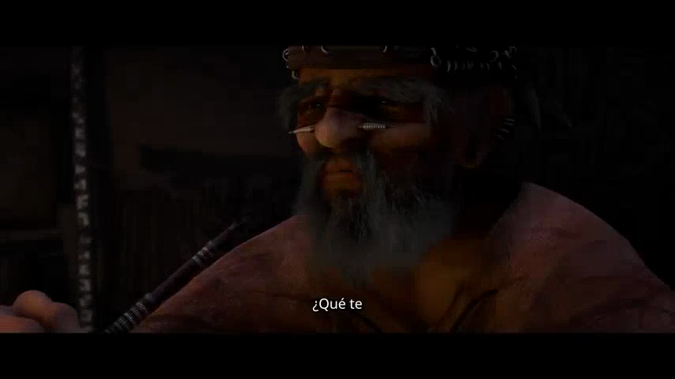
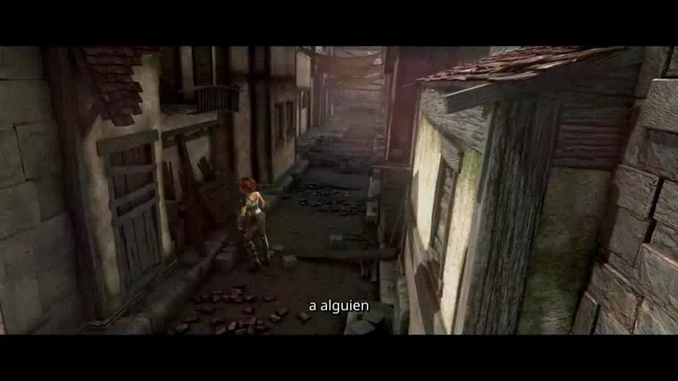

# Spanish video captions with the original English audio: a recorded Valmera example

We supplied two Spanish subtitle translations to Valmera, rendered them on a licensed film excerpt, and compared the result with the same edit carrying English captions. The two 9.6-second previews decode to identical audio samples. The words on screen changed; the recorded soundtrack did not change between those previews.

This is a small, reproducible product demonstration published by Valmera on November 7, 2026. It is not a translation-quality benchmark. The Spanish wording was supplied by the assistant running the demonstration, and has not received independent native-speaker approval. Valmera's `retypeset_language` tool applied that supplied wording; this run does not demonstrate the tool generating a translation itself.

[Plan your own subtitle translation](SUBTITLE-TRANSLATION.md) · [Connect an assistant](CLIENTS.md) · [Open Valmera Studio](https://valmera.io/dashboard)

## Open the actual files

| Artifact | What to inspect |
| --- | --- |
| [English v4 preview](evaluation/sintel-captions-20261107/clean-v4-preview.mp4) | The original comparison treatment, 9.6 seconds. |
| [Spanish v5 comparison preview](evaluation/sintel-spanish-20261107/spanish-v5-preview.mp4) | The same selection and soundtrack with supplied Spanish captions. This draft retains a black ending that blocked export. |
| [Spanish v6 reviewed preview](evaluation/sintel-spanish-20261107/spanish-v6-preview.mp4) | The same translation after removing 0.2 seconds from the source tail for export. |
| [Spanish v6 final MP4](evaluation/sintel-spanish-20261107/spanish-v6-final.mp4) | Full-resolution 1920 × 1080 export, 14.458333 seconds including Valmera branding and the appended end card. |
| [Measurements and provenance](evaluation/sintel-spanish-20261107/evidence.json) | Versions, assets, hashes, comparison scope and review limits. |
| [Attribution and reuse terms](evaluation/sintel-spanish-20261107/ATTRIBUTION.md) | Source film, license and modifications. |

The preview files are downloadable evidence, not full-resolution deliverables. The version numbers matter: the audio identity finding applies to English **v4 versus Spanish v5**, whose selections match. The shorter v6 is a separate delivery revision.

## The passage and supplied translation

The source is the [Sintel trailer published by Blender Foundation](https://download.blender.org/durian/trailer/sintel_trailer-1080p.mp4), used under [CC BY 3.0](https://creativecommons.org/licenses/by/3.0/). We used our own demonstration project, not a customer's project. The comparison retains source seconds **11.9–21.5**, producing a 9.6-second program.

| Phrase window reported in the comparison program | English source | Supplied Spanish draft |
| --- | --- | --- |
| 0.10–2.50 s | What brings you to the land of the gatekeepers? | ¿Qué te trae a la tierra de los guardianes? |
| 6.55–8.00 s | I'm searching for someone. | Busco a alguien. |

These windows identify the phrases returned by the inspection tool. They are not a frame-by-frame specification of every caption chunk. The existing clean treatment displays at most two words at once, so the complete sentences appear across successive chunks. Translated words do not have a one-to-one relationship with the English speech tokens.

The first line uses *guardianes* for *gatekeepers*. A translator familiar with the film's terminology might choose a different term. That editorial decision is separate from proving the renderer displayed the supplied text.



*Frame at 0.4 seconds of Spanish v5. Modified Sintel excerpt © Blender Foundation, CC BY 3.0; caption modification by Valmera.*



*Frame at 7.6 seconds of Spanish v5. The second phrase is displayed in successive chunks.*

## What the assistant actually did

1. Inspected the retained phrases with `retypeset_language`, `lang: "es"` and `list_phrases: true`. That inspection ran as a background job and took approximately six minutes to finish; it did not change version 4.
2. Supplied the two Spanish strings through `retypeset_language`. The product saved version 5 and reported preserved program timing.
3. Rendered one complete draft preview of version 5. We downloaded the returned asset, verified its SHA-256 against the receipt, decoded the file and extracted audio for comparison.
4. Inspected rendered samples at 0.4, 1.2, 2.0, 6.8 and 7.6 seconds. The samples show the supplied Spanish words, the accent in *Qué*, and the opening and closing question punctuation without clipping in those frames.
5. Requested export of version 5. The product refused to start it because the ending contained 0.08 seconds of black picture. We did not dismiss that finding as a false positive.
6. Used `cut_range` to remove source seconds 21.3–21.5, with word snapping disabled. Version 6 retains 9.4 seconds on the timeline. Its encoded preview reports 9.417 seconds because video is frame-based. A fresh preview reported a clean picture check, and its caption and whole-program contact sheets were inspected before requesting export.

Every timeline change and render used Valmera's product tools. Local FFmpeg commands only decoded downloaded outputs, measured them and extracted evidence frames; they did not generate the edited video.

For reference, the translation operation in this recorded run used these arguments. The project identifier belongs to our demonstration; use your own authorized project and inspect its phrase list first.

```json
{
  "project_id": 5534,
  "lang": "es",
  "translation": [
    "¿Qué te trae a la tierra de los guardianes?",
    "Busco a alguien."
  ]
}
```

The tool was `retypeset_language`. Translation order must correspond to the inspected phrases. A successful mutation is followed by a new preview; it is not itself evidence of rendered typography or a completed export.

## The exported file

The version 6 export completed as asset 40421. The downloaded MP4 matched its receipt's SHA-256, decoded without reported errors, and contains 347 frames at 24 fps, 1920 × 1080. Its measured container duration is **14.458333 seconds**, including the appended end card. Inspected samples show the Spanish captions, the corner branding and the end card. The scene is still visible beneath the end-card crossfade in the inspected 9.3-second sample.

The final file is longer than the 9.4-second edit because delivery branding adds time. Its SHA-256 is `266890c519a0dada866e7564f98ed3bb2278ff604079712db3425c3d708798bc`. All published media hashes are listed in [SHA256SUMS.txt](evaluation/sintel-spanish-20261107/SHA256SUMS.txt).

## Verify audio preservation yourself

The comparison previews are both 854 × 480, 24 fps, with 230 video frames and a reported container duration of 9.6 seconds. Their MP4 hashes differ, as expected when the visible captions differ. Their decoded audio hashes match:

```text
6c92f86529b67b6bb9548e9da0ff4dde5cd299a8404d1bd1f2e839343cf78217
```

Run the same decoding command on each downloaded comparison file:

```sh
ffmpeg -v error -i clean-v4-preview.mp4 -map 0:a:0 -c:a pcm_s16le -f hash -hash sha256 -
ffmpeg -v error -i spanish-v5-preview.mp4 -map 0:a:0 -c:a pcm_s16le -f hash -hash sha256 -
```

Both outputs decoded without errors in our check. Equal hashes establish identical decoded samples under these settings for **these two previews**. They do not establish identity with the source trailer, a listening review, translation accuracy, or identity with a later export that includes a different ending or branding. Comparing only MP4 file sizes or whole-file hashes would not answer the audio question.

## What to carry into your own trial

Keep a stable approved cut for the language comparison. Give the assistant a glossary and an explicit instruction to preserve the existing spoken recording, music and mix. Review the proposed translation before applying it, especially names, numbers, negations and technical terms. Then review the actual rendering: punctuation, line breaks and reading pace are output properties, not just text properties.

This example verifies a narrow operation on two sentences. It does not test long-form synchronization, right-to-left scripts, selectable subtitle tracks, burned-in text removal, dubbing or multilingual translation accuracy. No separate listening model or independent language reviewer evaluated this run. Sampled frames do not prove every instant of playback is readable. The source trailer's internal fades also remain in the edit; this is not an uninterrupted interview scene.

Use the [subtitle review worksheet](SUBTITLE-TRANSLATION-WORKSHEET.md) to record the language reviewer, exact media version and unresolved items. For choosing among subtitle-only, bilingual and dubbed outputs, read the [translation workflow and ten-provider documentation comparison](SUBTITLE-TRANSLATION.md). For the preceding English style revision, see the [caption-style experiment](CAPTION-STYLE-EXAMPLE.md).

To try the workflow, bring a short licensed passage to [Valmera Studio](https://valmera.io/dashboard) or [connect your assistant](CLIENTS.md). Account creation and uploads are free; AI editing requires an eligible plan. Check [current subscriptions](https://valmera.io/subscribe), including the distinction between external-assistant MCP access and Studio AI editing.
