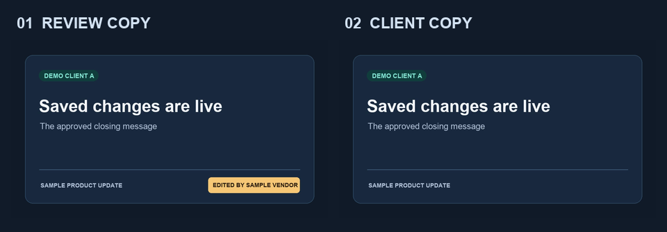

# White-label video editing for agencies: test the client handoff

A white-label editing pilot should prove that your agency can send the review link and final video under the identity you agreed to use with your clients. Test one edit for each of two client brands. Use a guest account to open each review link, make one targeted revision, and open the exact downloadable files you would hand over. The test covers finished videos, delivery metadata and who can see what.

[Request a quote for your agency's monthly batch](mailto:support@valmera.io?subject=Enterprise%20editing%20inquiry%20%28agency%20white-label%20pilot%29&body=Agency%20and%20country%3A%0ANumber%20of%20client%20brands%3A%0ARecordings%20and%20deliverables%20per%20month%3A%0ATypical%20source%20length%20and%20formats%3A%0AAgency%20and%20client%20review%20permissions%3A%0ARequired%20credits%2C%20disclosures%20and%20delivery%20branding%3A%0AFirst%20deadline%20and%20time%20zone%3A%0A). Include your country, brands, formats, monthly volume and any white-label requirements. We can discuss those requirements and scope a pilot before you send private footage.

## Compare two versions of the same handoff

Both clips are four-second test exports made for this guide. The first two seconds match. Play through the close at 00:03, then inspect the files themselves. The closing frame and file tags represent separate places where a production credit can appear.



| Download | What you see at 00:03 | What the file contains |
| --- | --- | --- |
| [Review copy](examples/agency-white-label-handoff/review-copy.mp4) | “EDITED BY SAMPLE VENDOR” in the closing frame. | The title says “Demo Client A product update.” The comment contains an internal vendor credit. |
| [Client copy](examples/agency-white-label-handoff/client-copy.mp4) | The same closing message and client identity. | The same approved title. The internal comment is absent. |

With FFprobe installed, use this command on each exported MP4 to see container and stream tags. Check the picture and subtitle content in a player as well. Some footage and music licences require credits. Record those requirements, together with any client disclosure obligations, before approving a release.

```sh
ffprobe -v error -show_entries format_tags:stream_tags -of json client-copy.mp4
```

## Run the pilot from the client's side

1. **Confirm the review identity.** Send a review invite to a dedicated guest. Open it outside your agency account and check the invitation sender, review page, file labels and download screen against your agreement.
2. **Separate the clients.** Have a guest for Client A attempt to open Client B's agreed test link. Confirm the expected access behavior against your review policy, including what happens if a link is forwarded. Test on staging samples before adding unreleased content.
3. **Request one revision.** Change a credit or correction in Client A and export again. Verify Client B's approved version still downloads. Check that old Client A links have the agreed expiry or visibly identify the superseded version.
4. **Approve the actual package.** Play the entire MP4 at its delivery dimensions. Inspect the filename, title, comments, captions, audio credits, and any required companion files. Record the approved version, location and reviewer.

[Download the two-brand handoff worksheet](examples/agency-white-label-handoff/handoff-checklist.csv) and use it with your pilot. Record the actual reviewer identity, first cut and revision arrival times, and whether each delivered version passed. For a peak-week schedule with multiple formats, use [the agency delivery planning guide](AGENCY-VIDEO-EDITING-DELIVERY-WEEK.md).

## What to put in the quote request

Include the number of brands, how often files arrive, how many distinct edits and export variants you need, and who approves each release. Ask whether an agency-only review path, client guest access and unbranded or client-branded exports can be included in the same agreement. Put confidentiality, required credits, source-file access, retention and where files will be delivered in writing. [Email Valmera Enterprise with that scope](mailto:support@valmera.io?subject=Enterprise%20editing%20inquiry%20%28agency%20white-label%20pilot%29&body=Agency%20and%20country%3A%0ANumber%20of%20client%20brands%3A%0ARecordings%20and%20deliverables%20per%20month%3A%0ATypical%20source%20length%20and%20formats%3A%0AAgency%20and%20client%20review%20permissions%3A%0ARequired%20credits%2C%20disclosures%20and%20delivery%20branding%3A%0AFirst%20deadline%20and%20time%20zone%3A%0A), or use [the recurring-editing quote brief](REQUEST-ENTERPRISE-VIDEO-EDITING.md).
