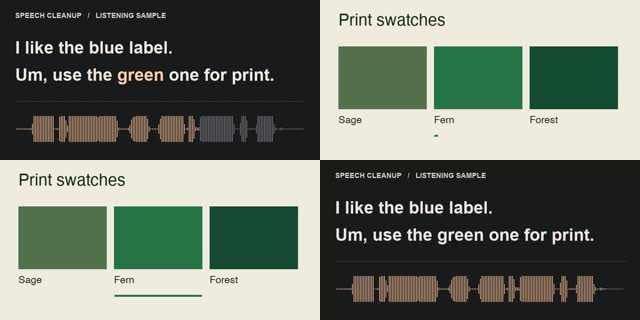

# Valmera MCP tools: find the right operation for your video edit

Use Valmera's tools to work on footage you already recorded: inspect the source, shape the edit, review a rendered version and export the approved result. The assistant chooses operations from the tools available to its connection.

**Start here:** [connect your assistant](https://valmera.io/mcp/setup) · [live tool reference](https://valmera.io/mcp/tools) · [public server card](https://valmera.io/.well-known/mcp/server-card.json)

For current tool counts, read-only annotations, and example inputs, [run the public connector check](CONNECTION-TROUBLESHOOTING.md#check-a-directory-listing-without-signing-in). The [dated result](evaluation/public-connector-check/2026-11-15.json) includes the registry endpoint and a SHA-256 check of a recorded export.

## Discover tools before planning the edit

Your authenticated client's `tools/list` response is authoritative for the tools and input schemas available to that connection. The public server card helps you discover the published catalog without sharing credentials. Project state, media, permissions and configured services still matter.

Refresh discovery after reconnecting or when an expected tool is missing. Read the current argument schema before constructing a call. Do not invent arguments from a tool name or treat this guide's examples as a complete inventory.

For example, the current public schema for `export_final` requires both `project_id` and `edl_version`: a project selected for navigation is not a substitute for an explicit export target. Record the reviewed version before requesting the final file.

## Choose tools by the result you want

These are representative names present in the checked card. Follow their current descriptions and schemas for behavior and supported settings.

| Editing job | Useful starting points | What to establish before applying changes |
| --- | --- | --- |
| Find the right spoken passage | `get_transcript`, `get_words`, `search_transcript`, `get_kept_transcript` | Identify the passage in the source and distinguish it from the currently kept edit |
| Understand the footage visually | `get_video_info`, `get_shots`, `find_visual_moments`, `look_at` | Inspect the relevant frames and what must remain visible |
| Cut a passage or tighten pacing | `cut_range`, `cut_output_range`, `keep_segments`, `cut_silences`, `remove_filler_words`, `restore_range` | Name the timing basis and preserve complete meaning, speech and necessary pauses |
| Add or revise captions | `add_captions`, `set_caption_style`, `set_caption_fixes`, `audit_captions` | [Choose a caption operation by the change you want on screen](CAPTION-STYLE-EXAMPLE.md#which-caption-change-do-you-need) |
| Reframe for a new format | `auto_reframe`, `set_frame`, `add_aspect_shift`, `deliver_aspects` | Specify the output format, subject and text or demonstrations that must stay readable |
| Shape music and sound | `list_music_library`, `add_library_music`, `add_music`, `add_sfx`, `set_master_loudness`, `audit_audio_mix` | Identify the intended assets and balance them against speech in the preview |
| Add supporting visuals or a demo | `research_broll`, `source_broll`, `insert_media`, `add_overlay`, `record_website_demo` | State the source material, placement and visible outcome; inspect captured actions |
| Build typography and motion | `add_typeset`, `add_motion_graphic`, `compose_panels`, `import_font`, `audit_motion` | Define the visual treatment and test a representative passage before expanding it |
| Adjust color or a region | `set_color_grade`, `match_grade`, `set_grade_window`, `blur_region`, `erase_region` | Identify the affected shot or region and what should remain unchanged |
| Create short versions | `make_shorts`, `shorts_status`, `open_short`, `apply_short_edit_batches` | Track each child project's identity and version separately |
| Review and deliver | `render_preview`, `wait_for_job`, `watch_video`, `export_final`, `download_url` | Distinguish an edit saved, a preview rendered and a downloadable final file |

The broader creative workflow is covered in [creative media and generated visuals](https://valmera.io/docs/ai-generation). Ask for the required result and let the current catalog determine the available route; the presence or absence of a name in this short table does not establish a product-wide capability limit.

## Put a product shot over a spoken word

A creator has a narrated video and a close-up of the product. They want the close-up to appear when they name the product, with their voice continuing underneath. Use the supplied clip as a full-frame overlay on the current edit. An insertion that moves later speech would change the timing of the program.

1. Open the intended project. Identify the main recording and the asset key of the supporting clip. Read the words and the kept transcript. If earlier cuts shortened the recording, map the spoken phrase onto **edited program time** before placing the overlay.
2. Call `add_overlay` with that project's `project_id`, the supporting clip's `asset_key`, the program-time `start`, the `duration_s` and `fit="cover"`. The recorded example used a silent clip. If the supporting clip has its own sound, listen for competing audio in the preview.
3. Render a complete preview of the edited version. Inspect the last frame before the cutaway, the first covered frame and the first frame back. Play the entire phrase to catch duplicated or missing speech. Export the reviewed version and repeat the check on the downloaded MP4.

In our four-second sample, the speaker says “use the green one for print.” The overlay starts on “green” at 2.56 seconds. Its authored duration is 1.12 seconds. At 25 fps the swatches still appear at 3.68 seconds and the waveform returns at 3.72. The final voice matches the original during the middle of the cutaway (correlation 0.999999 at equal timestamps). The nine-second download includes a five-second branded ending. [Play the example and download both inputs](https://valmera.io/tools/add-b-roll#cutaway-example) · [Read the measurements](https://valmera.io/examples/b-roll-cutaway/measurements.json)

### Inspect the four frames at the cutaway boundaries



At 25 frames per second, adjacent frames are 0.04 seconds apart. Read the top row left to right to check when the close-up appears. Read the bottom row left to right to check when the main picture returns. The written brief gives the intended interval. The decoded output shows which frame the viewer actually sees at its boundary.

To recreate this sheet from the [four-second preview](https://valmera.io/examples/b-roll-cutaway/preview.mp4), run these commands in a folder where you want to keep the MP4 and JPEG. FFmpeg counts the first decoded frame as zero.

```sh
curl -fsS https://valmera.io/examples/b-roll-cutaway/preview.mp4 -o cutaway-preview.mp4
ffmpeg -v error -i cutaway-preview.mp4 \
  -vf "select='eq(n,63)+eq(n,64)+eq(n,92)+eq(n,93)',scale=320:-1,tile=2x2" \
  -frames:v 1 cutaway-boundaries.jpg
```

### Mark a cutaway using two local clips

Use the [free B-roll timing planner](https://valmera.io/tools/add-b-roll#cutaway-planner) when the editor needs to know which part of a supporting shot to show. For example, the speaker may name the product at 1.12 seconds, but a hand blocks the label at the start of the close-up. Open the narration under **Main recording**, mark 1.12 seconds as the cutaway start, and mark 1.96 seconds as the return. Under **Supporting shot**, scrub past the hand and mark 0.12 seconds as the source start.

The resulting brief requests 0.84 seconds of picture from the supporting file, covering 0.12–0.96 seconds of that file. The original voice continues throughout. A supporting clip ending at 0.90 seconds is six hundredths of a second short. Move the source start earlier or shorten the picture change. The planner checks both durations before enabling the handoff.

Download the brief to share the file names and timings with an editor, or carry it into Studio. The free planner reads the clips locally. To run the AI edit, add those same two files to the intended project. If the main cut has since changed, find the phrase on its new timeline before applying the brief. This timing example illustrates the calculation. The four-second rendered sample above supplies separate evidence of an executed edit.

### Compare exports from different AI video editors

Use the [two-clip editing test](https://valmera.io/ai-video-editor#test-an-ai-video-editor) to download the synthetic narration and silent product clip. Give each editor the same brief, export the result, and open it beside the reference in your browser. Check the last waveform frame at 2.52 seconds, the first swatches at 2.56, the last swatches at 3.68 and the return at 3.72. Play through the whole sentence to hear whether the voice survives both cuts.

For a review you can share with another editor, save the measurements as CSV. From the repository root, with Python 3 and FFmpeg on your path, run the following commands. Supply your own export in place of `my-export.mp4`. Align the first frame of the program with the beginning of the narration.

```sh
curl -fLO https://valmera.io/examples/filler-word-cut/original.mp4
curl -fLO https://valmera.io/examples/b-roll-cutaway/preview.mp4
python3 docs/evaluation/compare_cutaway_export.py original.mp4 preview.mp4 my-export.mp4 > cutaway-review.csv
```

The four picture rows compare corresponding RGB frames after resampling to 25 fps and 32 × 16 pixels. A difference of zero means the small frames match, on a scale from 0 to 255. A shifted cut, crop, letterbox or color change can all increase the difference. The audio row compares the original and delivered mono waveforms at equal times from 2.625 to 3.550 seconds. A correlation near one indicates similar waveform shape during that interval. Listen for volume changes and watch the full file, including any added ending.

## Move a sound effect onto the reveal frame

At 25 fps, five frames last 0.200 seconds. In the four-second swatch example, the picture changes at 2.560 s. The first preview places a short library click at 2.760 s. To revise a cue like this in your own project:

1. Call `list_sound_library` with `role="click"`. For library recordings, the `at` argument to `add_sfx` identifies the intended **hit** in program seconds. Valmera accounts for the quiet lead-in of the selected sound.
2. Keep the effect ID returned by `add_sfx`. In this example the revision used `move_sfx(project_id=PROJECT_ID, id="sx1", at=2.56)`. Use the ID from your own edit. Moving the existing cue preserves the recording and gain.
3. Render the revised preview. To check the result, step to the first reveal frame in the downloaded MP4 and compare it with the click transient. In our two decoded files the peak moved from 2.7594 s to 2.5594 s. The reveal stayed at 2.560 s.

The recorded revision used these MCP arguments. Substitute the project and effect IDs from your own edit before calling `move_sfx`.

```json
{"project_id":5807,"id":"sx1","at":2.56}
```

### Check the click timing in the downloaded previews

With Python 3 and FFmpeg on your path, run these commands from the root of this repository. They download the three public MP4s to the current directory. The checker scales the original narration to match the rendered voice, subtracts it, and compares the strongest remaining audio peak with the first light swatch frame.

```sh
curl -fLO https://valmera.io/examples/b-roll-cutaway/preview.mp4
curl -fLO https://valmera.io/examples/sound-effect-timing/late.mp4
curl -fLO https://valmera.io/examples/sound-effect-timing/aligned.mp4
python3 docs/evaluation/check_reveal_click.py preview.mp4 late.mp4 aligned.mp4
```

The late preview measures approximately **+199 ms** and the aligned preview **−1 ms**, rounded to the nearest millisecond. Positive means the sound follows the picture. This check uses the known 25 fps swatch sequence and a copy of its narration without the click. For other footage, choose the reveal frame and isolate the sound against its own original mix.

[Hear both mixes in the browser](https://valmera.io/tools/add-sound-effects#hear-the-click) · [Read the sample checker](evaluation/check_reveal_click.py)

## From a connected account to a reviewed file

1. **Identify the project.** Use `list_projects` and inspect the intended project with `open_project` or `project_state`. Keep its explicit identifier with subsequent requests. An empty project list is different from a failed connection.
2. **Prepare the media.** Upload through Studio, or follow `upload_start` and `upload_finish` from a client that can send the file. Use `index_status` to check when the source analysis is ready. See [file uploads](https://valmera.io/docs/file-uploads).
3. **Agree on the edit.** Read the transcript and relevant frames. Name the desired output, required content, source ranges and parts that should stay unchanged. Use the available tools to make a versioned edit.
4. **Review the preview.** Request a representative rendered preview, follow any job identifier until a terminal result, and inspect the actual output. Listen to speech and joins; check captions, framing and visible claims.
5. **Export the reviewed version.** Supply the project and version required by the current export schema. A queued or running response is pending work. After completion, obtain the download link and open the resulting file.

The live card describes versioned edit decisions that preserve the uploaded original. It also states that simultaneous Studio and MCP editing of the same project is refused. Respect that project lock and resolve which editor is active before continuing.

## Three briefs to adapt

For a worked timing map and caption corrections after a cut, see [Fix AI captions after cuts](CAPTION-REVISIONS.md). It covers one-word revisions, cues that cross removed footage, and matching subtitle files to the final export.

Replace the bracketed fields with the project and version returned by your connection. These are requests for an assistant to interpret, not literal API payloads.

**Transcript-led rough cut**

> In project [project ID], inspect version [version] and the source transcript. Propose a shorter explanation of [topic]. Keep the complete claim, its qualifications and the visible demonstration. List proposed source ranges before applying them. After approval, render a preview and report the new version and any unresolved review issues.

**A caption correction without a new cut**

> In project [project ID], version [version], correct the caption spelling of [name] in the passage beginning [quoted words]. Keep the spoken recording, cuts, framing and duration unchanged. Discover the available caption-correction tool, apply the scoped change, then show a preview where I can check it.

**A focused visual revision**

> In project [project ID], version [version], improve the readability of [specific title or demonstration] during [identified passage]. Keep the story and spoken audio unchanged. Explain the proposed visual treatment, test it on that passage and show the rendered preview before extending it.

## Missing tools, pending jobs and explicit exclusions

A missing tool does not by itself prove that Valmera cannot perform the underlying task. Check current discovery and account requirements; the public card states that tools with unconfigured backing services are hidden. Use the [connection troubleshooting guide](CONNECTION-TROUBLESHOOTING.md) for sign-in, missing-tool and transport checks.

Conversely, a listed name is not proof of a completed edit. Inspect the result and report unresolved work accurately. If a job remains running, continue observing that job instead of repeating the mutation merely because a wait returned.

On November 7, the public card's only explicit `notSupported` entry was **delegating edits to Valmera's in-house agent**. Connected assistants use the direct editing tools. Older documentation's broader exclusion list is not the current card. Removal of an old exclusion is not a promise that every conceivable request is supported; consult current schemas and verify the requested output.

## Continue with your footage

- [Creator workflow briefs](CREATOR-WORKFLOWS.md): choose a practical first edit.
- [Webinar replay and clips](WEBINARS.md): preserve source, replay and clip timing.
- [Website demos](WEBSITE-DEMO.md): inspect capture actions and the final result.
- [Edit-and-revise evaluation kit](EDITOR-EVALUATION.md): compare tools with the same footage and evidence.
- [Current plans](https://valmera.io/subscribe): account creation and upload are free; editing requires a subscription. Your assistant provider's billing is separate.
