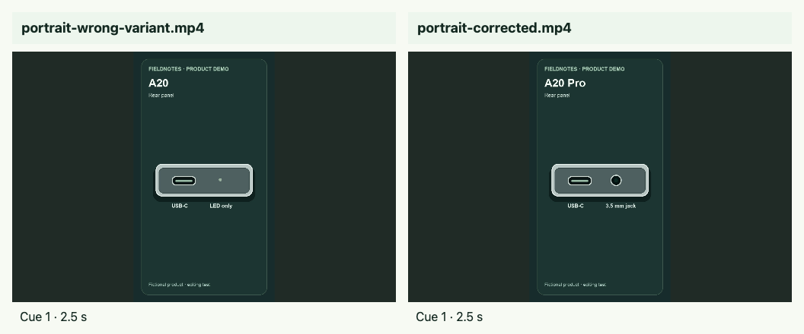

# How to check that your product video shows the right SKU

Review the exported store video and vertical ad side by side. At the first frame where the variant matters, compare something a buyer can see: a port, a clasp, a label, a color or a bundle item. If only one version shows the wrong variant, replace that shot in that version and review both downloads again.

## Try it with the A20 product videos

The fictional A20 Pro has a 3.5 mm jack. The standard A20 has an LED in the same place. Both portrait edits open with the words “A20 Pro.” At 2.5 seconds, the first one shows the standard A20 rear panel.

| Download | What to look for |
| --- | --- |
| [Landscape product gallery](examples/product-variant-review/store-gallery-pro.mp4) | At 2.5 s the rear panel shows USB-C and the 3.5 mm jack. |
| [Portrait ad with the wrong shot](examples/product-variant-review/portrait-wrong-variant.mp4) | At 2.5 s the rear panel shows USB-C and an LED. |
| [Corrected portrait ad](examples/product-variant-review/portrait-corrected.mp4) | At 2.5 s the jack is visible and readable within the vertical crop. |

These are locally rendered, silent test videos. A decoded-frame comparison found changes only from 1.000 seconds up to 4.000 seconds. The opener and CTA match frame for frame. [Sample measurements](examples/product-variant-review/measurements.json)

## Review two downloads in your browser

1. Download [Compare Product Video Frames](examples/product-variant-review/compare-product-video-frames.html) using GitHub’s raw download control. Open the HTML file in your browser.
2. Choose the gallery export as the first video and the original portrait export as the second. Enter `0.5, 2.5, 4.5` for each. When a cut is positioned differently, use the cue from each actual file.
3. Build the frame sheet. The middle row reveals the wrong model. Select the corrected portrait export and build the sheet again. Download the PNG to include with the approval.
4. Play both exports through. Cue stills are useful for checking parts and crops. Playback lets you check the adjacent cuts, motion and any spoken claims as well.

The sheet works locally with media your browser can decode. Your videos stay on your device. Check the downloaded files at delivery size, especially when the distinguishing detail sits near the edge of the vertical crop. If you sell on Shopify, check how the product-level video appears on the storefront too. Shopify supports videos as product media and reserves variant media for images. [Shopify’s product media guide](https://help.shopify.com/en/manual/products/product-media/add-media#videos-and-3d-models)

## Give your editor a one-shot test

Use the same prompt or brief and source files when comparing editors.

> In the portrait ad, replace the rear-panel cutaway from 1.000 s until the cut at 4.000 s with `A20-PRO-rear-panel.mp4`. Use the view where the 3.5 mm jack is visible. Crop to portrait so both ports remain in frame. Keep the same cut points, opener and CTA. Leave the gallery edit as supplied. Return both versions with filenames that identify the SKU and destination.

A pass means the distinguishing part is visible in both downloads, the portrait cut still starts and ends on the agreed frames, and the opener and CTA still read correctly. For a catalog batch, keep one approval row per SKU and destination. Twelve variants for two destinations means 24 approvals.

Descript documents a layer-level media replacement that preserves the clip’s existing adjustments, which is useful when a reviewer has already approved the timing. Ask for both downloads and inspect the crops. [Descript Replace Media](https://help.descript.com/visuals/replace-media)

With Valmera, upload your footage and describe the cutaway by source file, time range and distinguishing detail. For a team reviewing its first cutaway, start with the [B-roll editor](https://valmera.io/tools/add-b-roll?utm_source=github.com&utm_medium=referral&utm_campaign=product_variant_review). For recurring done-for-you editing, include your monthly video count, destinations and the variant errors your team needs to catch when you [contact Valmera Enterprise](https://valmera.io/subscribe?inquiry=product-demo-video-editing-service&utm_source=github.com&utm_medium=referral&utm_campaign=product_variant_review#enterprise).
