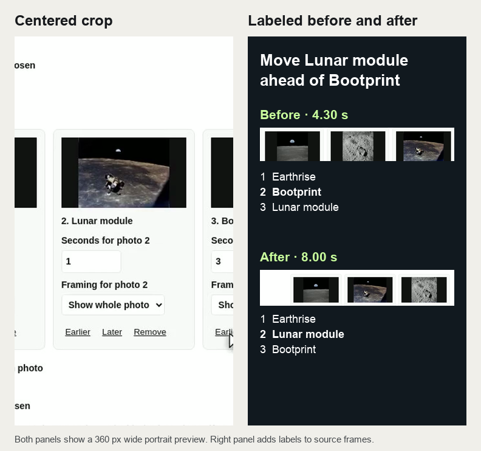

# How to cut a product demo for a phone screen

When a landscape screen recording becomes a vertical product demo, check whether the viewer can still see what changed. Play the exported MP4 on a phone at its normal size with sound off. A viewer should be able to identify the starting state, the action and the result without pausing or zooming.

## Compare two layouts from the same recording

The [downloadable 1080p MP4](https://raw.githubusercontent.com/ABO3SKRALMASAOODI/valmera-mcp/e5c8b456ce0f7a5e06117a50674035d720f63c98/docs/examples/website-photo-reorder/reorder.mp4) shows someone moving the Lunar module photo ahead of Bootprint in a slideshow builder. In the first frame at 4.30 seconds, Bootprint is second. At 8.00 seconds, Lunar module is second and Bootprint is third. The duration fields move with their photos.

The left panel uses a 608 × 1080 center crop from the 1920 × 1080 export, displayed at 360 × 640. The crop keeps about a third of the original width. Lunar module is visible, Earthrise's name is gone and Bootprint's name is cut off. The right panel is a layout mockup using two stills from that same MP4. It keeps the three thumbnails in view and displays the original order and the changed order as readable labels.

## Choose what the phone viewer needs to see

| The action and result are… | Try this edit | Check the export |
| --- | --- | --- |
| In the same part of the screen | Reframe around the control and resulting state | The label and the new value are readable in one view. |
| Far apart | Cut from the action to a close view of the result | A viewer can tell which control caused the result. |
| Visible only by comparing multiple panels | Stack matching before-and-after frames and add short labels | The same panels or items can still be identified in both states. |

Keep the result visible long enough for the viewer to read it at a normal pace. If the final shot needs dense instructions, make a short portrait teaser and link to the full landscape walkthrough.

## Send this brief with your footage

> Make a 9:16 cut from the approved landscape demo. The viewer needs to see [starting state], [control or action] and [result]. Preserve the label [exact text]. If the crop clips the result, show a close-up or add a labeled before-and-after panel. Keep the result visible long enough to read on a phone. Send a preview and the final MP4 for review with sound off.

Before sign-off, ask someone who has not seen the master what changed and where they saw it. Record the time they point to in the final file. When you add captions, check that they leave the control and confirmation visible in the downloaded export. If the viewer misses a step, revise that moment and test the new file.

**[Start with a recording or website in Valmera](https://valmera.io/tools/record-website-demo?utm_source=valmera_mcp_docs&utm_medium=repository&utm_campaign=vertical_product_demo#start-demo)** · [Ask about recurring demo edits and vertical cutdowns](https://valmera.io/product-demo-video-editing-service?utm_source=valmera_mcp_docs&utm_medium=repository&utm_campaign=vertical_product_demo#scope)
